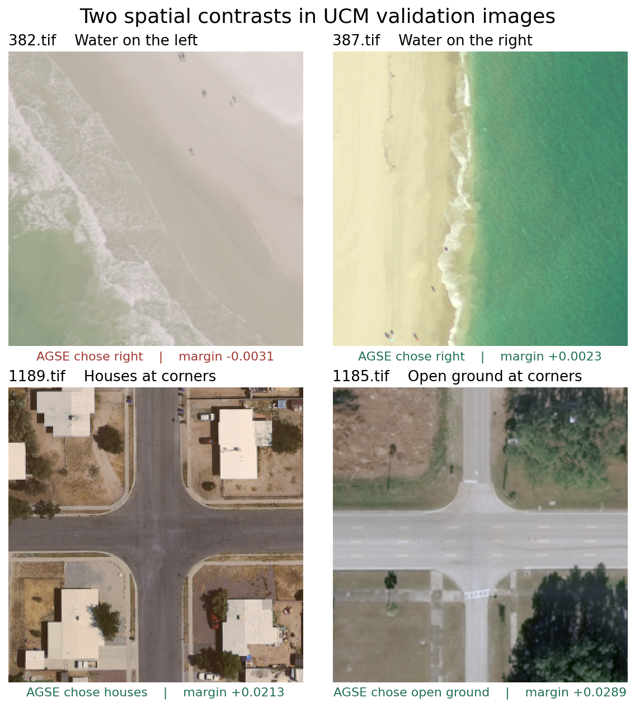

# UCM E1 实验交付 · 2026-11-20

**在本批 UCM 验证图上，原始 AGSE 能判对一部分细节，空间关系仍是明确的困难项。** 对 18 对同场景、空间关系相反的图，沿用历史首条描述先验的 AGSE 和 CUP 各有 4 对两张都判对。AGSE 在 11 对中两次都偏爱同一句话。属性上两者同为 23/36。现有证据足以把关系错误带入 E3-1，尚缺同图多候选及奖励排序的证据来解释 RFPO 在其中的作用。

## 1　怎样读这项实验

每次给模型看一张真实图和两句只在目标细节上不同的描述，以正确句的余弦分数更高为判对。例如一张海滩图的海水在沙滩左边，另一张在右边，两图共用“海水在左”和“海水在右”这两句。每张各答一次，就能区分模型是否随图改变选择。另加入一句真实、笼统的场景描述，观察三句话的排序，并单独读取 Agent 实际生成的最终文本。

采用 UCM 原验证划分。历史上经用户确认的数量标签覆盖 100 图，其中验证集 22 图用于主表，另外 78 张训练图的既有结果见首轮报告。新筛的 40 对验证候选与上一轮已评分图像按文件名去重。一次按像素标注，一次隐藏预期答案与模型得分、打乱图文次序后由另一位同模型家族的助手看图。4 对由于道路位置、岸线或参照物含糊整对剔除，6 对视觉朝向按属性归类。初次锁定为 19 对属性、17 对关系。交付复核发现，评分前的盲审已将“阴影在储罐的哪一侧”标为双物体关系，锁定程序仍沿用了候选表里的属性分类。主表按该盲审意见更正为属性、关系各 18 对。图像、描述、正负答案和原始分数均可逐项追溯，初次分组保存在统计表的 locked_attribute 和 locked_relation 两项。主表的数量 A、属性、关系合计 94 项、89 张不同图。加上历史验证项目、数量 B 措辞和反向数量对照，共 104 张不同验证图、每种设置 156 项。训练、验证和测试的角色沿用项目划分。新标签的第二次复核来自视觉助手，六对属性和四对关系另有数据集原描述直接提供细节依据。没有新增独立人工签字。[实验口径](实验口径.md) · [逐对裁决与源标注线索](inputs/adjudication.json) · [原始图文记录](inputs/candidates.json) · [上轮训练及验证分表](../三类细节基线_20261120/实验结果.md)

## 2　与直接基线 CUP 的对照

表中为判对数/判断数。数量 A、B 是同一批图的两套句式。最后一列对数量 A、属性、关系三项的平均余弦分差等权平均。每个图的分差等于正确细节分数减错误细节分数。各方法使用各自的嵌入，准确率和同图配对差用于比较方法。

| 方法与先验输入 | 数量 A | 数量 B | 新增属性 | 新增空间关系 | 三类等权平均分差 |
|---|---:|---:|---:|---:|---:|
| 原始 CLIP ViT-L/14 | 8/22 | 9/22 | 21/36 | 19/36 | +0.00243 |
| CUP，CCB 先验，项目复现 | 15/22 | 11/22 | 23/36 | 21/36 | +0.00327 |
| ASPF，纯推理重建 | 15/22 | 12/22 | 22/36 | 18/36 | +0.00396 |
| 原始 AGSE，历史首条描述先验 | 16/22 | 17/22 | 23/36 | 19/36 | +0.00726 |
| 同一 AGSE，通用查询 | 15/22 | 16/22 | 23/36 | 24/36 | +0.00687 |
| 同一 AGSE，仅提供场景标签 | 15/22 | 16/22 | 25/36 | 18/36 | +0.00674 |

**数量。** 历史 AGSE 相对 CUP 在 A 句式多判对 1 张，在 B 句式多判对 6 张。B 句式里有 7 张由错变对、1 张由对变错，图级配对重采样的差值 95% 区间为 +4.5 至 +50.0 个百分点。22 张里有 6 张的历史输入首句直接出现正确英文数词，其他首句也可能通过单复数提供信息。另把已确认数量不同的同类图组成 5 个互不重复的反向图对，原始 AGSE 两套句式均对 7/10，两侧均对的各为 2/5 对，CUP 分别为 7/10、5/10。数量优势的大小随措辞和配对方式变化。

**属性。** 历史 AGSE 和 CUP 的准确数相同，逐图看有 7 张由 CUP 错变成 AGSE 对，另有 7 张相反。净差为 0 个百分点，按图对重采样的差值 95% 区间为 −16.7 至 +16.7 个百分点。两者均有 5/18 对两侧答对。去掉单一朝向类以后，两者均为 17/24。

**空间关系。** 历史 AGSE 在 18 对中有 4 对两侧均对、11 对只对一侧、3 对两侧均错。CUP 对应为 4、13、1 对。历史 AGSE 相对 CUP 的净差为 −5.6 个百分点，按图对重采样的差值 95% 区间为 −22.2 至 +11.1 个百分点。按场景整组重采样的区间为 −17.6 至 +7.9 个百分点。把两张图的分数放在一起，检查正确图文配对的总分能否胜过互换两句后的总分，历史 AGSE 为 8/18，CUP 为 11/18。由原始描述直接佐证的关系子集上两者均为 7/8，这些对多涉及可辨认的邻接物或周围地物，与整批方位和布局题的难度构成不同。[各维度准确数与原始边际](分项结果.csv) · [相对 CUP 的配对差及区间](相对CUP配对差.csv) · [反向图对得分](反向图对.csv)

以两张海滩图为例，历史 AGSE 两次都选“海水在右边”。382.tif 实际在左，分差 −0.00314。387.tif 实际在右，分差 +0.00231。另一对路口图则两张均对，“角上有房屋”和“角上是空地”的分差分别为 +0.02134 和 +0.02886。这说明同样是关系题，模型在这些实例上的判别表现有差异。

## 3　笼统正确、细节正确、细节错误的三句排序

三句使用同一幅图、同一冻结图像向量和同一文本编码器。下表给出新增的 36 项空间关系中三类描述各自排第一的次数，以及“细节正确 > 笼统正确 > 细节错误”完整顺序的次数。各方法均无平分。笼统句同样描述了真实场景，排第一意味着模型优先选择场景概括。错误细节句排第一则是明确的错误排序。数量和属性的三句排序及三种成对比较也已交付。[全维度结果](分项结果.csv) · [逐图三句余弦](逐条三句得分.csv)

| 方法 | 细节正确第一 | 笼统正确第一 | 细节错误第一 | 完整顺序 |
|---|---:|---:|---:|---:|
| CLIP | 3 | 29 | 4 | 3 |
| CUP | 5 | 27 | 4 | 4 |
| ASPF | 4 | 22 | 10 | 1 |
| 历史 AGSE | 10 | 15 | 11 | 1 |
| AGSE 通用查询 | 13 | 18 | 5 | 4 |

历史 AGSE 对关系描述表现出更强的细节偏好，但它同时把正确细节和错误细节推到第一位的次数都高于 CUP。给模型提供场景标签的设置仅用于正负细节比较，场景词与笼统句共享信息。

## 4　Agent 实际生成了什么

104 张验证图全部重新走原始 rollout。使用各图的首条原描述、原始 LoRA、场景工具和检索权重，每张最终隐藏向量都与历史归档逐元素相同。95 张调用场景工具。最终解码有 94 条仅含异常词 `addCriterion` 和空白，9 条为空，1 条只有标点。两张海滩图都调用了工具，收到的首选类别都是 beach，两张图的最终回答同为 `addCriterion`。这些记录给出了归档路径上的实际输出，检索器同时仍然取得了表中的非零判别能力。[逐图回放与缓存一致性](历史先验逐图回放.csv)

固定权重更换输入后，104 张图使用通用查询时全部立即输出结束符。只提供场景标签时，89 张调用工具，58 张有可见最终文本，其中 40 张的最终文本含异常词。按最终答复逐项检查主表 94 个细节，历史、通用、场景标签三种 AGSE 设置均为 0/94 条明确表达了正确或错误一侧的目标细节。ASPF 的 104 张图均产生可见文字，主表的 94 项中有 5 项明确说对、3 项明确说错、86 项未明确区分。其中 17 项在盲审时被标为有歧义。独立审计另外指出，“前景有两个球场”只覆盖局部，“停了很多车”也可与很多空位并存。将这两项按更严格的标准重计后，ASPF 为 5 项正确、1 项错误、88 项未明确区分。全部文字结果采用每轮最多 64 个新词元的原设置，ASPF 有 85/104 条最终输出长度达到这个上限。文本复核只看最终解码及随机排序的两种陈述，隐藏图号、方法与正确答案。明确数字、方位和所指对象等细节才被计入。该测量反映实际文字是否明确表达判别点，隐藏向量的来源还包括图像、输入和生成过程。[原生生成汇总](四种输入生成核对.csv) · [文字判读证据](生成文字逐项核验.csv) · [文字判读分项](生成文字判断.csv)

## 5　适用范围和 E3 的入口

这些样本来自一个数据集的一次固定验证划分，模型和读出器有各自的训练历史。ASPF 的历史原检查点缺失，使用预先冻结的纯推理重建读出器。CUP 使用本项目复现的 CCB 检查点。历史 AGSE 首句可能直接提供目标细节。方法行之间的差异综合反映了这些输入、检索器与训练差异。[模型及论文来源](../三类细节基线_20261120/基线来源.md)

对 104 张评分图与同场景训练、验证图的 8,970 个不同图像组合做像素配准筛查，检出 2 对局部重叠，均在验证划分内。其中 1088/1089 两张均参与评分，1689/1690 中只有 1690 参与。成对剔除涉及任一重叠裁块的属性题后，历史 AGSE 和 CUP 均为 20/30。关系题全部保留。该筛查只覆盖算法能配准的可见重叠，地理位置独立性仍待确认。[重叠候选](画面重叠候选.csv) · [剔除后的结果](重叠敏感性.csv)

后续 E3-1 可以先用**与本轮验证题隔离的训练图**构造左右或上下互换的关系样本，在同图生成多个候选先验，并逐个记录真实图文分差。先看同图是否产生能改变正负句排序的候选，再看原 RFPO 奖励把哪个排在前面。若候选已有差别而奖励频繁选错，才有直接依据调整奖励。若候选最终回答仍然近乎相同，则先定位生成和候选多样性。独立验证时重新选择图片，保留本轮 E1 作为已查看的诊断集。

## 6　复核与复现

六种设置各 156 项，936 组三句评分。使用保存的 FP32 图文向量在 CPU 上以双精度独立重算全部 2,808 个余弦值，最大绝对差低于 8×10⁻¹⁶。与上轮具有相同设置的 5 行各复算 64 项旧验证判断，320 项正负排序全部吻合。A100 上生成、评分与历史回放各自的结束状态和日志均已归档。附带候选池、锁定标签、原生词元、向量、权重哈希、原始分数和分析脚本。[数值复核](数值复算.csv) · [锁定清单](inputs/lock.json) · [复现说明](复现.md) · [独立审计](.aris/traces/experiment-audit/2026-11-20_run02/EXPERIMENT_AUDIT.md)
