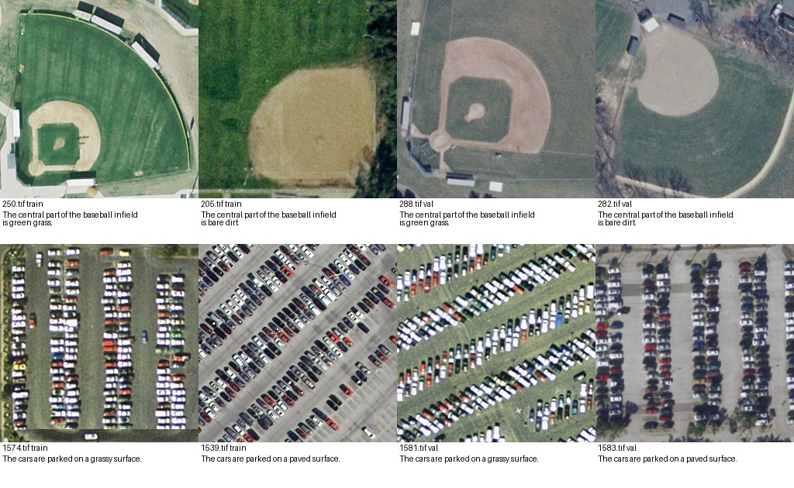
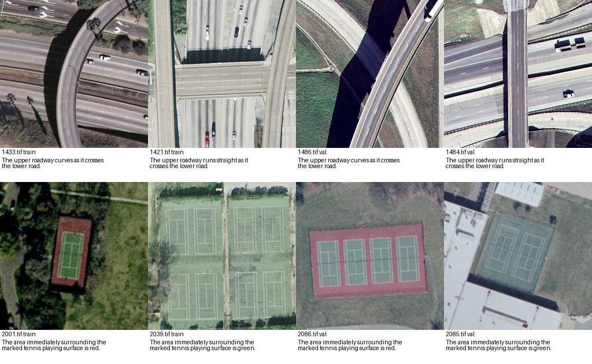
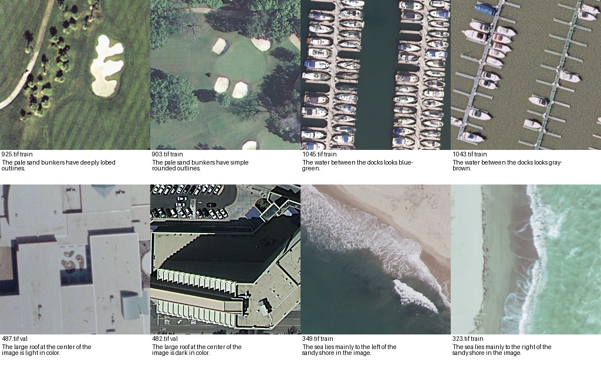
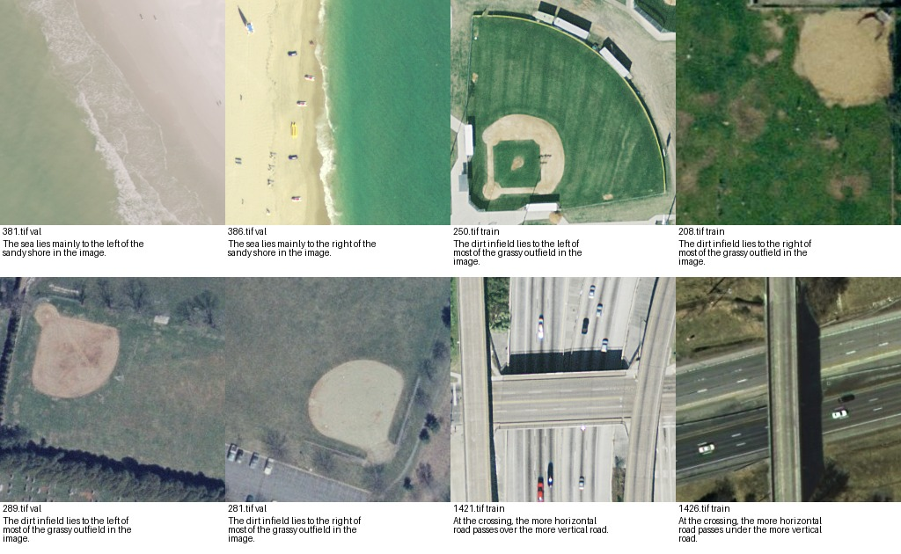
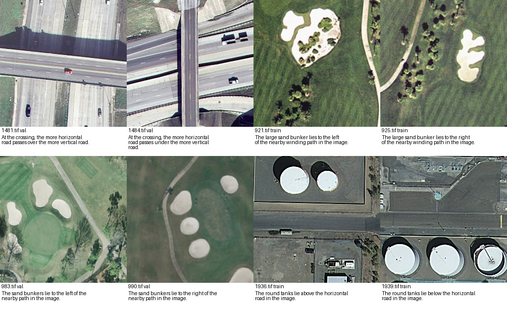
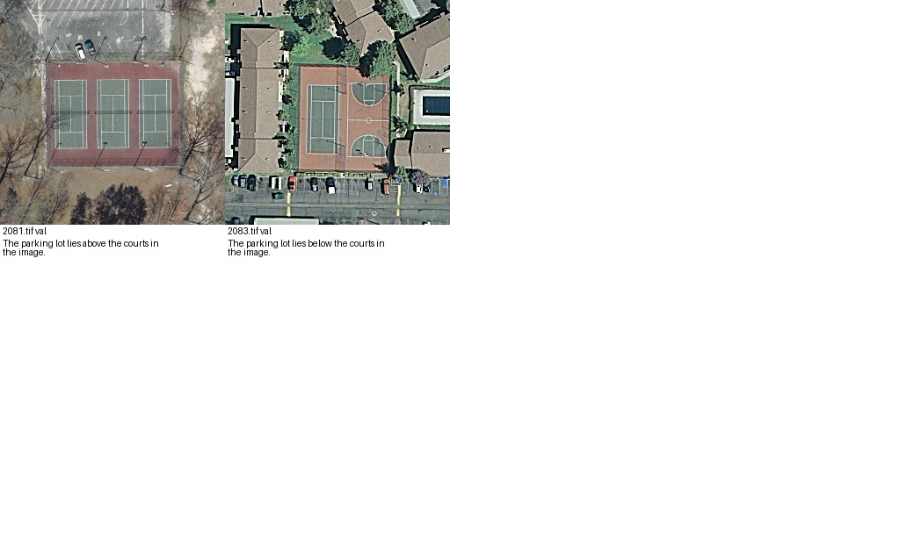

# 属性与空间关系复核图

21 对同场景图共含 42 项判断，源图来自 UCM 原始 train 或 val。每张图下方是目前按像素选定的描述，配对中另一张图的描述作为该图的困难负例。请分别看图核对两条描述是否确实一真一假，尤其关注淡色边界、轻微曲率、视角方向和参照物。当前标签来源为助手目视复核。

[标注原表](inputs/paired_visual_labels.tsv)

