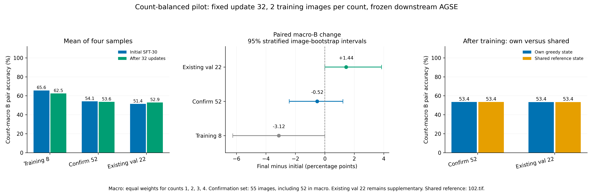

# A100数量均衡32步短训结论（2026-11-15）

本阶段完成 **8张图、32次正式优化器更新、128条训练采样及425条训练后评估轨迹**。每种数量1–4各8次更新、每图4次更新。训练图外确认集的采样数量宏平均B PairAcc为 **54.11% → 53.58%**，配对变化为 **-0.52 个百分点，95%区间 [-2.42, +1.23]**。正式采用条件通过 **7/9** 项。

确认集训练后贪心自身先验相对固定共享先验的数量宏平均B变化为 **+0.00 个百分点，95%区间 [+0.00, +0.00]**。下一节点复用本轮保存的全部候选，开展多负例数量奖励的离线诊断：使用同一对象的所有已缓存数量描述构造间隔，再用B写法和共享状态核对候选排序。

## 1. 样本职责、初始模型和运行环境

数量1、2、3、4各选2张已确认train图，按上一阶段固定顺序训练。图像为 102.tif, 120.tif, 121.tif, 124.tif, 147.tif, 933.tif, 157.tif, 1937.tif。其余55张train图用于本轮训练图之外的确认，既有val22图单列补充；确认集内数量1–4共52图，每种数量在宏平均中占四分之一。数量6/7另列原始图像等权结果和分组表。所有输入、轨迹与失败样本保留。

初始策略为上一轮固定SFT第30步检查点，LoRA张量哈希 `10cb14e3f10f94eeaa8cc98f84b5fe7f9abd05d97cbc26ad4b219efde88017cb`。本轮模型固定取第32次正式更新，最终哈希 `76156912e519f8d0165decfe0423de34300d93840c36a15255b260e1ae6fad85`。方案SHA-256为 `19589700d2e5e81ead05a2ba1177434d766e97138ca000f39d2ab50891d0c578`。

服务器实际为 NVIDIA A100-SXM4-80GB，81920MiB显存；PyTorch 2.4.1+cu124、TorchVision 0.19.1+cu124、Transformers 4.57.2、PEFT 0.10.0。沿用原A100环境及 `/private` GPFS挂载。此前5090适配尝试按用户指示切回A100，相关日志另行保留。

## 2. 概率、状态与固定基线核对

正式更新前重放 `102.tif` 的贪心与首条采样，生成token及末步隐藏状态与已归档基线逐项一致；425条冻结AGSE评分重放最大误差为0，val排名一致。本轮沿用这一固定基线，训练后采用同一输入、同一种子和同一控制器。

生成采用原系统提示和示例、统一输入 `Describe the visible scene.`、真实 `scene_classify` 回填、完整工具关闭标签及回答原生EOS。采样温度1、top_k=0、top_p=1、min_new_tokens=1，最多3轮、每轮256 token。先验为实际generate最后有效解码步的末层末位置BF16[3584]；同一张量保存并传入冻结评分器。

逐token核对了首token EOS屏蔽、助手目标位置和17个额外padding的裁剪。实际解码与完整前缀重算之间，训练token的最大logprob差为0.231538 nat，最大轮平均绝对差为0.039556 nat；运行前阈值分别为0.25和0.05 nat。预检中末步状态余弦最低为0.999847889，阈值为0.999。先验缓存与评分输入使用同一实际生成张量。正式更新前的临时Adam单步内存验证已恢复初始LoRA哈希，记录在 `contract_gate/`，其正式策略更新数为0。该检查与本轮32次正式更新分别登记。

## 3. 实际训练设置与执行

每次对同一训练图采样4条实际轨迹，奖励为质量合格时的0.2加冻结下游AGSE的A数量句对间隔。组内奖励按样本标准差标准化，加1e-8稳定项；对各轨迹实际助手token的logprob和进行组平均策略梯度更新，工具回填和用户提示作为上下文。

| 项目 | 实际设置或记录 |
|---|---|
| 参数 | BF16基座、584个FP32 LoRA张量；95178752个可训练参数 |
| 优化器 | AdamW，学习率5e-6，betas=(0.9,0.999)，eps=1e-8，weight decay=0.01 |
| 稳定措施 | 梯度检查点、Dropout p=0、梯度L2范数上限1、逐轨迹逐轮反向 |
| 更新预算 | 32次；每图4次，每数量8次；中间第16步与最终第32步保存 |
| 训练采样 | 125/128条通过质量检查；真实工具事件126次 |
| 训练阶段耗时 | 737.21秒，含模型加载与检查点保存 |
| PyTorch峰值分配显存 | 21.20GiB |
| 优化器核验 | 584份Adam状态，步数最小/最大均为32 |

每条训练采样均保存生成概率、真实工具、状态、A/B分数与奖励。A用于奖励，B用于评价；32次更新的参数哈希链、梯度范数和概率重算记录均保留。

## 4. 数量均衡与共享状态结果

下表以每图4条采样平均B PairAcc汇总，数量宏平均对1、2、3、4各赋相同权重：

| 集合 | 数量等权 B：初始 → 第32步 | 宏平均配对变化 | 原始图像等权 B：初始 → 第32步 |
|---|---:|---:|---:|
| 训练8图 | 65.62% → 62.50% | -3.12 个百分点，95%区间 [-6.25, +0.00] | 65.62% → 62.50% |
| 训练图外确认55图（宏平均52图） | 54.11% → 53.58% | -0.52 个百分点，95%区间 [-2.42, +1.23] | 69.09% → 68.64% |
| 既有val22图 | 51.44% → 52.88% | +1.44 个百分点，95%区间 [+0.00, +3.85] | 40.91% → 44.32% |

共享先验控制固定参考图为 `102.tif`，分别使用初始和第32步模型的贪心状态广播到全部目标图；自身先验使用各目标图的贪心状态。确认集训练后的自身/共享数量宏平均B PairAcc为 53.43%/53.43%，差值区间见本报告开头。

确认集训练后采样严格合格率为 96.82%，实际工具使用率为 99.09%，贪心严格合格率为 100.00%。

既有val22的贪心RR为 0.328452 → 0.319832。RR沿用原391条描述、原正例集合与严格大于最佳正例分数的零基排名规则。原始图像等权、数量分组及A指标均保存在 `analysis.json` 和CSV中。

所有区间按图像重采样10,000次，数量宏平均在各数量内分层重采样，主种子2026111555。本轮仅有一个正式训练种子，区间描述当前图像集合的配对变化。

## 5. 预先固定的采用条件与下一节点

| 条件 | 结果 |
|---|---|
| 实际优化器更新32次 | 通过 |
| 数量1、2、3、4各8次更新 | 通过 |
| 8张训练图各4次更新 | 通过 |
| 确认集采样严格合格率至少90% | 通过 |
| 确认集贪心严格合格率至少95% | 通过 |
| 确认集采样实际工具率至少80% | 通过 |
| 确认集采样自产结果率至多2% | 通过 |
| 确认集数量宏平均B增益区间下界为正 | 未达成 |
| 确认集自身先验较共享先验的宏平均B区间下界为正 | 未达成 |

下一节点复用本轮保存的全部候选，开展多负例数量奖励的离线诊断：使用同一对象的所有已缓存数量描述构造间隔，再用B写法和共享状态核对候选排序。 第32步模型、优化器、随机状态和本轮所有失败轨迹均已保存。

## 6. 独立核验与备份

服务器和本机分别核对32次更新、128条训练采样、850条初始/训练后自身先验记录、170条共享控制，共1148条状态与评分记录。训练概率token共核对7076个，完整词表float64概率见证24行；float64数量判别一致2296/2296，val排名一致264/264。另重建510行逐图结果与260组区间，并递归核对前序EOS、SFT和分歧诊断证据。

最终LoRA、优化器和随机状态完整归档为 `模型检查点/balanced_quantity32_checkpoint_20261115.tar.gz`，1059901764字节，SHA-256 `55e2737695e943252ca888a7985a9f787adf04e10bd6074bad6baeb2f61621be`；16份文件与584个FP32适配张量已本机核对。证据包为 `balanced_quantity32_evidence_20261115.tar.gz`，校验见 [备份校验](备份校验.json)。

复现步骤见 [复现说明](复现说明_20261115.md)，原始记录在 `原始运行记录/`；[425条训练后文本事实清单](训练后文本事实复核清单.csv)保留人工事实准确性 `[待确认]`。服务器目录为 `/private/AGSE_E3_1_rebuild_20261112/balanced_quantity_32_a100_20261115`。
