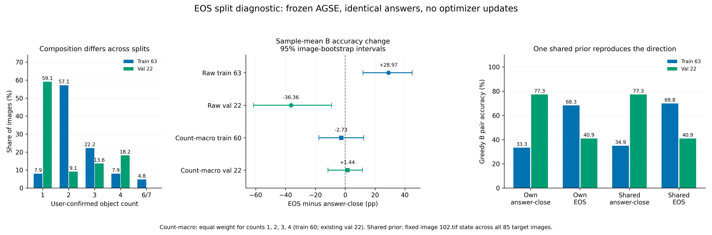

# EOS 训练与验证分歧诊断（2026-11-14）

本阶段完成 **425 条既有轨迹的逐图诊断、340 次新增冻结模型对照及170次原评分重放**，新增生成和优化器更新均为 **0**。85 张图的缓存行号、原始首条描述与先验哈希均对应；实际 Dataset 读取还核对了 170 个描述样本。

1. EOS 终止后，下游 AGSE 对“二”这一数量的偏好明显增强；相同最终文本对应的状态位置变化产生了评分变化。
2. train 与 val 的数量组成差异影响了总准确率：train 以双目标图为主，val 以单目标图为主。按数量 1–4 等权后，采样 B PairAcc 变化分别为 **-2.73 个百分点**和 **+1.44 个百分点**，两组区间均跨过 0。
3. 将一张参考图的同一状态用于全部目标图，也重现了 train 上升、val 下降。下一节点采用数量均衡的短程训练设计，并以数量宏平均和共享状态对照核对逐图收益。

## 1. 逐图映射和模型来源

本轮复用上一阶段固定的 63 张确认 train 图和 22 张既有 val 图。Arrow 的 split、图像行号、图像名及第一条描述沿用原核验材料，85 份历史先验逐文件哈希与 E1 相符。调用实际 `BaseDataset.get_image` 时，同一图像的首、末描述样本均读取该图的同一份先验；记录见 `dataset_loader_replay.json`。170 条自身先验评分与上一轮的最大单项误差为 0。

两份冻结模型的职责和输入来源如下，元信息由实际检查点读取：

| 模型 | SHA-256 | 训练配置中的缓存 |
|---|---|---|
| 下游 AGSE，本轮数量与检索打分使用 | `09ef20e0b354efbf8a7d4d49105cd92e1ae9412b3ea58820961265a065a874dc` | `/workspace/cup-debug/agent_cache_domain_tool` |
| E3-1 重建检索代理 | `e36801d50807519273408e4caf18604ad2f43db2c7b520cee98675631eac9a59` | `/private/AGSE_E3_1_rebuild_20261112/plain_prior_full_20261112/run_01/priors` |

下游 AGSE 的历史缓存来源由保留的 `pipeline_domain_tool.sh`、原 rollout 源码和已核对的缓存文件共同追溯：历史流程为主 LoRA、场景工具、图像及原始首条描述。缓存按 split 和图像行号保存。该批历史缓存逐条生成时的实际停止 token 和完整轨迹为 `[待确认]`。

重建代理的纯推理缓存另有完整生成记录：基础 Qwen、工具集合为空、原始首条描述、贪心、每轮预算 64 token，取最后一次生成的末步隐藏状态。上一轮本次 EOS 对照使用 SFT-30、完整真实工具回填、统一中性输入和每轮 256 token。两套模型及缓存来源分别保留，当前数值对照固定采用下游 AGSE。

## 2. 数量组成解释汇总方向

以下为每图四条采样平均的 B PairAcc，所有失败保留：

| 实际数量 | 确认 train 图数 | train 标签停止 → EOS | 既有 val 图数 | val 标签停止 → EOS |
|---|---:|---:|---:|---:|
| 1 | 5 | 95.00% → 40.00% | 13 | 100.00% → 30.77% |
| 2 | 36 | 26.39% → 95.83% | 2 | 0.00% → 100.00% |
| 3 | 14 | 57.14% → 26.79% | 3 | 0.00% → 0.00% |
| 4 | 5 | 55.00% → 60.00% | 4 | 100.00% → 75.00% |

确认 train 有 36/63 张双目标图和 5/63 张单目标图；既有 val 有 2/22 张双目标图和 13/22 张单目标图。两组内的单目标表现都下降、双目标表现都上升，原始总体变化因此朝相反方向。train 的数量 6/7 另含3张，完整结果保存在分组表中。

在两组共同数量 1、2、3、4 上等权汇总，train 60 图为 58.38% → 55.65%，配对变化 95% 区间 [-17.62, +12.38] 个百分点；val 22 图为 50.00% → 51.44%，区间 [-11.54, +11.54]。

共同数量范围的 train/val 改变量之差为 66.78 个百分点。对称加权分解中的数量组成项为 +74.17 个百分点，数量组内差异项为 -7.39 个百分点，两项之和还原总差异。这项分解描述当前数据的组成关系。

## 3. 共享状态与零输入对照

参考图按继承确认集顺序预先固定为第一张 `102.tif`，其标签停止与 EOS 贪心状态分别广播到全部85张目标图。每种状态在所有目标图中保持相同，目标图像本身沿用原输入。另用历史先验及零向量各评分85次。

| 固定 AGSE 的先验输入 | train 63 B PairAcc | val 22 B PairAcc | val RR |
|---|---:|---:|---:|
| 各图自身标签停止状态 | 33.33% | 77.27% | 0.407181 |
| 各图自身 EOS 状态 | 68.25% | 40.91% | 0.328452 |
| 同一参考图标签停止状态广播 | 34.92% | 77.27% | 0.391150 |
| 同一参考图 EOS 状态广播 | 69.84% | 40.91% | 0.310679 |
| 3584 维零向量（保留投影层偏置） | 60.32% | 68.18% | 0.537935 |
| 历史训练缓存（原始首条描述条件） | 84.13% | 77.27% | 0.570115 |

自身 EOS 状态与共享 EOS 状态都使 train 准确率上升、val 准确率下降。共享状态仅提供固定参考图的信息，这个对照显示汇总增益包含普遍数量偏好的变化。零输入仍经过原 `agent_proj` 的线性层、偏置和归一化层，其定义及张量保存在归档中。

历史缓存为原始首条描述条件下的参考结果。原始描述可能直接给出数量词，相关记录保留在 `inputs/cases.json` 及 E1 核查材料中；本轮中性输入的 EOS 状态和共享状态分别承担新的对照职责。

## 4. 核验与结论

服务器与本机分别从保存特征复算 1020 次 float64 数量判别、132 项排名、84 行分组结果、178 组区间、4组数量等权结果和2组组成分解；上一轮425条 EOS 与935条 SFT 轨迹递归核验通过。统计按图像重采样10,000次；数量等权区间在各数量内重采样，主种子2026111451。单图或小样本分组同时保留图数与区间。

本阶段为观察到上一轮分歧后的探索性诊断。上一轮预设门槛及原始输出保持原值。当前证据支持将数量组成和普遍数量偏好列为主要处理项；后续收益核对采用数量均衡指标，并比较自身状态与固定共享状态。

## 5. 下一节点

已形成 [数量均衡短程试验方案](下一阶段数量均衡试验方案.json)：从当前确认 train 中按数量1、2、3、4各固定2图，共8图，拟执行32次实际优化更新，每数量8次、每图4次；其余55张train图用于训练图之外的确认，既有val22继续单列。训练图为 102.tif, 120.tif, 121.tif, 124.tif, 147.tif, 933.tif, 157.tif, 1937.tif。

奖励沿用 A 数量间隔及现有质量项，B用于评价。训练前先复核概率、完整工具序列与 EOS 末步状态一致性；检查点固定取最后一步。下一次实际运行前封存训练代码及完整数值门槛，确认数量宏平均、共享状态对照及协议质量。该方案当前为待执行设计。

复现入口见 [复现说明](复现说明_20261114.md)，核验见 [服务器核验](服务器独立核验.json)和 [本机核验](本机独立核验.json)。本轮新建证据包 `eos_split_diagnostic_evidence_20261114.tar.gz`，逐文件及本机备份核对见 [备份校验](备份校验.json)。
