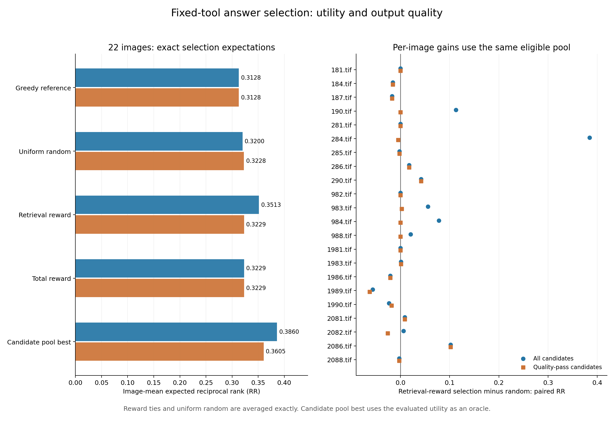

# 固定工具候选选择收益比较（2026-11-14）

本轮已完成昨天计划的候选选择比较。全部 176 个候选中，按原检索奖励选择的平均 RR 为 **0.351325**，高于贪心参考的 **0.312757** 和随机选择期望的 **0.319970**；其中 6 幅图选中了格式失败回答。筛选格式合格候选后，按奖励选择的平均 RR 为 **0.322903**，随机期望为 **0.322779**，配对差 **+0.000123**，95% 图像 bootstrap 区间 **[-0.011035, +0.012988]**。当前最需要解决的是完整回答条件下的收益稳定性及其与训练状态提取的衔接。

## 1. 承接材料与计算规则

这是对 2026-11-13 已有候选的后续离线分析。[分析方案](分析方案.json)在本轮策略比较计算前保存，复用 22 图、每图 8 个候选、22 条贪心参考和全部原始评分。当前方案采用昨天报告中提出的五种策略，并单列新增 19 图、历史 3 图及格式合格子集。

1. **按原检索奖励选择**：选 `r_retrieval` 最大的候选。
2. **按总奖励选择**：选 `r_total=r_retrieval+r_format` 最大的候选；原格式奖励为 0.2。
3. **贪心参考**：使用昨天已生成、与候选具有相同固定真实工具上下文的贪心回答。
4. **均匀随机**：对当前候选池等概率选择，直接计算每图精确期望。原采样中的重复项保留相应概率质量。
5. **候选集收益上界**：对每种收益分别取当前候选池中的最大值，用于衡量候选池内可达到的收益。

奖励并列时，对所有并列最高候选均匀选择，报告其精确期望收益。全部候选为主分析，格式合格子集沿用昨日保存的 `quality_usable` 标记，包含 165 个候选，每图 6–8 个；22 条贪心参考均合格。各策略在同一子集中比较，贪心参考单独保留。候选集上界逐指标计算，贪心参考单独列示。

主收益为最终 AGSE 在昨日固定的 391 条 val 描述中的最佳正例倒数排名 RR；余弦间隔、E1 数量对照句式 A/B 的间隔为次指标。每图贡献等权，配对差先在同一图像上计算，再汇总。图像 bootstrap 为 10,000 次，随机种子 20261114，区间取百分位 2.5% 和 97.5%。RR 的相对提升为平均配对差除以基线平均 RR；余弦间隔使用绝对差。表中的胜/平/负按 RR 容差 1e-12 判断。

## 2. 22图主结果

| 策略 | 全部候选平均RR | 合格候选平均RR | 全部候选策略的回答合格率 |
|---|---:|---:|---:|
| 贪心参考 | 0.312757 | 0.312757 | 100.00% |
| 均匀随机的期望 | 0.319970 | 0.322779 | 93.75% |
| 按原检索奖励选择 | 0.351325 | 0.322903 | 72.73% |
| 按总奖励选择 | 0.322903 | 0.322903 | 100.00% |
| 候选集收益上界 | 0.385957 | 0.360452 | 85.80% |

按原检索奖励选择，在全部候选中相对贪心平均 RR 提升 12.33%，相对随机期望提升 9.80%。总奖励相对贪心提升 3.24%，相对随机提升 0.92%。合格子集内，奖励选择相对随机的平均 RR 提升约 0.038%，两者均值非常接近。

| 条件与配对比较 | 平均RR差 | 95%图像bootstrap区间 | 胜/平/负图像数 |
|---|---:|---:|---:|
| 22图，全部候选，原奖励 − 贪心 | +0.038568 | [+0.006475, +0.086774] | 10/8/4 |
| 22图，全部候选，原奖励 − 随机 | +0.031354 | [+0.002292, +0.071806] | 11/4/7 |
| 新增19图，全部候选，原奖励 − 贪心 | +0.040093 | [+0.004178, +0.095663] | 9/7/3 |
| 新增19图，全部候选，原奖励 − 随机 | +0.032354 | [-0.000796, +0.079880] | 10/3/6 |
| 22图，全部候选，总奖励 − 贪心 | +0.010146 | [-0.000776, +0.027007] | 8/10/4 |
| 22图，全部候选，总奖励 − 随机 | +0.002932 | [-0.012388, +0.020019] | 7/4/11 |
| 22图，合格候选，原奖励 − 贪心 | +0.010146 | [-0.000776, +0.027007] | 8/10/4 |
| 22图，合格候选，原奖励 − 随机 | +0.000123 | [-0.011035, +0.012988] | 6/7/9 |
| 新增19图，合格候选，原奖励 − 随机 | +0.000285 | [-0.012555, +0.015124] | 6/5/8 |

全部候选的原奖励选择对两个基线均显示正的配对差，其 22 图区间位于 0 以上；新增 19 图相对随机的区间跨过 0。总奖励及合格子集的 RR 区间均跨过 0。合格子集内，原检索奖励与总奖励的选择结果一致，格式奖励在该子集中恒定为 0.2。

合格候选集的收益上界为 0.360452，高于奖励选择的 0.322903，说明本批完整回答中仍有可利用的收益差异。现有奖励在合格候选池内的平均收益与随机期望接近，提示后续应关注奖励对候选质量差异的辨识能力。



图左给出五种策略的期望 RR；图右为同一图像内“原检索奖励选择 − 随机选择”的差值。蓝色保留全部候选，橙色使用合格子集。完整收益与区间见[策略汇总](策略收益汇总.csv)和[配对差值](相对基线配对差.csv)。

## 3. 提升集中在哪里

以下为看到主结果后补充的描述性归因，主比较保留原先固定的全部图像与规则。

1. 原检索奖励在 22 图中选中了 6 幅图的格式失败回答，合格率为 72.73%；总奖励所选回答全部合格。
2. 图像 `284.tif` 的被选候选达到 token 上限，实际检索排名为 2，RR 为 0.5；贪心排名为 23，RR 为 0.043478。单图配对差为 +0.456522，占 22 图相对贪心净差之和的 53.80%。
3. 这 6 幅图合计贡献相对贪心净差之和的 75.20%。该分组展示提升的集中程度；格式合格子集提供相同质量条件下的策略对照。

| 图像 | 被选失败候选 | 失败形式 | 实际检索排名 | 相对贪心RR差 |
|---|---|---|---:|---:|
| 284.tif | 22_candidate_6 | 达到64-token上限 | 2 | +0.456522 |
| 982.tif | 93_candidate_1 | 达到64-token上限 | 1 | +0.000000 |
| 983.tif | 94_candidate_3 | 达到64-token上限 | 6 | +0.066667 |
| 984.tif | 95_candidate_3 | 达到64-token上限 | 5 | +0.088889 |
| 1990.tif | 199_candidate_2 | 结束标签格式错误 | 49 | -0.007370 |
| 2082.tif | 201_candidate_3 | 达到64-token上限 | 5 | +0.033333 |

逐一移除任意一幅图时，原奖励相对贪心平均 RR 差的范围为 +0.018666 至 +0.041255，相对随机为 +0.014535 至 +0.035537。这是描述性的逐一移除均值，主表的 bootstrap 区间仍按预定图像组报告。全部分组和逐图贡献见[归因诊断](选择结果归因诊断.json)。

## 4. 新增19图与次指标

| 策略 | 新增19图全部候选平均RR | 新增19图合格候选平均RR |
|---|---:|---:|
| 贪心参考 | 0.336241 | 0.336241 |
| 均匀随机的期望 | 0.343981 | 0.347818 |
| 按原检索奖励选择 | 0.376335 | 0.348103 |
| 按总奖励选择 | 0.348103 | 0.348103 |
| 候选集收益上界 | 0.415904 | 0.391050 |

新增 19 图的合格候选中，原奖励相对随机的 RR 差为 +0.000285，95% 区间为 [-0.012555, +0.015124]，与 22 图的接近随机现象一致。

余弦次指标中，全部候选总奖励选择相对贪心的间隔差为 +0.001059，95% 区间为 [+0.000196, +0.001996]；相对随机的间隔差为 +0.000177，区间为 [-0.001246, +0.001608]。合格子集相对随机的间隔差为 +0.000364，区间为 [-0.000732, +0.001594]。22 图 E1 句式 A/B 的两种奖励选择与两个基线的间隔差区间均跨过 0。全部次指标作为本次后续分析的描述性结果一并保留。

## 5. 核验、材料与下一步

开始时，服务器 `/private` 私有挂载正常，昨日证据中的 734 个文件哈希均通过核对。原始 242 条评分 JSON 的 SHA-256 为 `5c3cc7067a7cc8520ca42601f8801df311f11848897479282ac3d5102c9a0b83`，本轮输入为逐字节副本。原始模型、缓存、实验源代码与昨日输出保持原文件。

本轮比较使用本机 CPU，服务器复用原环境进行独立 CPU 核验。核验脚本从原始排名以精确分数重建 RR 期望，并独立重建所有选择集合、质量概率及配对差，检查 880 条逐图策略指标、240 组配对比较和 360 组 bootstrap 区间，同时核对归因诊断的 44 条分组图像记录。双端核验结果见[本机记录](本机独立核验.json)和[服务器记录](服务器独立核验.json)。

本目录保留固定方案、原评分副本、可复算脚本、完整统计、CSV、PNG/PDF 图及双端核验。服务器对应目录为 `/private/AGSE_E3_1_rebuild_20261112/selection_utility_20261114`，最终证据包为 `selection_utility_evidence_20261114.tar.gz`；[备份校验](备份校验.json)记录归档和逐文件哈希。本轮代码与材料随项目实验分支同步 GitHub。

复算命令（本目录，需要 NumPy；绘图另需 Matplotlib）：

```bash
python3 compare_selection.py --root .
python3 selection_diagnostics.py --root .
python3 verify_selection.py --root . --out 复核结果.json
python3 plot_selection.py --root .
```

当前证据对应固定真实工具、每图第一条描述、22 幅已确认 val 图像及每图 8 次采样。下一步优先核对 GRPO 完整序列前向与离线 rollout 的状态提取规则，再对被选失败候选涉及的 6 幅图进行完整回答条件下的小样本检查，记录补全前后状态、代理排名和实际收益。这样可以检验合格回答状态下的收益能否保留，并为奖励调整和后续训练提供依据。

## 附：22图原始策略收益表

每项均为该图像下对应策略的精确期望 RR。

| 图像 | 全部原奖励 | 全部总奖励 | 贪心 | 全部随机 | 合格原奖励 | 合格随机 |
|---|---:|---:|---:|---:|---:|---:|
| 181.tif | 0.333333 | 0.333333 | 0.333333 | 0.333333 | 0.333333 | 0.333333 |
| 184.tif | 0.125000 | 0.125000 | 0.142857 | 0.140625 | 0.125000 | 0.140625 |
| 187.tif | 0.205556 | 0.205556 | 0.200000 | 0.222917 | 0.205556 | 0.222917 |
| 190.tif | 1.000000 | 1.000000 | 1.000000 | 0.887500 | 1.000000 | 1.000000 |
| 281.tif | 1.000000 | 1.000000 | 1.000000 | 1.000000 | 1.000000 | 1.000000 |
| 284.tif | 0.500000 | 0.055728 | 0.043478 | 0.115443 | 0.055728 | 0.060507 |
| 285.tif | 0.225000 | 0.225000 | 0.200000 | 0.227083 | 0.225000 | 0.227083 |
| 286.tif | 0.142857 | 0.142857 | 0.111111 | 0.125496 | 0.142857 | 0.125496 |
| 290.tif | 0.500000 | 0.500000 | 0.500000 | 0.458333 | 0.500000 | 0.458333 |
| 982.tif | 1.000000 | 1.000000 | 1.000000 | 1.000000 | 1.000000 | 1.000000 |
| 983.tif | 0.166667 | 0.105556 | 0.100000 | 0.111111 | 0.105556 | 0.103175 |
| 984.tif | 0.200000 | 0.111111 | 0.111111 | 0.122222 | 0.111111 | 0.111111 |
| 988.tif | 0.333333 | 0.333333 | 0.333333 | 0.312500 | 0.333333 | 0.333333 |
| 1981.tif | 1.000000 | 1.000000 | 1.000000 | 1.000000 | 1.000000 | 1.000000 |
| 1983.tif | 0.005348 | 0.005348 | 0.005025 | 0.004562 | 0.005348 | 0.004562 |
| 1986.tif | 0.166667 | 0.166667 | 0.166667 | 0.187500 | 0.166667 | 0.187500 |
| 1989.tif | 0.083333 | 0.083333 | 0.100000 | 0.139810 | 0.083333 | 0.145833 |
| 1990.tif | 0.020408 | 0.022727 | 0.027778 | 0.043829 | 0.022727 | 0.041149 |
| 2081.tif | 0.142857 | 0.142857 | 0.125000 | 0.133929 | 0.142857 | 0.133929 |
| 2082.tif | 0.200000 | 0.166667 | 0.166667 | 0.193750 | 0.166667 | 0.192857 |
| 2086.tif | 0.333333 | 0.333333 | 0.166667 | 0.231250 | 0.333333 | 0.231250 |
| 2088.tif | 0.045455 | 0.045455 | 0.047619 | 0.048155 | 0.045455 | 0.048155 |
