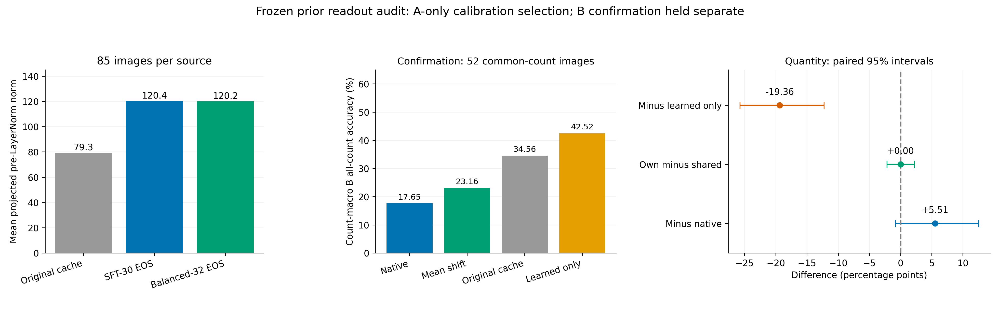
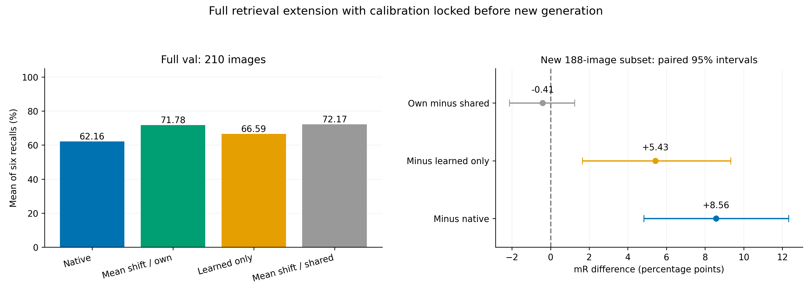

# 先验分布、注入校准与完整检索验证（2026-11-16）

本阶段完成 **511份先验状态的分布与注入审计、5种冻结前向干预、55图数量确认、32次输入梯度探测，以及完整210图val检索验证**。核心审计包含1470条新评分；扩展验证新增188份贪心先验、2次锚点重放和840份图像编码。模型参数优化更新数为0。

完整val210的检索mR由 **62.16% → 71.78%**。此前未参与本轮评分的188图上，mR为 **63.55% → 72.11%**，对应配对变化 **+8.56个百分点，95%区间[+4.82, +12.32]**。数量确认集上，B全数量宏平均由 **17.65% → 23.16%**，变化 **+5.51个百分点，95%区间[-0.86, +12.50]**。数量采用条件通过2/5项；扩展检索条件通过2/3项。

下一大阶段统一图像独立推理协议和训练端缓存：固定当前均衡第32步Agent及统一查询，复用本轮210张val缓存，为1680张train和210张test补齐1890份先验，形成2100图缓存；随后按相同划分、初始化与预算执行读出网络的匹配对照，完成val选择及保留test的最终检索评价。

## 1. 注入路径与分布证据

实际模型路径为：BF16隐藏态3584维 → 线性投影1024维 → LayerNorm → 重复成16个视觉提示 → 门控混合先验与可学习提示 → gather线性投影 → 插入CLIP视觉CLS之后 → 图像编码与adapter → L2归一化。源代码见 [AGSE前向](source_snapshot/vilt/modules/vilt_module.py)第584–605行、[CLIP插入](source_snapshot/prompt_clip/model.py)第240–275行。四份实际前向见证逐项重建了273个token的Transformer输入。

511份状态的原生门控截断值均为0，先验分支系数为1。32次原生/校准输入梯度探测均有非零响应，记录在 `gradient_witnesses.csv`；该探测围绕BF16状态的F32解量化点做epsilon0.1有限差分，策略更新数0。

原始描述缓存与均衡32步贪心先验的隐藏态平均范数分别为290.79和290.73，线性投影后平均范数分别为79.30和120.18。LayerNorm后的范数均约32；确认55图上，与同图原始缓存的投影方向余弦由 **0.3746** 经均值校准提高至 **0.8547**。方向比较来自已保存权重的float64重建，见 `alignment_by_image.csv`。

## 2. 校准选择与数量确认

候选在评分前封存为原生、门控0、门控0.5、门控1、投影均值校准。均值校准偏置在各固定策略内，由原8训练图的“原始缓存线性投影均值−当前贪心先验线性投影均值”计算，并加在线性输出与LayerNorm之间。偏置拟合使用这8图，随后以均衡32步策略的A全数量宏平均和A最难负例间隔选候选；B未参与选择。程序在960条诊断网格后锁定 `mean_shift_auto`，再执行510条确认评分。

确认55图中，数量1–4共52图，各数量等权；其余数量保留图像等权结果。完整表如下：

| 前向方式 | 确认52图B全数量宏平均 | 原始55图等权 |
|---|---:|---:|
| 原生自身先验 | 17.65% | 43.64% |
| 均值校准自身先验 | 23.16% | 47.27% |
| 均值校准共享先验 | 23.16% | 47.27% |
| 仅可学习提示 | 42.52% | 45.45% |
| 原始描述条件缓存 | 34.56% | 65.45% |

校准自身相对校准共享先验的B全数量变化为 **+0.00个百分点，95%区间[-2.21, +2.21]**，相对仅可学习提示为 **-19.36个百分点，95%区间[-25.74, -12.25]**。B最难负例间隔改善区间下界为正，二值判对与自身先验对照的采用条件尚未达成。SFT第30步支路作为补充保留，其全部表格与区间在 `analysis.json`。

## 3. 完整210图检索验证

在校准候选与偏置已经锁定后，原22张补充val图的RR由0.319832提高到0.603276，据此增加完整val验证，并将新增188图单列。扩展阶段仍使用固定均衡32步策略、统一查询 `Describe the visible scene.`、真实场景工具和原生EOS控制器；复用22份已有val状态，新增188份贪心状态。两份val锚点重放与原状态精确一致。四路前向只改变已封存的校准/提示处理。

完整图库为210幅图和1050条原始描述。R@1/5/10与mR按仓库的重复token描述等价正例规则计算，实际调用原 `tr_top_k/ir_top_k` 完成一致性检查；token长度61，原有16个文本提示保留。保存的float32相似度矩阵与top-k索引为主结果，float64点积用于独立数值复核。

| 冻结前向方式 | I2T R@1 | R@5 | R@10 | T2I R@1 | R@5 | R@10 | mR |
|---|---:|---:|---:|---:|---:|---:|---:|
| 原生纯推理先验 | 32.86 | 46.19 | 62.38 | 48.86 | 87.71 | 94.95 | 62.16 |
| 均值校准＋自身先验 | 46.19 | 66.67 | 76.19 | 55.71 | 88.67 | 97.24 | 71.78 |
| 仅可学习视觉提示 | 37.62 | 62.38 | 78.10 | 46.29 | 82.00 | 93.14 | 66.59 |
| 均值校准＋固定共享先验 | 48.10 | 68.10 | 76.19 | 55.24 | 88.10 | 97.33 | 72.17 |

mR为图像到文本、文本到图像两方向R@1、R@5、R@10的六项均值。对新增188图，以图像为配对重采样单位，文本查询随其所属图像成组抽样，保留原描述数权重。10,000次重采样的mR变化为：

- 相对原生纯推理先验：+8.56个百分点，95%区间[+4.82, +12.32]。
- 相对仅可学习视觉提示：+5.43个百分点，95%区间[+1.65, +9.33]。
- 相对均值校准＋固定共享先验：-0.41个百分点，95%区间[-2.13, +1.24]。

val210是现有划分的验证集。此处新增188图指此前未参与本轮评分的图像；原test210保留供后续最终评价。本轮参数选择使用训练8图的A分数，扩展验证结果完整保留。

## 4. 缓存协议核对

85份原始domain-tool缓存的模型版本元数据为 `[待确认]`，文件SHA-256与历史标注逐项匹配。另核对现有 `plain_prior_full_20261112` 生成器：它对1680张train和210张val调用第一条标注描述 `item['caption']`，日志的LoRA路径为空、单轮token预算64；代码第185–217行和原始输入清单已保存于 `context_snapshot/`。本轮中性查询、均衡32步LoRA及原生EOS先验使用单独的来源记录。

因此，后续需要统一训练与部署的查询、策略版本、停止位置和缓存来源。校准对照展示了现有读出网络对先验分布变化的敏感性，数量信息及图像相关性继续由固定对照检验。

## 5. 双端核验与保存

服务器和本机分别重建511份原状态、线性投影、LayerNorm、门控及视觉提示，检查4份实际视觉插入、1470条新评分、340条父评分、220个原子集检索排名、672组区间与32次梯度见证。完整val阶段另核对210份先验、840份图像特征、1050个描述查询与9组图像成组区间。原AGSE全部张量哈希保持 `e94b036eca9fb2e45f3d8ad5a9fc3b3b26accf7d32a87844d6697e8d76c2dfab`。

所有原始文件与失败轨迹保留。首轮在模型指纹的标量张量处理处停止，评分数0；v2只将张量展平后记录字节，新版随后完成全部评分。原失败日志、修正源码和哈希清单分别封存。

完整证据：`prior_injection_calibration_evidence_20261116.tar.gz`。校准偏置与前向处理见 `校准候选.json`；它保留数量条件和扩展检索条件的各项结果。双端备份、逐文件校验和复现说明分别见 `备份校验.json`、`file_checksums.json`、[复现说明](复现说明_20261116.md)。

## 6. 下一大阶段

下一大阶段统一图像独立推理协议和训练端缓存：固定当前均衡第32步Agent及统一查询，复用本轮210张val缓存，为1680张train和210张test补齐1890份先验，形成2100图缓存；随后按相同划分、初始化与预算执行读出网络的匹配对照，完成val选择及保留test的最终检索评价。 训练与验证各路共用数据划分、原始初始化和固定预算，比较原生图像独立先验、校准自身先验、校准共享先验和仅可学习提示；评估报告同时保留检索指标、数量确认及自身/共享先验对照。具体入口与预算在执行前按实际训练代码封存，规划见 [下一大阶段](下一大阶段方案_20261116.json)。
