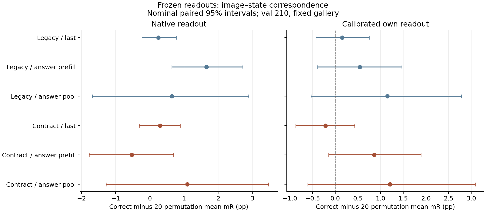
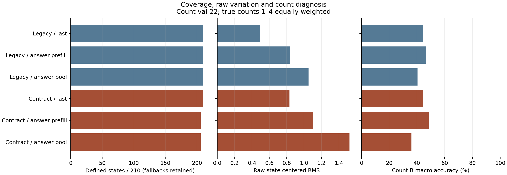

# 协议提示修复与候选状态验证（2026-11-17完成）

本阶段采用训练63图选择提示，随后完成完整val210验证、六类状态及270组冻结读出对照。选定无示例的明确回合顺序约定（contract_only），train严格完成且消费已请求工具反馈62/63，val为206/210；两者自行生成result标签分别0和0。Agent和读出端新增优化更新均为0。

在校准自身读出中，所选提示的正文均值正确配对减20次置换均值为+1.21个百分点，名义配对95%区间[-0.60, +3.09]。顺序约定下的正文均值与置换均值之差的区间覆盖0。后续RFPO奖励对照建议暂保留原末状态，先核对随机采样协议及同图候选奖励区分度；候选状态的专门适配另列E4验证。

## 协议与历史监督核对

历史SFT执行目标为15个工具调用与15个答案，共30例；每例6个活动标签，每轮180、两轮360。556个答案正文重叠位置均被屏蔽，工具反馈处于user上下文。正文来自既有冻结策略生成的轨迹。24个全词表NLL见证的CPU重算最大绝对差2.665e−7。
历史RL核对覆盖128条轨迹、8张图、32次更新、254轮、7076个生成token；126个实际工具事件及反馈记录在user回合，125条轨迹通过历史严格可用检查。原生成与replay逐位标签、长度一致，logprob最大数值差0.23154，符合原0.25阈值。SFT调用目标含EOS共6token，RL在闭标签处停止共5token。
30条SFT示例与128条RL轨迹均含同一港口示例。以上记录定位了训练覆盖情况；去示例错误形成于哪段训练、初始继承适配器更早的监督来源，均为[待确认]。完整审阅见 `.aris/traces/experiment-audit/` 与 `supervision_mask_audit.json`。

三种提示、通过阈值与固定优先级在生成前封存。contract_only明确第一回合输出scene_classify调用，等待外部结果，再输出答案；neutral_placeholder保留中性格式示例；rotated_actual3按图像名确定训练示例。轮换来源为训练图101/1826/1902.tif，与273图队列分离。

| 训练候选提示 | 严格完成并消费反馈 | 自行生成result标签 | 95%通过门槛 |
|---|---:|---:|---|
| contract_only | 62/63 | 0 | 通过 |
| neutral_placeholder | 62/63 | 0 | 通过 |
| rotated_actual3 | 59/63 | 0 | 未通过 |

选定规则仅使用train63协议结果。原始锁记录生成时尚无本阶段验证指标；30步格式SFT备选分支未触发，balanced32适配器哈希持续为 `76156912e519f8d0165decfe0423de34300d93840c36a15255b260e1ae6fad85`。

每个工具反馈来自此前真实scene_classify轨迹的逐图文本及置信度，只有模型生成规范调用后才按需回放。外部程序保留user角色与result标签，当前阶段对分类器采用已核验结果回放。所有图像采用同一查询 `Describe the visible scene.`，贪心生成最多3轮、每轮256token。

## 状态定义、位置与覆盖

末状态沿用最后一个实际解码步的末层末位置。答案预填充取最终严格答案轮第0步，即请求反馈后答案提示的最后一个输入token表征。正文均值取输入token完整落在答案正文内的实际解码状态；生成token j在步骤j+1进入模型，以原始ByteLevel字节映射定位，边界跨越token排除。均值在CPU float64计算后转BF16。
严格答案或反馈条件未满足时，候选状态回退同轨迹末状态，并保留全部案例及回退标记。三类状态共用实际生成；原始每步矩阵、IDs、原生EOS、正文跨度与位置均保存。

| 状态／val210 | 定义可用数 | 回退数 | 唯一状态数 | 中心化RMS | 有效秩 |
|---|---:|---:|---:|---:|---:|
| 港口示例／末状态 | 210 | 0 | 210 | 0.49233 | 22.188 |
| 港口示例／答案预填充 | 210 | 0 | 210 | 0.84098 | 17.652 |
| 港口示例／正文均值 | 210 | 0 | 210 | 1.05136 | 18.516 |
| 顺序约定／末状态 | 210 | 0 | 210 | 0.83307 | 5.680 |
| 顺序约定／答案预填充 | 206 | 4 | 210 | 1.10210 | 9.201 |
| 顺序约定／正文均值 | 206 | 4 | 210 | 1.52287 | 18.196 |

V2保存672次主队列生成、两张热身锚点与1638行状态库。273个原基线的末状态及生成IDs精确重放；独立核验重建2016个候选张量、45591步状态和36311个正文输入位置。预评分与独立审计发现的严格答案悬空工具标签数为0。

初始V1在14条已完成试运行后，为补齐锚点矩阵、结果标签独立计数、单一答案限制及失败备选记录，停止该自有任务并新建V2。V1源码、日志和轨迹完整保留，14条IDs及末状态与V2精确一致；当时训练更新为0。修订清单见 `protocol_execution_addendum_v2.json`。

2026-11-17恢复时，本机首先完整校验暂停归档1527份文件。版本化恢复入口保留651条旧记录的完整前缀、原提示选择锁和锚点；两条原提示锚点与一条已完成验证轨迹的生成IDs、全部解码状态及三类候选向量精确重放，随后只新增余下21张验证图。包版本与seed0 CUDA前反向见证保持一致，连续性独立核验见 `本机恢复连续性核验_20261117.json`。

## 完整验证集与冻结读出

四个读出检查点沿用父阶段val选择。原生自身及校准自身各132组，校准共享与可学习视觉提示各3组，共270组。每类状态均比较正确配对、训练102.tif同类共享状态及20次保持状态集合的划分内无固定点置换。val沿用同一组210图置换；train数量诊断采用63图队列内部置换。

42组legacy_last验证矩阵在状态、检查点和文本特征逐字节证明后复用，数量特征重新计算。总来源行79650，其中新GPU图像编码70830、复用8820。数量库存56条，每图每句式按其对象只比较3–7个候选。

| 状态 | 原生主mR | 校准自身主mR | 校准自身严格mR | 校准自身同分平均严格mR |
|---|---:|---:|---:|---:|
| 港口示例／末状态 | 77.11 | 77.97 | 57.70 | 57.67 |
| 港口示例／答案预填充 | 73.17 | 70.84 | 50.97 | 51.05 |
| 港口示例／正文均值 | 64.48 | 60.46 | 42.95 | 42.75 |
| 顺序约定／末状态 | 77.48 | 78.03 | 57.79 | 57.77 |
| 顺序约定／答案预填充 | 68.81 | 67.62 | 48.41 | 48.70 |
| 顺序约定／正文均值 | 63.49 | 62.60 | 43.29 | 43.34 |

| 状态 | 原生正确−置换（百分点） | 配对95%区间 | 校准自身正确−置换（百分点） | 配对95%区间 |
|---|---:|---:|---:|---:|
| 港口示例／末状态 | +0.25 | [-0.23, +0.77] | +0.15 | [-0.42, +0.75] |
| 港口示例／答案预填充 | +1.66 | [+0.64, +2.72] | +0.54 | [-0.39, +1.47] |
| 港口示例／正文均值 | +0.65 | [-1.69, +2.89] | +1.15 | [-0.53, +2.78] |
| 顺序约定／末状态 | +0.30 | [-0.31, +0.88] | -0.22 | [-0.87, +0.43] |
| 顺序约定／答案预填充 | -0.53 | [-1.78, +0.69] | +0.86 | [-0.15, +1.89] |
| 顺序约定／正文均值 | +1.10 | [-1.28, +3.48] | +1.21 | [-0.60, +3.09] |

主协议沿用重复token描述的等价正例；严格对应报告保存top-10前缀和完全同分项均匀抽取的期望命中率两个约定。全部六类状态、三协议、正确减共享及状态间变化共102组检索区间，另有136组分层数量区间。每项采用10000次配对重采样：验证图像及同图5条描述同步抽取，数量按真实1–4层分别抽取后等权。图库、模型及20个置换固定，区间为名义逐项95%。相同逐图命中轮廓先逐项相减再均值，保持精确零差。

## 数量与投影诊断

| 正确配对状态 | 原生val22 B宏平均 | 校准val22 B宏平均 | 校准train60 B宏平均 | 校准val门控均值 |
|---|---:|---:|---:|---:|
| 港口示例／末状态 | 46.63 | 44.71 | 40.06 | 0.00000 |
| 港口示例／答案预填充 | 44.71 | 46.63 | 49.33 | 0.00000 |
| 港口示例／正文均值 | 60.90 | 40.38 | 24.68 | 0.00000 |
| 顺序约定／末状态 | 48.56 | 44.71 | 40.06 | 0.00172 |
| 顺序约定／答案预填充 | 48.56 | 48.56 | 43.37 | 0.00172 |
| 顺序约定／正文均值 | 32.21 | 36.06 | 29.64 | 0.12462 |

数量1–4样本数：val为13/2/3/4，train为5/36/14/5。85图原始人核标签、A/B句式的成对与全候选正确率、原始分差均保存；train另3图也保留，1–4宏平均对应train60。检索与数量使用原标注，状态离散度、格式通过率与门控属于描述性诊断；生成场景描述的语义正确性为[待确认]。
不同状态与固定读出端之间还存在输入分布变化，绝对指标结合各自的正确/置换/共享对照解释。本阶段val继续沿用读出选择所用划分，单策略与单组固定模型结果用于开发诊断。
本轮每图采用贪心生成，逐图配对对照检验图像对应作用。后续RFPO还需单独检验同一图像的多个采样候选是否得到有区分度的奖励。满足严格完成并消费反馈定义的纯预填充向量，由正文生成前的输入前缀决定；代码在轨迹结束后依完成情况选择这一向量或末状态回退。selected验证的4条异常实际采用末态，因此该家族同时包含纯预填充与末态回退。固定图像及相同工具历史的纯预填充，对后续正文候选共享同一数值；其逐图效果与同图候选奖励区分能力分别记录，并在进入策略训练前以采样实测核查。

## 核验、保存与下一节点

服务器与本机分别重建5670项检索指标、6480项数量汇总及全部区间。补充核验逐行绑定1638行状态库到封存cohort/Arrow图序，并将210条所选提示、五项关键输入字节绑定到原始来源。所有原始源码、模型、三份Arrow及父阶段证据复核原SHA；本阶段新增test评分为0。

独立审阅由experiment-audit技能要求的审阅代理完成，标注same-family/provisional；确定性重算与范围限定分别记录在 `EXPERIMENT_AUDIT.json`。完整运行记录、原始状态矩阵、统计脚本及报告在本机与/private保存，归档、分卷、文件索引及双端SHA证明见 `备份校验.json`。

顺序约定下的正文均值与置换均值之差的区间覆盖0。后续RFPO奖励对照建议暂保留原末状态，先核对随机采样协议及同图候选奖励区分度；候选状态的专门适配另列E4验证。

本轮归入E4先验表征诊断及工具流程核查，为后续E3奖励试验提供生成条件和状态定义依据。按当前证据决定是否保留候选状态或先开展匹配读出检查；下轮RFPO须额外核对随机采样条件下的协议稳定性，并保持新旧奖励组的提示、状态提取、初始化、训练数据和预算一致。生成描述的事实语义另作盲法核查。下一轮方案在训练前单独封存，本轮完成后停止自动扩展实验范围。
