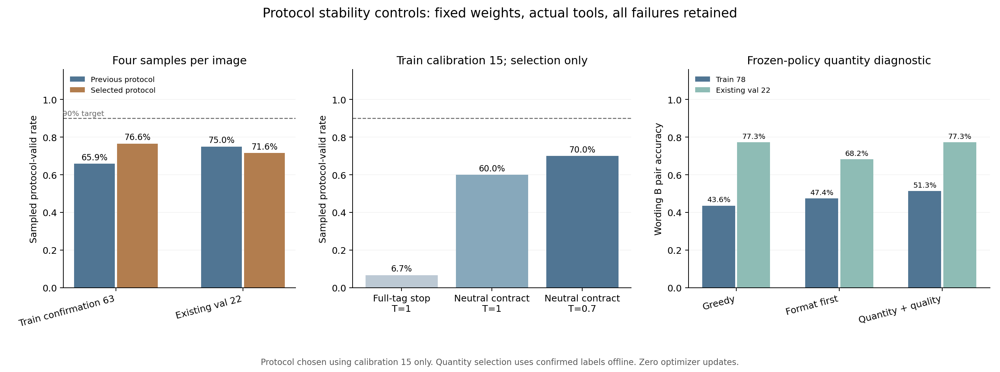

# 协议稳定性对照结论（2026-11-14）

本阶段完成 3 组协议小样本对照、固定方案的 100 图 500 条轨迹确认，以及服务器与本机独立复算。选中方案为 **清晰中性协议，温度 0.7**；协议确认条件 **未通过**。当前确认采样采用直接回答路径。下一节点加入完整工具调用与回答标签的格式训练，再同时确认协议稳定性、真实工具使用和数量信号。

本轮策略权重固定为 `c742c8dab5499595fd7b9698faffc4fedccad1befa531ed8a44a354bab0fb0c8`，优化器更新数 **0**。本轮检验推理协议与采样设置的作用。数量选择继续采用已有人工标签进行离线候选诊断，后续训练阶段再检验训练收益。

## 1. 对照问题与预先固定的规则

上一轮在 train 312 条采样中合格 210 条，失败含 64 条格式失败、36 条模型自产工具结果及 2 条 token 上限终止。本轮首先检查了实际输出，发现原调用路径在生成注册工具名时即可截断，部分模型原生输出也在工具名后结束。因此单独增加结束标签要求需要实测其与现有模型的适配情况。

方案 SHA-256 为 `79b45a02a5051ea7109398452a22dcbf4601cd328db4d4cbda775d02deda3829`。全部实际图像输入均为 `Describe the visible scene.`。清晰中性协议只调整系统要求和固定示例，原数量标签继续用于奖励与评价。模型、图像、数词对、最终 AGSE 及文本向量沿用相同版本。

| 项目 | 设置 |
|---|---|
| 硬件与框架 | NVIDIA A100-SXM4-80GB，PyTorch 2.4.1+cu124，Transformers 4.57.2，PEFT 0.10.0 |
| 参数与模型 | 基础策略 BF16、LoRA FP32，全部冻结；最终 AGSE 沿用原版本 |
| 生成预算 | 最多 3 轮，每轮最多 256 token；首 token EOS 屏蔽 |
| 采样 | 每图 4 条，温度按方案取 1 或 0.7，top-k=0、top-p=1；另生成 1 条贪心 |
| 先验状态 | 最后一次实际解码的最后有效步骤、末层末位置，缓存与评分共用同一张量 |

完整标签停止改变了解码终止时点，缓存位置也随实际生成变化；检索评分测量整套推理流程的效果。

15 张 train 图按预设 SHA-256 排序规则选出，每组图像生成 4 条采样；剩余 train 63 图用于确认，原 E1 已检查的 val 22 图用于补充诊断。train 中唯一棒球场图保留于确认组。校准图共覆盖 5 个目标类型，确认和补充组的分布见输入清单。

三组依次比较：完整工具调用及回答结束标签停止；清晰中性协议加相同停止规则；清晰中性协议加温度 0.7。运行中保留所有失败，实际工具只在识别到完整注册调用后执行。所有回填结果由外部程序产生。输出与解码状态按原样同步保存。

选择优先采用声明顺序中首个满足预设条件的方案；当三组均未达成条件时，按合格率、自产工具结果率及声明顺序选出一组继续确认。选择使用 15 张 train 图的协议指标及有效状态数量。原始数量分数和 val 结果均在后续评分阶段计算。

## 2. 小样本选择结果

| 方案 | 合格率 | 严格协议合格率 | 自产工具结果率 | 两条有效不同状态的图像 | 预设条件 |
|---|---:|---:|---:|---:|---|
| 完整标签停止，温度 1 | 6.67% | 6.67% | 15.00% | 1/15 | 未达成 |
| 清晰中性协议，温度 1 | 60.00% | 60.00% | 1.67% | 12/15 | 未达成 |
| 清晰中性协议，温度 0.7 | 70.00% | 70.00% | 0.00% | 13/15 | 未达成 |

本轮小样本选择条件尚待达成，已按预设回退规则完成确认。最终方案为 清晰中性协议，温度 0.7。正式 500 条索引包含选中组原有 60 条小样本，另生成 440 条，其余两组各 60 条也完整保留。

## 3. 固定方案的稳定性确认

| 图像组 | 原流程采样合格率 | 当前采样合格率 | 配对差及 95% 图像区间 | 当前严格协议合格率 | 当前自产工具结果率 |
|---|---:|---:|---|---:|---:|
| 校准 train 15 | 73.33% | 70.00% | -3.33 pp [-20.00, +13.33] | 70.00% | 0.00% |
| 确认 train 63 | 65.87% | 76.59% | +10.71 pp [+3.97, +17.46] | 76.59% | 0.00% |
| 合计 train 78 | 67.31% | 75.32% | +8.01 pp [+1.28, +14.42] | 75.32% | 0.00% |
| 原 E1 val 22 | 75.00% | 71.59% | -3.41 pp [-17.05, +10.23] | 71.59% | 0.00% |

确认 train 63 图的贪心合格率为原流程 92.06%、当前 95.24%。采样合格率按图像等权统计，每张图包含全部 4 条采样。区间为 10,000 次图像配对 percentile bootstrap，种子 2026111428。主确认条件只用 train 63 计算。确认组包含飞机 11、储罐 18、棒球场 1、沙坑 9、网球场 23、住宅 1 张；[分目标结果](分目标协议与数量结果.csv)另列图像数与两套协议指标。

| 图像组与流程 | 采样条数 | 合格条数 | 终止原因计数 |
|---|---:|---:|---|
| confirmation_train63 / baseline | 252 | 166 | {"answer": 166, "model_generated_tool_result": 28, "format_failure": 57, "token_limit": 1} |
| confirmation_train63 / selected | 252 | 193 | {"answer": 193, "format_failure": 59} |
| val22 / baseline | 88 | 66 | {"answer": 66, "model_generated_tool_result": 7, "format_failure": 15} |
| val22 / selected | 88 | 63 | {"answer": 63, "format_failure": 23, "mixed_or_unknown_tool_output": 2} |

| 图像组 | 原流程采样工具调用率 | 当前采样工具调用率 | 原流程贪心工具调用率 | 当前贪心工具调用率 |
|---|---:|---:|---:|---:|
| 确认 train 63 | 63.49% | 0.00% | 100.00% | 0.00% |
| 原 E1 val 22 | 75.00% | 0.00% | 100.00% | 0.00% |

部分工具请求的实际结尾为 `scene_classify<|im_end|>`，在当前完整标签规则下归入工具格式失败。数词标签和协议提示保持分开，token 编码与样例见 [工具终止诊断](tool_terminal_diagnosis.json)。后续格式训练同时检查调用完成率、实际工具使用及最终回答。

沿用上一轮的兼容合格规则用于流程对比，同时报告严格协议合格率：最终输出须完整匹配非空 answer，所有执行过的调用均含完整结束标签。协议指标衡量格式与调用过程，回答内容的事实准确性仍需独立评价。[文本事实复核清单](文本事实复核清单.csv)保存 100 张图在贪心、格式选择和数量加格式选择下的 300 条原始文本与人工数量，文本准确性列留待人工核对。

## 4. 数量候选信号与完整检索补充

| 图像组 | 原流程贪心 B PairAcc | 当前贪心 B PairAcc | 原流程采样 B PairAcc | 当前采样 B PairAcc |
|---|---:|---:|---:|---:|
| 确认 train 63 | 73.02% | 42.86% | 65.87% | 44.05% |
| 合计 train 78 | 71.79% | 43.59% | 65.06% | 43.91% |
| 原 E1 val 22 | 50.00% | 77.27% | 59.09% | 72.73% |

确认 train 63 的采样 B PairAcc 从 65.87% 变为 44.05%，贪心从 73.02% 变为 42.86%；原 E1 val 22 的变化方向不同。协议合格率、实际工具调用和数量区分需要共同评价。停止时点、提示与工具路径在本轮同时变化，后续训练继续保留原流程作为固定对照。

| 图像组 | 贪心 B PairAcc | 格式选择 B PairAcc | 数量加格式 B PairAcc | 数量加格式相对格式的 B 间隔差及区间 |
|---|---:|---:|---:|---|
| train 78 | 43.59% | 47.44% | 51.28% | +0.0007304 [+0.0004794, +0.0010013] |
| val 22 | 77.27% | 68.18% | 77.27% | +0.0002656 [-0.0000253, +0.0006503] |

原先基于 train 78 的 7 项数量训练条件保持原值，本轮结果为 **未通过**。各项判定见 `analysis.json` 的 `decision`；协议条件另见 `protocol_analysis.json`，两份判定分别保留。

对于原 391 条 val 描述图库，原流程贪心平均 RR 为 0.356160，当前为 0.303438；原流程数量加格式选择为 0.341772，当前为 0.330176。完整流程的绝对指标与候选内部差值同时保留。

当前流程中，数量加格式筛选相对首条格式合格候选的平均 RR 差为 +0.008736，95% 区间 [+0.000017, +0.024953]。数量句对、完整图库与单条贪心均提供对照。

## 5. 协议确认条件与下一节点

| 运行前固定的检查 | 结果 |
|---|---|
| 确认 63 图的采样合格率至少 90% | 未达成 |
| 确认 63 图的严格协议合格率至少 90% | 未达成 |
| 确认 63 图的自产工具结果率至多 2% | 通过 |
| 相对原流程的合格率配对区间下界高于 0 | 通过 |
| 确认 63 图数量加格式选择后的合格率至少 95% | 通过 |

当前确认采样采用直接回答路径。下一节点加入完整工具调用与回答标签的格式训练，再同时确认协议稳定性、真实工具使用和数量信号。 [后续格式训练要点](下一阶段格式训练要点_20261114.md)记录工具标签监督与温度一致概率核对。若进行格式训练，训练图与确认图继续分开，保留实际工具回填和完整轨迹，检查输出合格率、数量跨写法信号与贪心检索表现。

## 6. 独立复核、启动修正与备份

6 条旧流程复现的生成 token、工具消息和隐藏状态哈希与上一轮逐项一致。本轮保存 626 条完整唯一轨迹：6 条复现、180 条小样本及 440 条确认生成。两端各核对 626 个状态与轨迹、631 轮生成、5 次实际工具事件、600 个候选选择结果和 206 组区间。CPU float64 数量二分类 1252/1252、val 排名 110/110 项与保存结果一致。上一轮完整归档的 1,219 个文件与 503 条轨迹也再次独立复核。

首次启动在第一条中文轨迹写盘时发生编码错误，旧入口的异常处理又将失败误写为 complete；第二次启动在完成 6 条复现后因小样本父目录缺失退出。两次失败的日志、部分状态与哈希分别保存在 `failed_attempt_01/`、`failed_attempt_02/`，对应原脚本与执行前哈希快照保存在 `code/` 及根目录；两次各有一条已生成但未形成完整记录的轨迹，均在诊断中保留说明。后续入口显式启用 UTF-8，目录在采样前创建，并沿用已核验的 6 条前缀。**实际成功生成结果以 `generation_pipeline_result_v3.json` 为准**，原错误状态作为失败证据保存。

详情见 [服务器独立核验](服务器独立核验.json)、[本机独立核验](本机独立核验.json)、[来源核验](final_source_audit.json)及 [复现说明](复现说明_20261114.md)。原模型、上一阶段文件和环境保持原值，本阶段新增训练检查点为 0。

本机完整原始材料在 `原始运行记录/`；服务器目录为 `/private/AGSE_E3_1_rebuild_20261112/protocol_stability_20261114`。完整归档为 `protocol_stability_evidence_20261114.tar.gz`，校验信息见 [备份校验](备份校验.json)。模型沿用上阶段已验证的格式模型归档，位置与摘要见 [模型来源与备份核验](模型来源与备份核验.json)。
