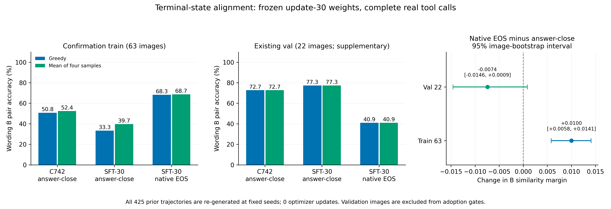

# 回答 EOS 终止状态对齐结论（2026-11-14）

本阶段固定上一轮第 30 步 SFT 权重，完成 **85 张图、425 条原生 EOS 终止轨迹**，新增优化器更新为 **0**。425 条轨迹均通过提示、已有 token 前缀及真实工具回填的逐项核对。

确认 train 63 的采样 B PairAcc 为 **39.68% → 68.65%**，贪心 B PairAcc 为 **33.33% → 68.25%**。采样严格合格率为 **97.62%**，实际工具使用率为 **99.21%**。预先封存的采用条件通过 **9/9** 项，数量候选准备条件通过 **7/7** 项。

补充 val 22 的采样 B PairAcc 为 **77.27% → 40.91%**，贪心 RR 为 **0.407181 → 0.328452**。这组反向变化保留为下一节点的优先诊断项；本轮预设门槛维持原值。

确认 train 63 的预设采用条件与数量候选条件全部达成。补充 val 22 出现相反方向变化：下一节点优先核查 train/val 分歧，固定两套已保存先验，按对象、数量及图像逐项对照，并核对冻结评分器训练缓存的终止约定及样本映射。完成这项诊断后，再封存数量奖励训练方案及独立验证职责。

## 1. 本轮固定项与处理项

上一轮完整工具调用监督训练改善了调用和回答格式，同时观察到回答标签终止与历史 EOS 终止对应的末步隐藏状态存在差异。本轮保留完整工具标签、真实场景分类回填、模型权重、原系统提示及固定示例，仅将最终回答延续到模型配置中的原生 EOS。

原始输入统一为 `Describe the visible scene.`。每张图生成 1 条贪心与 4 条温度 1 采样，采用原 100 图顺序对应的固定种子，最多 3 轮、每轮 256 token、min_new_tokens=1、top_k=0、top_p=1、repetition_penalty=1。生成轨迹与失败记录全部保留。预先封存方案的 SHA-256 为 `2e86d45d27279a301e71282273a7380dab893e173d455d0007d4fa2526d67a2d`。

15 张格式训练图已从本轮 85 张图中剔除；其余 63 张 train 图用于采用条件，既有 E1 val 22 图用于补充诊断。继承优化图像并集与本轮 85 图的交集为零。原始模型、冻结 AGSE 及既有 E1 数据的历史来源随归档保留。

运行环境沿用 NVIDIA A100-SXM4-80GB、PyTorch 2.4.1+cu124、Transformers 4.57.2、PEFT 0.10.0。环境与数据哈希均在运行前后核对。当前 LoRA 张量哈希为 `10cb14e3f10f94eeaa8cc98f84b5fe7f9abd05d97cbc26ad4b219efde88017cb`。

## 2. 续写与末步状态核对

与上一轮同权重的完整标签轨迹逐条对齐：每轮提示 token 完全相同；旧生成 token 序列为新序列前缀；所有中间工具调用轮的输出完全相同；工具文本、来源与实际回填保持一致，置信度容差为 1e-6。合格回答均检查原生 EOS。

| 末轮对齐结果 | 条数 |
|---|---:|
| 总轨迹 | 425 |
| 解码后最终文本逐字相同 | 425 |
| 原 token 序列后仅增加一个 EOS | 419 |
| 最终 token 序列保持相同 | 6 |
| 新轨迹最后发出配置 EOS | 424 |

先验取最后一次实际 generate 的最后有效解码步骤、最后一层、最后位置，保存为 BF16[3584]；缓存与冻结评分器使用同一张量。仅增加 EOS 的轨迹，保存的是读取原末尾 token 后预测 EOS 的状态。序列保持相同的轨迹另核对隐藏张量哈希逐字节相同。逐项记录见 `terminal_state_pairs.csv`。

## 3. 数量句对和检索结果

PairAcc 采用冻结评分器对正确数量描述的分数严格高于错误描述的比例。A/B 句对与文本特征沿用既有材料并校验哈希。数量选择在四条候选中按 A 间隔选取，再用 B 写法评价；实际数量标签只参与离线候选诊断。文本内容的事实复核保留为独立的人工清单。

**确认 train 63：**

| 设置 | 采样严格合格率 | 采样工具率 | 贪心 B PairAcc | 采样 B PairAcc | 数量选择 B PairAcc | 贪心 RR |
|---|---:|---:|---:|---:|---:|---:|
| 原 c742＋历史流程 | 4.76% | 63.49% | 73.02% | 65.87% | 71.43% | — |
| 原 c742＋回答标签停止 | 4.76% | 0.00% | 50.79% | 52.38% | 49.21% | — |
| SFT-30＋回答标签停止 | 97.62% | 99.21% | 33.33% | 39.68% | 47.62% | — |
| SFT-30＋原生 EOS | 97.62% | 99.21% | 68.25% | 68.65% | 71.43% | — |

原生 EOS 相对同权重回答标签停止的采样 B 间隔变化为 +0.0100108，95% 区间 [+0.0057959, +0.0140886]。数量加格式选择相对首条合格候选的 B 间隔变化为 +0.0008370，95% 区间 [+0.0004985, +0.0011850]；63/63 张图具有至少两条合格且 A 间隔不同的候选。

**补充 val 22：**

| 设置 | 采样严格合格率 | 采样工具率 | 贪心 B PairAcc | 采样 B PairAcc | 数量选择 B PairAcc | 贪心 RR |
|---|---:|---:|---:|---:|---:|---:|
| 原 c742＋历史流程 | 6.82% | 75.00% | 50.00% | 59.09% | 50.00% | 0.356160 |
| 原 c742＋回答标签停止 | 6.82% | 0.00% | 72.73% | 72.73% | 68.18% | 0.329850 |
| SFT-30＋回答标签停止 | 100.00% | 100.00% | 77.27% | 77.27% | 77.27% | 0.407181 |
| SFT-30＋原生 EOS | 100.00% | 100.00% | 40.91% | 40.91% | 45.45% | 0.328452 |

val 的采样 B 间隔配对变化为 -0.0074199，95% 区间 [-0.0145883, +0.0008612]。RR 沿用原 391 条候选文本、每图已有正例集合与零基排名规则。既有 val 图全部作为补充记录，采用门槛按 train 63 计算。

区间均按图像进行 10,000 次配对 percentile bootstrap，种子 2026111444。完整选择器均值、区间及配对变化见 `analysis.json`、`selector_summary.csv`、`paired_deltas.csv`。

## 4. 采用条件与下一节点

| 运行前固定的条件（train 63） | 结果 |
|---|---|
| 采样严格合格率至少 90% | 通过 |
| 贪心严格合格率至少 95% | 通过 |
| 采样实际工具使用率至少 80% | 通过 |
| 采样自产工具结果率至多 2% | 通过 |
| 采样 B PairAcc 达到同控制器原 c742 | 通过 |
| 贪心 B PairAcc 较历史 c742 至多下降 5 个百分点 | 通过 |
| 相对上一轮的采样 B 间隔增益区间下界为正 | 通过 |
| 425 条提示、原 token 前缀与工具回填逐项一致 | 通过 |
| 模型哈希保持一致且新增优化更新为零 | 通过 |

数量候选准备条件保留质量、有效候选图数、跨写法间隔及句对准确率等 7 项，见 `analysis.json` 的 `quantity_readiness`；有效候选图数要求为至少 38 张。原方案与所有采用阈值在正式生成前封存。

确认 train 63 的预设采用条件与数量候选条件全部达成。补充 val 22 出现相反方向变化：下一节点优先核查 train/val 分歧，固定两套已保存先验，按对象、数量及图像逐项对照，并核对冻结评分器训练缓存的终止约定及样本映射。完成这项诊断后，再封存数量奖励训练方案及独立验证职责。

## 5. 核验与保存

服务器和本机独立核对 425 条 BF16 状态与轨迹、848 轮生成、423 个工具事件、2125 个选择结果和 792 组区间。float64 数量判别一致 850/850，val 排名一致 110/110。上一轮 935 条轨迹与 30 步训练更新在两端递归复核，上一轮 2000 份证据文件保持原哈希。

本轮记录、源码、输入、归档校验和服务器目录见 [复现说明](复现说明_20261114.md)、[服务器核验](服务器独立核验.json)、[本机核验](本机独立核验.json)、[来源核验](final_source_audit.json)与 [备份校验](备份校验.json)。255 条选定文本另存 [人工事实复核清单](文本事实复核清单.csv)，其中事实准确性为 `[待确认]`。

模型复用上一轮已核验的 `full_tool_supervision_checkpoint_20261114.tar.gz`，包含最终 LoRA、优化器及随机状态，SHA-256 为 `ffddaeda587631002335aaa0c9aa0c4c668cb681bb6ef3af4dc7db55a3aa9957`。本轮生成新的证据归档 `answer_eos_alignment_evidence_20261114.tar.gz`；原始材料在本机 `原始运行记录/` 及服务器 `/private/AGSE_E3_1_rebuild_20261112/answer_eos_alignment_20261114`。
