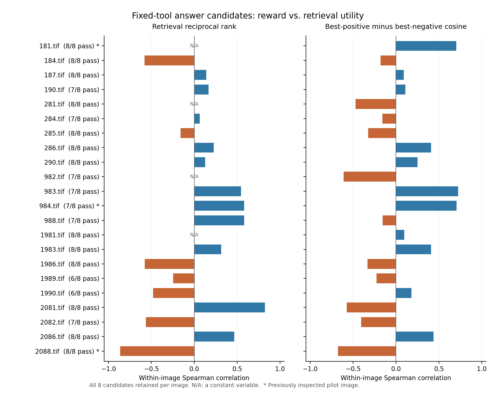

# 22图固定工具回答与奖励一致性结果（2026-11-13）

本轮已完成 E1 中全部 22 幅已确认 val 图像的固定真实工具回答实验，共生成 176 个候选。原检索奖励与最终 AGSE 检索收益的逐图平均同向率为 **52.56%**，图像层面 95% bootstrap 区间为 **37.17%–67.49%**，逐图平均 Spearman 相关系数为 **0.0313**。这些结果显示，在本轮固定工具回答条件下，原奖励与实际检索收益的关联较弱，当前证据仍不足以支持稳定的正向关系。

## 1. 本轮与 E1、E3-1 的对应

E1 提供已经确认的图像、数量对照描述和最终 AGSE 模型，本轮沿用其中 22 幅 val 图像，并重算每图两种句式的正确描述与错误描述之差。E3-1 提供恢复后训练并冻结的检索代理评分器及其图库，本轮用该代理给同一图像的不同回答状态评分，再与最终 AGSE 检索收益配对比较。这样可以观察代理奖励较高的回答，是否也带来较高的下游收益。

上一轮 3 图已被检查过，因此本轮同时单列新增 19 图结果。22 图主结果、19 图结果、格式合格子集和统计规则均在生成前固定于[预先固定方案](预先固定方案.json)。

## 2. 固定方案与实际执行

- 图像为 E1 已确认的全部 22 幅 UCM val 图像；Arrow 行号为 10、13、16、18、19、22、23、24、28、93、94、95、99、190、192、195、198、199、200、201、205、207。
- 沿用历史主 LoRA。每次 rollout 先由实验提供规范的 `scene_classify` 调用，实际执行一次冻结 CLIP 与场景头，并将真实工具结果放入上下文；随后仅采样回答续写。
- 每图 8 个候选，随机种子 0–7，温度 1.0，每次单独调用生成，`min_new_tokens=1`、`max_new_tokens=64`。失败和重复结果全部保留，候选各生成一次。
- 每图额外生成 1 条相同工具上下文下的贪心参考回答、1 条 seed 0 重复回答，因此共保存 220 条生成记录；评分时加入 22 条历史 E1 先验，共 242 条。
- 注入状态采用原离线 rollout 的最后一次生成、最后解码步、最后层、最后位置，形状为 `[3584]`、BF16。当前 GRPO 的完整序列前向状态提取另有实现；本轮记录的状态规则与离线评估一致，后续训练衔接仍需专门核对。
- 原检索奖励为代理图库内目标图像排名的倒数，`R_retrieval=1/(1+rank0)`；总奖励为它与格式奖励之和，完整 `<answer>...</answer>` 的格式奖励为 0.2。
- 实际检索收益使用冻结最终 AGSE 模型，在 391 条按原始字符串去重的 val 描述中检索。该图像任一原始标注描述均为正例，主指标为最佳正例排名的倒数 RR；次指标为最佳正例与最佳负例的余弦间隔，以及 E1 句式 A/B 的数量对照间隔。
- 22 图每图 28 对候选，主指标共 616 对。奖励严格相等记并列，RR 容差为 1e-12，余弦间隔容差为 1e-6；余弦 Spearman 使用六位小数与平均秩。
- 主汇总先逐图计算同向率，再对有信息候选对的图像等权平均。区间按图像重采样 10,000 次，种子 20261113，取百分位 2.5% 和 97.5%；每个子组的无定义次数保存在统计 JSON 中。

本轮服务器为 A100-SXM4-80GB，复用 `/private` 下环境。Python 3.12.6、PyTorch 2.4.1+cu124、Transformers 4.57.2、PEFT 0.10.0。生成、评分和初步分析均以退出码 0 结束，耗时约 450 秒；生成阶段 PyTorch 峰值分配约 17.38 GiB。完整环境见归档中的 `environment_witness.json`。

## 3. 生成质量与复现

176 个候选中，165 个通过预定质量检查（93.75%），11 个格式失败，其中 9 个达到 token 上限；空轨迹与 `addCriterion` 均为 0。每个候选均执行一次真实工具。22 条贪心参考均通过质量检查。每图内部合计有 175 个独特回答和 175 个独特状态，重复项按原计划参与统计。

22 次 seed 0 重复检查中，状态、生成 token 与工具结果均相同。历史 3 图的 30 条生成记录也与上一轮状态及文本完全一致；33 条公共评分的余弦间隔差为 0，代理排名和实际检索排名均相同。391 条 val 文本特征逐位复用；另复用 12 条既有数量描述特征，仅新增编码 16 条数量描述，保持跨轮比较的文本基准。

## 4. 逐图统计

下表为图像等权汇总；方括号为按图像 bootstrap 的 95% 区间。“有效图像”表示该指标具有可比较的奖励与收益变化。22 图 RR 主结果有 18 图提供信息，另 4 图的 8 个候选 RR 相同。

| 条件与收益指标 | 有效图像 | 平均同向率及95%区间 | 平均Spearman及95%区间 |
|---|---:|---:|---:|
| 22图，全部候选 | 18 | 52.56% [37.17%, 67.49%] | 0.0313 [-0.1939, 0.2524] |
| 新增19图，全部候选 | 16 | 52.88% [38.10%, 67.33%] | 0.0529 [-0.1622, 0.2642] |
| 22图，格式合格候选 | 15 | 41.09% [25.53%, 56.72%] | -0.1342 [-0.3845, 0.1188] |
| 22图，全部候选，总奖励 | 18 | 44.37% [28.26%, 60.23%] | -0.0854 [-0.3189, 0.1432] |
| 22图，全部候选，余弦间隔 | 22 | 50.56% [43.12%, 58.09%] | -0.0003 [-0.1757, 0.1790] |
| 22图，全部候选，E1句式A | 22 | 49.47% [42.22%, 56.89%] | -0.0024 [-0.1823, 0.1840] |
| 22图，全部候选，E1句式B | 22 | 46.55% [38.72%, 54.22%] | -0.0726 [-0.2454, 0.0972] |

主指标的 616 对中，137 对同向、133 对反向、37 对仅奖励并列、287 对仅收益并列、22 对两者均并列。可比较的 270 对合并同向率为 50.74%。该比例与图像等权均值使用不同汇总方式，报告中分别列出。

原检索奖励与 RR 的逐图相关有 11 图为正、7 图为负、4 图因 RR 固定而无定义；与余弦间隔的相关有 11 图为正、11 图为负。新增 19 图的平均同向率为 52.88%，区间仍覆盖 50%，其平均相关也接近 0。格式合格子集的方向有所下降且区间较宽，余弦指标整体接近 50%。各项结果共同提示，当前奖励与下游检索收益的关联在图像间存在明显差异。

在 RR 有变化的 18 图中，按原检索奖励最高值选出的候选集合包含收益最佳候选的图像为 10 幅，其中 9 幅的所有奖励并列最高候选均达到最佳 RR；余弦间隔对应为 7/22。该计数描述候选集内覆盖情况，下一轮将通过明确的并列选择规则与参考策略比较实际平均收益。



图中使用原检索奖励和全部 8 个候选，蓝色表示正相关，橙色表示负相关；标签给出质量检查通过数量，星号标记上一轮 3 图，N/A 表示变量固定。逐图数据、合格子集、总奖励及全部次指标见[逐图指标汇总](逐图指标汇总.csv)和[完整统计](完整逐图统计与重采样.json)。

## 5. 独立核验和证据位置

服务器与本机各自从保存张量重算了奖励、排名、收益和参考差值，核验均通过。独立统计脚本使用 SciPy 重算 330 项有定义相关、核对 22 项无定义相关，重算 9,256 对包含全部与质量子集的候选比较，并复算 96 组 bootstrap 区间。主配对 CSV 含 4,928 行，覆盖 2 种奖励与 4 种收益的全部配对。

原有项目 8 个源文件与本轮启动前固定的 8 个脚本哈希均在结束时再次核对。44 组 E1 历史数量描述评分在相同输入下完成 CPU 回算，最大单项分数误差为 2.38e-7。原始结果和检查点保持原文件。

关键 SHA-256：

| 对象 | SHA-256 |
|---|---|
| 本轮固定方案 | `fb5adc4de0f84f78fb69d8995bd2342b18763182f88ccd093a7d028b9f1403bf` |
| 冻结代理评分器 | `e36801d50807519273408e4caf18604ad2f43db2c7b520cee98675631eac9a59` |
| 代理图库 | `26cef629ac01ef90ea7bc7d8606bd92e513d776c3e8e3351b0ae523afa0a0b29` |
| 最终 AGSE 模型 | `09ef20e0b354efbf8a7d4d49105cd92e1ae9412b3ea58820961265a065a874dc` |
| 242条评分JSON | `5c3cc7067a7cc8520ca42601f8801df311f11848897479282ac3d5102c9a0b83` |

本目录保留可阅读的方案、CSV、统计 JSON、绘图与验证脚本及本机核验记录。`原始运行记录/` 保留逐条回答、完整工具上下文、状态、分数矩阵和环境日志。最终证据归档 `fixed_tool_22_evidence_20261113.tar.gz` 含运行记录和独立核验输入，另以 `备份校验.json` 记录归档及逐文件校验结果。服务器目录为 `/private/AGSE_E3_1_rebuild_20261112/fixed_tool_22_20261113`；最终归档也保存于其上级私有目录。

离线核验时，在本目录执行（需要 PyTorch、NumPy、SciPy）：

```bash
python3 verify_saved_pilot.py --run 原始运行记录 \
  --proxy-cache 原始运行记录/verification_inputs/grpo_val_cache_rebuilt_last50.pt \
  --text-cache 原始运行记录/verification_inputs/pilot_scoring_tensors.pt \
  --text-cache-gallery 原始运行记录/verification_inputs/pilot_text_gallery.json \
  --out 离线重核结果.json
python3 verify_statistics.py --run 原始运行记录 --out 离线统计重核结果.json
```

## 6. 结论与下一步

本轮把固定真实工具后的回答配对从 3 图扩展到全部 22 图。主指标、独立 19 图检查及次指标均显示较弱的奖励—检索收益关联，区间仍较宽。本轮样本来自已确认的 E1 val 图像，每图使用第一条描述，工具调用由实验固定，结论对应这组条件。

建议下一步直接利用保存的 176 个候选，比较“按原检索奖励选取”“按总奖励选取”“贪心参考”“均匀随机选取的期望收益”和“候选集收益上界”。事先固定奖励并列时均匀选取的期望值，按图像计算收益差和区间，并分别报告新增 19 图及质量合格子集。该步骤可在本机离线完成，用于回答原奖励能否在实际选择时改善检索，再据结果决定训练调整方案。

## 附：全部失败候选

| 候选ID | 图像 | 达到token上限 | 停止类别 |
|---|---|---|---|
| 18_candidate_0 | 190.tif | 是 | format_failure |
| 22_candidate_6 | 284.tif | 是 | format_failure |
| 93_candidate_1 | 982.tif | 是 | format_failure |
| 94_candidate_3 | 983.tif | 是 | format_failure |
| 95_candidate_3 | 984.tif | 是 | format_failure |
| 99_candidate_3 | 988.tif | 是 | format_failure |
| 198_candidate_2 | 1989.tif | 否 | format_failure |
| 198_candidate_3 | 1989.tif | 是 | format_failure |
| 199_candidate_2 | 1990.tif | 否 | format_failure |
| 199_candidate_3 | 1990.tif | 是 | format_failure |
| 201_candidate_3 | 2082.tif | 是 | format_failure |
