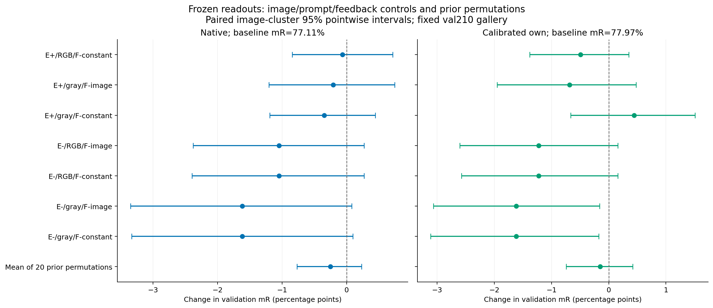
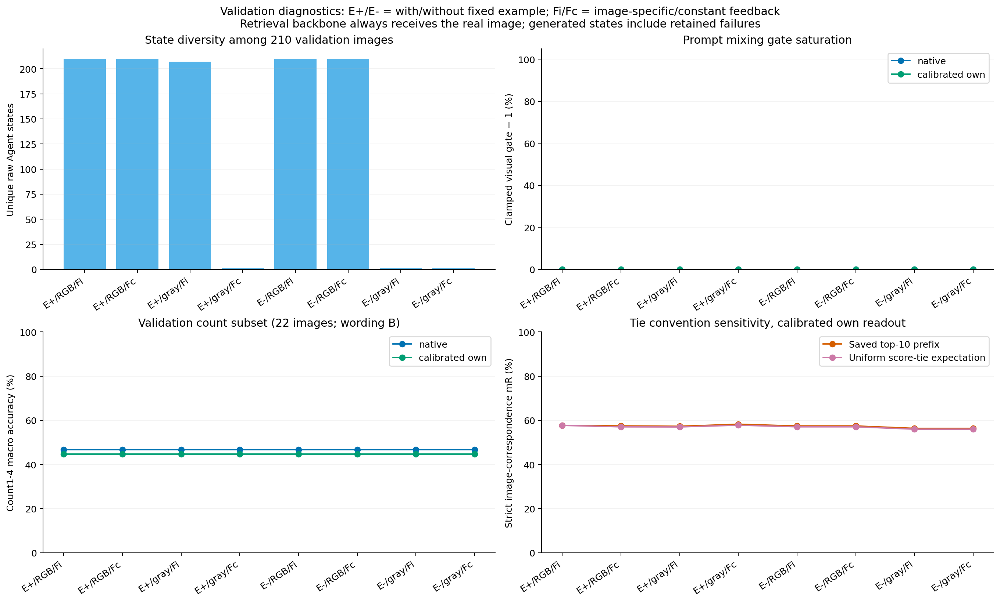

# 图像依赖性与提示对照诊断结论（2026-11-16）

本阶段完成273图三因素八条件、20次完整划分内先验置换及64组冻结读出前向。生成逻辑状态2184份：复用基线273份，实际新增生成1367次，同条件等价输入复用544份，另精确重放两张锚点。Agent与读出端新增优化更新均为0。

校准自身模型在完整val210上的主协议基线mR为77.97%；20次置换的均值相对基线变化-0.15个百分点（相对变化-0.19%），配对95%区间[-0.74, +0.42]。校准自身模型的置换差异区间覆盖0，逐图先验对应信息的额外收益继续待验证。

去示例四条件累计1092个逻辑案例被控制器标记为模型自行输出工具结果标签；这些条件的实际工具请求为0。有示例四条件中，每个逻辑案例均保留一次模型工具请求及已回放反馈；灰图加常量反馈按等价输入复用相同计算。提示示例的协议作用成为本轮新增的直接证据，代表轨迹见 `protocol_witnesses.json`。

## 1. 实验对象、输入控制与范围

完整val210用于检索及状态诊断，train63沿用原数量清单。数量评分覆盖原85图，其中val22用于验证子集分析；各对象及句式只比较对应的3–7个数量候选，共用56条固定文本库存。人工标签原表副本及SHA见 `inputs/label_provenance/`。

三因素分别为固定港口示例有/无、Agent图像真实/灰色127、工具反馈逐图记录/训练102.tif常量。灰图保留256×256尺寸，检索骨干持续读取真实图像。工具反馈只在模型请求scene_classify时回放，逐图文本及置信度取自已核验的原始真实分类轨迹；常量取训练102.tif。最终轮请求后尚未进入下一次生成的反馈另计，反馈暴露情况见第4节。

20次置换在完整train1680与val210中分别生成，拒绝所有含固定点的置换；每次保持先验向量多重集合完全相同。训练数量子集按完整训练划分的置换取源向量。四个读出检查点沿用上一阶段val选择，全部参数冻结，原生与校准自身各28条件，共享与可学习视觉提示各4个实现对照。

父阶段完整性核验读取既有test产物和三份Arrow的字节哈希；本阶段的生成、评分与方案比较使用train/val。旧test指标及评分矩阵保持封存。当前val沿用读出模型选择所用划分，结果用于固定模型诊断。

## 2. 完整val210检索结果

主协议沿用重复token描述的等价正例。原严格图像对应使用保存的top-10前缀；补充协议对每个K处的完全同分项按等概率选择计算期望命中率。并列处理方案在新评分结果产生前单独封存，见 `tie_sensitivity_plan.json`。

| 生成条件 | 原生自身主mR | 校准自身主mR | 校准自身严格mR | 校准自身同分平均严格mR |
|---|---:|---:|---:|---:|
| 有示例／真实图／逐图反馈 | 77.11 | 77.97 | 57.70 | 57.67 |
| 有示例／真实图／常量反馈 | 77.05 | 77.48 | 57.44 | 57.02 |
| 有示例／灰图／逐图反馈 | 76.90 | 77.29 | 57.29 | 56.97 |
| 有示例／灰图／常量反馈 | 76.76 | 78.41 | 58.21 | 57.76 |
| 去示例／真实图／逐图反馈 | 76.06 | 76.75 | 57.43 | 57.03 |
| 去示例／真实图／常量反馈 | 76.06 | 76.75 | 57.43 | 57.03 |
| 去示例／灰图／逐图反馈 | 75.49 | 76.35 | 56.35 | 55.96 |
| 去示例／灰图／常量反馈 | 75.49 | 76.35 | 56.35 | 55.96 |

| 固定读出 | 协议 | 20次置换mR均值 | 相对正确配对变化（百分点） | 配对95%区间 |
|---|---|---:|---:|---:|
| 原生自身 | 仓库主协议 | 76.86 | -0.25 | [-0.77, +0.23] |
| 原生自身 | 原严格 | 56.92 | -0.95 | [-1.70, -0.20] |
| 原生自身 | 同分平均严格 | 57.30 | -0.32 | [-0.78, +0.13] |
| 校准自身 | 仓库主协议 | 77.82 | -0.15 | [-0.74, +0.42] |
| 校准自身 | 原严格 | 57.78 | +0.09 | [-0.76, +0.91] |
| 校准自身 | 同分平均严格 | 57.66 | -0.01 | [-0.58, +0.54] |

原生读出中，原严格对应的置换变化为-0.95个百分点、区间[-1.70, -0.20]；同分平均后为-0.32个百分点、区间[-0.78, +0.13]。严格对应的区间判断随并列处理约定发生变化，后续同时核对两者。

置换均值的配对区间按验证图像成组重采样10000次，同图5条描述共同抽样，图库固定；20次置换之间的标准差、极值及逐次指标单列在 `analysis.json`。区间对应固定模型及这20次置换的图像抽样不确定性。所有对照与名义逐项95%区间均保留。

## 3. 三因素平均变化与数量诊断

去示例条件未请求工具，分配的两类反馈均未进入实际生成；反馈因素的平均变化需结合这一暴露情况解释。下表中的每个因素变化，均对另外两个因素的四种组合取平均。简单条件相对基线的区间及全部186组检索区间、248组数量区间见 `analysis.json`。

| 校准自身读出因素变化 | 主协议mR变化（百分点） | 配对95%区间 |
|---|---:|---:|
| 去除固定示例 | -1.24 | [-2.35, -0.14] |
| Agent图像改为灰图 | -0.13 | [-0.89, +0.64] |
| 改为训练102.tif常量反馈 | +0.16 | [-0.27, +0.57] |

| 生成条件 | 原生val22 B宏平均 | 校准val22 B宏平均 | 校准train60 B宏平均 |
|---|---:|---:|---:|
| 有示例／真实图／逐图反馈 | 46.63 | 44.71 | 40.06 |
| 有示例／真实图／常量反馈 | 46.63 | 44.71 | 40.75 |
| 有示例／灰图／逐图反馈 | 46.63 | 44.71 | 41.85 |
| 有示例／灰图／常量反馈 | 46.63 | 44.71 | 46.11 |
| 去示例／真实图／逐图反馈 | 46.63 | 44.71 | 45.02 |
| 去示例／真实图／常量反馈 | 46.63 | 44.71 | 45.02 |
| 去示例／灰图／逐图反馈 | 46.63 | 44.71 | 46.11 |
| 去示例／灰图／常量反馈 | 46.63 | 44.71 | 46.11 |

校准自身模型的八个生成条件在val22的B全候选宏平均均为44.71%。

数量1–4等权，val样本数为13/2/3/4，train为5/36/14/5。train60属于读出训练内诊断；其余3张训练图的全部指标也保留。数量配对区间在每个真实数量层内同步重采样，A/B句式、成对与全部候选指标及原始分差完整保存。

## 4. 原始状态、轨迹与读出路径

| val生成条件 | 唯一状态数 | 中心化RMS | 轨迹可用规则通过 | 实际请求工具图数 | 已进入后续生成的反馈数 |
|---|---:|---:|---:|---:|---:|
| 有示例／真实图／逐图反馈 | 210 | 0.4923 | 210/210 | 210/210 | 210 |
| 有示例／真实图／常量反馈 | 210 | 0.8668 | 206/210 | 210/210 | 210 |
| 有示例／灰图／逐图反馈 | 207 | 1.1781 | 195/210 | 210/210 | 210 |
| 有示例／灰图／常量反馈 | 1 | 0.0000 | 210/210 | 210/210 | 210 |
| 去示例／真实图／逐图反馈 | 210 | 0.3829 | 0/210 | 0/210 | 0 |
| 去示例／真实图／常量反馈 | 210 | 0.3829 | 0/210 | 0/210 | 0 |
| 去示例／灰图／逐图反馈 | 1 | 0.0000 | 0/210 | 0/210 | 0 |
| 去示例／灰图／常量反馈 | 1 | 0.0000 | 0/210 | 0/210 | 0 |

| 固定读出与条件 | 门控均值 | 门控等于1比例 | 图像特征最大绝对变化 |
|---|---:|---:|---:|
| 原生自身：有示例／真实图／逐图反馈 | 0.0000 | 0.00% | 0 |
| 原生自身：有示例／灰图／逐图反馈 | 0.0000 | 0.00% | 0.0948 |
| 原生自身：去示例／真实图／逐图反馈 | 0.0000 | 0.00% | 0.0559 |
| 原生自身：去示例／灰图／常量反馈 | 0.0000 | 0.00% | 0.0626 |
| 校准自身：有示例／真实图／逐图反馈 | 0.0000 | 0.00% | 0 |
| 校准自身：有示例／灰图／逐图反馈 | 0.0000 | 0.00% | 0.0894 |
| 校准自身：去示例／真实图／逐图反馈 | 0.0000 | 0.00% | 0.0719 |
| 校准自身：去示例／灰图／常量反馈 | 0.0000 | 0.00% | 0.086 |

轨迹可用规则按完成答案、格式及预算检查计算，异常轨迹与状态全部保留。词项出现率属于生成文本描述统计。原始向量的离散程度、投影变化、门控饱和率及图像特征变化分别保留，检索与数量任务按真实标签评分；轨迹统计记录协议执行和词项出现，生成描述的语义正确性标记为[待确认]。

原代码的提示融合为 `(1−g)×Agent先验提示 + g×可学习视觉提示`。两种自身读出在本轮val条件中g均为0，当前路径使用Agent投影提示；后续继续核查该状态及投影保留的图像信息。

四个基线的图像/文本特征与父阶段精确一致。共享及可学习视觉提示两个实现对照各4条件的图像特征完全一致。独立核验用原检查点的线性层、LayerNorm和门控权重从已保存输入重新计算路径，同时核对全部18880个先验来源及数值SHA。

## 5. 核验与保存

服务器与本机分别核验2184条生成记录及64组冻结前向的保存结果，重建40个完整划分置换，并从原始张量重算1344项检索指标、1536项数量汇总、186组检索区间及248组分层数量区间。float64重算缩放分数的最大绝对误差为3.02e-05，投影为1.16e-06，门控为4.55e-07。原始源码、模型、数据及父阶段证据保持原哈希。

独立审阅及原始响应见 `EXPERIMENT_AUDIT.json` 与 `.aris/traces/experiment-audit/`；语义审阅标注same-family/provisional。单种子、既定读出检查点、验证图库及小规模数量子集构成本轮证据范围。完整原始记录在本机与/private双端保存，SHA见旁路 `备份校验.json`；既有四组读出检查点归档继续由父阶段备份引用。

## 6. 下一阶段安排

校准自身模型的置换差异区间覆盖0，逐图先验对应信息的额外收益继续待验证。

下一轮优先核查工具结果角色与训练监督掩码，比较中性格式示例、多场景轮换示例与当前提示，验证实际工具请求、真实回填及完成答案的比例。随后固定模型比较候选状态的图像信息可读性：以当前末有效解码状态作基线，核对实际生成中工具回填后首步及答案片段状态的位置和数值，保持相同图像、查询及预算。通过正确配对、同分布置换、共享状态三组对照检查检索与数量变化，再据证据确定状态与奖励方案。候选状态的位置定义和精确预算在控制器核对后封存，train/val用于开发，既有test记录继续保存。
