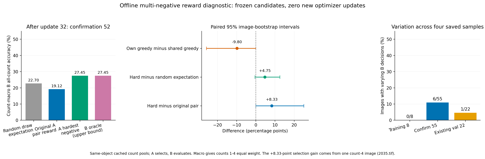

# 多负例数量奖励离线诊断（2026-11-15）

本阶段在本机CPU复用上一阶段的1148条冻结状态与评分，重建12616条数量文本分数、1190行逐图选样结果和1260组区间。新增策略更新数为0，新增生成轨迹数为0。

在固定第32步策略的训练图外确认集上，原A句对奖励与A最难负例奖励选出的B全数量判对率分别为 **19.12%和27.45%**，数量宏平均变化 **+8.33个百分点，95%区间[+0.00, +25.00]**。这8.33个百分点全部来自 `2035.tif` 这一张数量为4的图。预先登记的7项后续训练条件通过4项。下一节点先检查采样覆盖与跨图先验作用。

## 1. 冻结输入与数量候选

使用 [方案](plan.json) 中封存的父证据SHA-256及9份本机输入副本，父证据为 `balanced_quantity32_evidence_20261115.tar.gz`。冻结下游AGSE、56条数量文本特征和1148条图像特征沿用上一阶段。输入包括初始策略425条自身轨迹、第32步425条自身轨迹、170条共享先验控制及128条训练采样。每个固定策略有85组“每图4条采样”，合计170组；原训练过程另有32组。

所有负例来自缓存中同一对象的其他数量描述；A和B两种写法分别构造候选池，覆盖如下：

| 对象 | 缓存数量候选 | 每个正例的错误数量数 |
|---|---|---:|
| airplanes | 1, 2, 3, 4, 5 | 4 |
| baseball fields | 1, 2, 3 | 2 |
| sand bunkers | 1, 2, 3, 4 | 3 |
| houses | 1, 2, 3 | 2 |
| storage tanks | 1, 2, 3, 4, 5, 6, 7 | 6 |
| tennis courts | 1, 2, 3, 4, 5, 6 | 5 |

原人工数量和对象映射逐项匹配原句对列号。原句对指标检查指定错误数量；本阶段全数量指标要求人工数量的分数严格大于同对象全部已缓存错误数量的分数，平分记为未通过。确认55图中数量1–4共52图用于宏平均，各数量占四分之一；数量6/7另在图像等权结果保留。既有val22图单列补充。

## 2. 奖励定义与选样方式

原间隔为正例分数减去原指定负例分数；最难负例间隔为正例分数减去全部已缓存错误数量的最高分；平均负例间隔为正例分数减去错误数量的均值。三种奖励均为 `0.2 × 质量合格 + A间隔`。A写法用于定义选样，B写法用于核对选样结果；B预言机使用B最难负例间隔，仅描述当前候选池上限。

选样使用每图4个实际候选，最高奖励平分时选种子最小者。质量优先方式先保留质量合格候选，再按间隔选取；整组无合格候选时回退到全部候选。随机期望取4个候选的指标均值，贪心使用原保存轨迹。全部失败候选保留。

下面给出第32步策略的B全数量判对率，均为数量1–4宏平均：

| 选择方式 | 原8训练图 | 确认52图 | 既有val22图 |
|---|---:|---:|---:|
| 4条采样平均（随机选取期望） | 25.00% | 22.70% | 28.85% |
| 贪心轨迹 | 25.00% | 17.65% | 22.60% |
| 原A句对奖励选样 | 25.00% | 19.12% | 35.10% |
| A最难负例奖励选样 | 25.00% | 27.45% | 35.10% |
| A平均负例奖励选样 | 25.00% | 19.12% | 35.10% |
| 质量优先+A最难负例 | 25.00% | 27.45% | 35.10% |
| B预言机（候选上限） | 25.00% | 27.45% | 35.10% |

确认集最难负例选样相对4条随机期望的变化为 **+4.75个百分点，95%区间[-0.49, +12.56]**。最难负例选样的严格格式合格率为 **100.00%**。

## 3. 收益来源与候选覆盖

确认集55组中，最难负例奖励改变了30组的选择；B全数量判对率发生改善的是 `2035.tif`。该图人工数量为4，其余两张数量为4的确认图保持原判别结果，因此单图改善在数量宏平均中占8.33个百分点。其四条完整轨迹、A/B数量分数和人工事实复核占位保存在 [关键案例](decisive_case_2035.json) 和 `case_traces/`。所选生成文本的事实准确性保持 `[待确认]`。

确认集只有6/55张图在现有4个候选间出现B全数量二值判别变化；原8训练图为0/8，既有val为1/22。原8训练图上，原句对选择、最难负例选择和B候选上限的宏平均全数量判对率均为25%。原32次实际训练采样组中，B全数量判别变化为2/32组，最难负例与原句对的候选选择差异为6/32组。

另一方面，确认集每组4个生成隐藏状态均不同，候选图像特征的最大L2距离为1.074710，最小余弦为0.422499。A最难负例间隔的组内极差中位数为0.003208。这些连续变化与稀少的二值变化共同支持下一步先检查候选覆盖及状态对数量评分的作用。

确认集A最难负例间隔与B最难负例间隔的组内排序一致性为0.600，原A句对间隔与B最难负例间隔为0.345；该量在每组内排除任一分数平分的候选对，以同向记+1、反向记−1后取组均值，再对图像平均。它提供奖励方向的诊断信息。

## 4. 自身与共享先验

第32步策略在确认集上，贪心自身先验相对固定 `102.tif` 共享先验的B全数量宏平均变化为 **-9.80个百分点，95%区间[-25.74, +0.00]**；连续最难负例间隔变化为 **+0.00001277**，区间 **[-0.00045144, +0.00050609]**。

其中 `151.tif`、`2035.tif` 和 `2046.tif` 的共享先验通过全数量判别，自身先验未通过。逐图状态哈希、特征距离和预测数量见 [自身/共享敏感性表](own_shared_state_sensitivity.csv)。这也说明原指定句对相同的二值结果下，其他错误数量仍可能改变完整排序。

## 5. 统计、数值复核与后续条件

图像是重采样单位，配对比较在图像内计算差值，数量宏平均在数量1–4各层内重采样10,000次，主种子2026111556。原8训练图、确认55图和既有val22图分别统计。区间描述当前固定候选和图像集合的选样变化。

冻结float32分数与保存图像/文本特征的float64点积最大差为4.43e-08，全部2296个A/B全数量判别及预测数量的数值复核变化为0。原32组优势按保存的GPU float32均值和标准差重建，最大误差为0；新奖励的优势是CPU float32离线反事实记录，见 [训练奖励重放](training_reward_replay.csv)。独立程序重新核对1190行选样、1260组区间和384条优势。

| 预先登记条件 | 结果 |
|---|---|
| 每类对象至少2个错误数量 | 通过 |
| 原8训练图每数量2图 | 通过 |
| 确认集：最难负例优于原句对，区间下界为正 | 未达成 |
| 确认集：最难负例优于随机期望，区间下界为正 | 未达成 |
| 确认集：自身先验优于共享先验，区间下界为正 | 未达成 |
| 最难负例选样严格质量至少95% | 通过 |
| 原8训练图的选样宏平均变化至少0 | 通过 |

## 6. 下一节点与保存

下一阶段固定原8训练图和SFT第30步/均衡第32步两个策略，每图每策略采样16条，共256条新轨迹，保持策略更新数为0。对每个采样序号构造8幅目标图×8个来源图先验的完整评分网格，并复用16条既有贪心轨迹构造对应网格，共2176条评分；比较候选覆盖、A/B排序，以及自身先验相对其余7个来源先验均值的差值。

后续使用原8训练图进行机制核对，已有确认和val结果作为本阶段记录封存。两个检查点固定，A100正式执行前核对私有挂载、原环境、模型哈希和实际生成状态。预案见 [采样覆盖与先验置换预案](采样覆盖与先验置换预案_20261115.json)。

本阶段输入、源码、CSV、图和核验报告归档为 `multineg_quantity_offline_evidence_20261115.tar.gz`；来源和逐文件校验见 `input_verification.json`、`file_checksums.json` 和 `备份校验.json`。完整重放步骤见 [复现说明](复现说明_20261115.md)。
