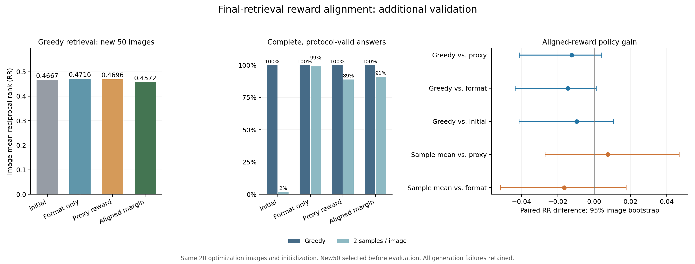

# 奖励对齐与新增验证结论（2026-11-14）

本阶段已完成：**最终 AGSE 检索间隔奖励训练、四个模型点在新增 50 图和旧 22 图上的统一评估、独立复算与模型备份。** 预设扩大训练条件未达到。建议保留本轮检查点，暂缓扩大训练，下一节点优先完成训练奖励库与验证库分离，并设计同场景困难负样本的小规模对照。

这轮将 E3-1 的奖励一致性诊断推进到一次 E3-2 小规模训练预实验：直接使用最终图文检索器给出的正负例间隔训练生成策略，再查看固定检索器下的实际 RR。完整统计见 [analysis.json](analysis.json)。

## 1. 方案、数据来源与本轮目标

实验方案在训练和新增验证评估前固定，SHA-256 为 `2d9947a2cadc07b4cb3ddd8b997a96bc684b1a6093e487b1585238df982f8f89`。主指标为新增 50 图的贪心图像平均倒数排名（RR），核心比较为对齐奖励模型相对原代理奖励模型、相对仅格式奖励模型。旧 22 图作为次要诊断。

| 项目 | 设置 |
|---|---|
| 共同初始化 | 同一原始 LoRA，初始适配器参数哈希 `e380e96cda478a157d07de13c6a61a0357aa18e2cd07f8683a93d5673af49d2c` |
| 实际优化图像 | 沿用上一阶段固定的 20 张 UCM val 图像 |
| 先验生成输入 | 每幅图像及其第一条原始描述，按图像与首条描述生成缓存 |
| 新增 50 图 | 在原 210 张中排除训练 20 张和旧 22 张后，从剩余 168 张用种子 20261114 随机抽取 |
| 数据核验 | 新增 50、旧 22、训练 20 三组行号分离，图像二进制哈希交集均为零 |
| 新奖励 | `0.2 × quality_usable + max(正确描述余弦) − max(其余描述余弦)` |
| 文本图库 | 沿用原始 391 条唯一 val 描述；每图的全部有效原始描述均作为正例，其余列作为负例 |
| 冻结评分器 | 最终 AGSE 检查点与全部原文本特征固定；原代理评分器也固定用于统一复算 |
| 训练 | 20 组 × 4 条轨迹，AdamW，学习率 5e-6，weight decay 0.01，梯度裁剪 1.0 |
| 概率与状态 | 沿用已验证的真实工具、EOS、padding、有效 assistant log probability 和隐藏状态缓存实现 |
| 模型精度 | 基座 BF16，LoRA FP32，运行时 dropout 为 0 |
| 评估 | 四模型点 × 72 图 ×（1 条贪心＋种子 0、1 两条采样），共 864 条 |
| 原始轨迹复用 | 三个旧模型点在旧 22 图的 198 条轨迹复用原文件并重新评分；其余 666 条新生成 |
| 检查点选择 | 第 20 次训练尝试后的最终检查点；既有两个对照检查点在新增 50 图抽取前固定 |
| 统计 | 每图等权；10,000 次图像配对 percentile bootstrap，种子 20261114 |

本轮训练奖励图库沿用完整 val 描述，包含新增 50 图的文本；原代理图库沿用原 210 张图像。此次图像划分排除了直接策略优化的重叠，实验结论定位为既有图库与初始化条件下的机制诊断。后续正式方法实验应重新固定训练来源的奖励图库，并使用分离的验证图文集合。

## 2. 实际训练结果

对齐组完成 20 次尝试、**20 次实际更新**；训练轨迹合格 73/80，真实工具调用 74 次。20 组中，15 组的四条轨迹全部合格，3 组为三条合格，2 组为两条合格；全合格组仍根据间隔差异产生更新。

80 条训练先验的间隔范围为 [-0.05196959, 0.04482198]。所有更新的梯度范数均为有限正值，冻结检索器保持 eval 与无梯度状态。训练耗时 5.12 分钟，最大 PyTorch 分配显存 20.51 GiB。对照组沿用前一阶段相同 20 组预算：原代理奖励组实际 18 次更新，格式组实际 7 次。

初始模型、三个训练模型采用相同新推理流程。最终对齐 LoRA 参数哈希为 `72f72b5b1eff9bb4f5207117365ddb6ba46e465384f2a754571ef7ad8eb14372`；保存重载与本机模型备份还原后的参数哈希一致。

## 3. 主结果：新增 50 图

| 模型点 | 实际更新 | 贪心平均 RR | 贪心合格率 | 采样平均 RR | 采样合格率 |
|---|---:|---:|---:|---:|---:|
| 初始 LoRA | — | 0.466744 | 100.00% | 0.562812 | 2.00% |
| 仅格式奖励 | 7 | 0.471638 | 100.00% | 0.491652 | 99.00% |
| 原代理检索＋格式奖励 | 18 | 0.469565 | 100.00% | 0.467645 | 89.00% |
| 最终 AGSE 间隔＋格式奖励 | 20 | 0.457174 | 100.00% | 0.475156 | 91.00% |

采样指标按每图两条取均值后在图像间等权平均。全部生成失败轨迹保留，质量合格率单独呈现。初始模型采样的 RR 应结合相应合格率阅读。

| 对齐奖励模型的配对比较 | 平均 RR 差 | 95% 图像 bootstrap 区间 | 胜/平/负图像数 |
|---|---:|---:|---:|
| 贪心：对齐组 − 初始 LoRA | -0.009570 | [-0.041379, +0.010596] | 5/40/5 |
| 贪心：对齐组 − 原代理检索＋格式奖励 | -0.012391 | [-0.041219, +0.004160] | 3/42/5 |
| 贪心：对齐组 − 仅格式奖励 | -0.014464 | [-0.043470, +0.001157] | 2/43/5 |
| 采样均值：对齐组 − 初始 LoRA | -0.087657 | [-0.187420, +0.012350] | 17/8/25 |
| 采样均值：对齐组 − 原代理检索＋格式奖励 | +0.007510 | [-0.027143, +0.046869] | 16/23/11 |
| 采样均值：对齐组 − 仅格式奖励 | -0.016496 | [-0.051688, +0.017565] | 12/24/14 |

对齐组贪心平均 RR 相对原代理组变化 -2.64%，相对格式组变化 -3.07%。两项配对区间均跨过 0，当前结果支持暂缓扩训。对齐组与原代理组有 42/50 图 RR 相同，与格式组有 43/50 图相同，变化集中在少数图像。

四组贪心合格率均为 100%。采样时，对齐组合格率为 91%，格式组为 99%；配对差为 -8 个百分点，95% 区间 [-13, -3] 个百分点。新奖励下的采样协议稳定性也需要继续改进。

上表区间反映当前一次训练下图像集合的抽样变化。此次只有一个训练随机种子安排，训练随机性的变化仍待后续重复实验检验。

图左为贪心 RR，中间为回答合格率，右侧为对齐组相对各对照的配对 RR 差。每图、每轨迹和余弦间隔统计分别见 [per_image_policy.csv](per_image_policy.csv)、[evaluation_scores.csv](evaluation_scores.csv)、[paired_policy_deltas.csv](paired_policy_deltas.csv)。

## 4. 扩大训练条件与下一节点

运行前固定的条件逐项如下；机器判定保存在 `analysis.json` 的 `decision`。

| 预设检查 | 结果 |
|---|---|
| 贪心 RR 相对原代理奖励的区间下界 > 0 | 未达成 |
| 贪心 RR 相对格式奖励的区间下界 > 0 | 未达成 |
| 贪心平均 RR 至少达到初始模型 | 未达成 |
| 贪心合格率距初始模型至多下降 5 个百分点 | 通过 |
| 已发生优化器更新 | 通过 |

总体判定：**未达到预设扩大训练条件。** 建议保留本轮检查点，暂缓扩大训练，下一节点优先完成训练奖励库与验证库分离，并设计同场景困难负样本的小规模对照。 后续方案保留本轮已验证的真实工具和状态缓存流程，以固定训练预算、格式奖励对照和分离的验证图文集合检验新增收益。

## 5. 旧 22 图的次要诊断

| 模型点 | 实际更新 | 贪心平均 RR | 贪心合格率 | 采样平均 RR | 采样合格率 |
|---|---:|---:|---:|---:|---:|
| 初始 LoRA | — | 0.315562 | 100.00% | 0.301466 | 13.64% |
| 仅格式奖励 | 7 | 0.316288 | 100.00% | 0.317173 | 97.73% |
| 原代理检索＋格式奖励 | 18 | 0.315283 | 100.00% | 0.323500 | 100.00% |
| 最终 AGSE 间隔＋格式奖励 | 20 | 0.314233 | 100.00% | 0.318893 | 100.00% |

| 对齐奖励模型的配对比较 | 平均 RR 差 | 95% 图像 bootstrap 区间 | 胜/平/负图像数 |
|---|---:|---:|---:|
| 贪心：对齐组 − 初始 LoRA | -0.001329 | [-0.007213, +0.002755] | 2/18/2 |
| 贪心：对齐组 − 原代理检索＋格式奖励 | -0.001050 | [-0.004940, +0.002021] | 2/17/3 |
| 贪心：对齐组 − 仅格式奖励 | -0.002055 | [-0.006613, +0.001769] | 2/17/3 |
| 采样均值：对齐组 − 初始 LoRA | +0.017427 | [-0.119521, +0.162404] | 7/6/9 |
| 采样均值：对齐组 − 原代理检索＋格式奖励 | -0.004607 | [-0.013482, +0.001501] | 4/13/5 |
| 采样均值：对齐组 − 仅格式奖励 | +0.001720 | [-0.005347, +0.011369] | 4/13/5 |

这一组已在前期用于诊断，按预设协议单独报告。当前采样均值使用每图两个种子；上一阶段的采样汇总使用四个种子，原始旧轨迹逐文件和重评分锚点均已核对。

## 6. 独立核验、原始记录与备份

服务器与本机分别核对 946 条状态及轨迹、1729 轮生成、783 次真实工具事件、82 条训练及单步检查奖励、864 条统一评估评分及 80 组配对区间。210 张图的正确描述映射从原始 Arrow 元数据重建。另将实际场景工具在训练与验证共 92 张图上重跑，逐事件检查反馈。

本机 CPU float64 重算时，代理排名 864/864 条一致，实际检索排名 864/864 条一致；原始 FP32 相似度下的全部保存排名和奖励精确复核通过。旧模型的 198 条继承轨迹同时核对原状态哈希、代理排名、实际排名与间隔。详见 [服务器核验](服务器独立核验.json)、[本机核验](本机独立核验.json)。

最终模型归档含 12 个文件，本机逐文件核对后，再从 584 个有限 FP32 适配器张量重建参数哈希。详见 [模型备份清单](模型备份清单.json)。本轮新模型保存在本目录 `模型检查点/`；原代理与格式模型保留上一阶段已验证归档。

服务器沿用 A100-SXM4-80GB、PyTorch 2.4.1+cu124、Transformers 4.57.2、PEFT 0.10.0、NumPy 1.26.4。正式六阶段流水线耗时 30.03 分钟，各阶段退出码均为 0。原始代码、模型、val Arrow 与环境兼容文件在运行后再次核对哈希，见 [来源核验](final_source_audit.json)。

首次奖励桥接检查遇到历史 Lightning 回调类的反序列化导入问题，新增加载器补充运行时类名映射后通过检查。失败现场保存在原始记录 `development_attempts/legacy_callback_import/`；正式训练在全部检查通过后启动。

实际训练与验证图像以方案行号列表、元数据及运行断言为准。方案中沿用的 `training.train_prompt_source` 文字仅提及旧 22 张，详细差异及复现命令见 [复现说明](复现说明.md)。

原始材料保存于本机 `原始运行记录/` 和服务器 `/private/AGSE_E3_1_rebuild_20261112/reward_alignment_20261114`；最终取证归档为 `reward_alignment_evidence_20261114.tar.gz`。归档与文件哈希见 [备份校验](备份校验.json)。GitHub 保存本轮方案、代码、汇总数据、图表和核验清单。
