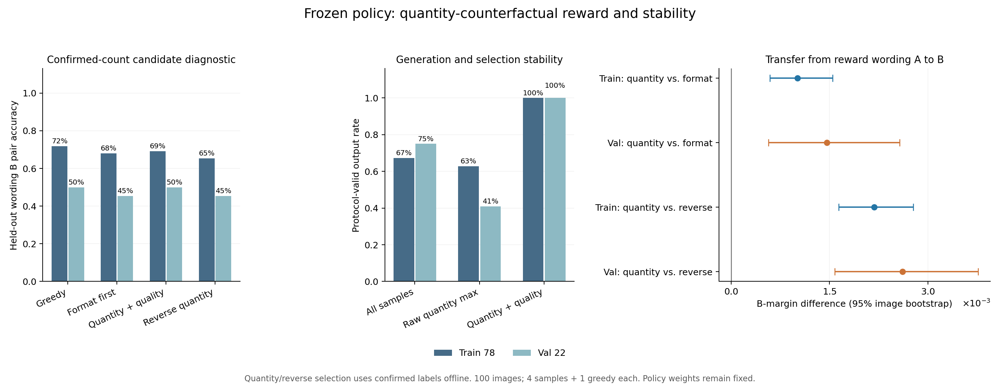

# 数量冲突奖励与生成稳定性诊断（2026-11-14）

本阶段完成 E1 数量负例核验、100 图的 500 条候选生成、A/B 跨写法对照及独立复算。**预设下一轮训练条件未通过。** 下一节点先稳定中性输入下的输出协议，再安排数量奖励短程训练。数量对照和跨写法评价可沿用本轮已核验材料。

本轮策略参数保持固定，优化器更新数为 **0**。数量和反向选择使用已有人工数量标注，测量带标注候选空间中的奖励信号；后续策略训练再检验固定推理流程的变化。

## 1. 已核验的数量负例

采用 E1 去重与补充后的最终 100 图清单，train 78、val 22。100 张图的数量均由用户确认，来源批次与原件哈希保存在 `inputs/`。已发现重叠对按原记录保留 134、1909、1981，移除 135、1910、1980；场地关联信息沿用原 E1 核查范围。

每图包含 A、B 两种写法，每种写法内部的正负描述仅替换一个数词，合计 **200 对明确数量冲突的描述**。真实数量与原人工清单及完整 E1 评分输入逐一对应。举例如下。

| 图像 | 对象 | 已确认数量 | 错误对照数量 | 确认来源 |
|---|---|---:|---:|---|
| 101.tif | 飞机 | 4 | 3 | 第一批人工核验 |
| 1901.tif | 储罐 | 3 | 2 | 第四至七批人工核验 |
| 2008.tif | 网球场 | 2 | 3 | 第三批人工核验 |

与上一轮按其他图像标注建立的候选负例相比，本轮逐对核对了目标数量的互斥关系。A 用作数量奖励写法，B 用作跨写法评价；两种写法共用同一已确认数量和同一个冻结检索器。固定句式及数词集合在 train/val 间共享。

策略模型引用上一轮格式奖励检查点，参数哈希 `c742c8dab5499595fd7b9698faffc4fedccad1befa531ed8a44a354bab0fb0c8`。其上一轮新优化的 19 图与本轮 100 图的交集为零，历史基础模型与冻结检索器沿用既有版本。

## 2. 固定生成与候选选择方案

方案 SHA-256 为 `32c339c693fe7dafa48af4195c9711049094f0518754228d3e9603a27e57e2c6`，在本轮新轨迹生成前固定。

| 项目 | 设置 |
|---|---|
| 生成输入 | 所有图统一采用 `Describe the visible scene.` |
| 数量标签位置 | 用于奖励、评价和分组；实际输入提示逐条核对 |
| 每图轨迹 | 1 条贪心＋4 条温度 1 采样，共 500 条；另有 3 条设备检查轨迹 |
| 采样种子 | `800000 + image_order × 4 + sample_index` |
| 工具 | 真实 `scene_classify`，识别注册调用后执行并用独立消息回填 |
| 生成预算 | 最多 3 轮，每轮最多 256 个新 token，首 token EOS 屏蔽 |
| 先验状态 | 最后一次有效解码步骤、末层末位置；缓存和评分使用同一张量 |
| 冻结检索器 | 原最终 AGSE，检查点哈希 `09ef20e0b354efbf8a7d4d49105cd92e1ae9412b3ea58820961265a065a874dc` |
| 核心主对照 | train 78 上，数量加格式筛选相对格式筛选的 B 数量间隔变化 |
| 统计 | 10,000 次图像配对 percentile bootstrap，种子 2026111418 |

格式筛选选首条协议合格的采样。数量加格式筛选在合格采样中取 A 间隔最大者，反向控制取最小者；无合格采样时三者均回退到贪心轨迹。原始数量最大选择使用全部 4 条采样，用于检查质量筛选的作用。所有失败轨迹保留，4 条采样均值按每图等权计算。

PairAcc 定义为正确数量描述的匹配分数严格高于错误数量描述的比例；间隔为这两个余弦分数之差。协议合格率依据完整非空 answer、结果标签、工具调用格式、生成词及长度/轮数终止规则判定；实际工具调用率另报。

## 3. train 78：数量奖励的跨写法信号

| 选择方式 | A PairAcc | B PairAcc | B 平均间隔 | 协议合格率 | 工具调用率 |
|---|---:|---:|---:|---:|---:|
| 固定策略贪心 | 70.51% | 71.79% | +0.0083125 | 92.31% | 100.00% |
| 4 条采样均值 | 64.10% | 65.06% | +0.0064002 | 67.31% | 64.42% |
| 首条格式合格候选 | 69.23% | 67.95% | +0.0078161 | 100.00% | 96.15% |
| A 数量间隔最大（全部候选） | 82.05% | 79.49% | +0.0103181 | 62.82% | 58.97% |
| 格式合格后取 A 数量间隔最大 | 73.08% | 69.23% | +0.0088283 | 100.00% | 93.59% |
| 格式合格后取 A 数量间隔最小 | 62.82% | 65.38% | +0.0066486 | 100.00% | 87.18% |

| 配对比较 | B 间隔差 | 95% 图像 bootstrap 区间 | B PairAcc 差 | 协议合格率差 |
|---|---:|---:|---:|---:|
| 格式合格后取 A 数量间隔最大 − 首条格式合格候选 | +0.0010122 | [+0.0005888, +0.0015474] | +1.28 pp | +0.00 pp |
| 格式合格后取 A 数量间隔最大 − 格式合格后取 A 数量间隔最小 | +0.0021797 | [+0.0016410, +0.0027783] | +3.85 pp | +0.00 pp |
| 格式合格后取 A 数量间隔最大 − 固定策略贪心 | +0.0005157 | [-0.0001444, +0.0011505] | -2.56 pp | +7.69 pp |
| A 数量间隔最大（全部候选） − 首条格式合格候选 | +0.0025020 | [+0.0017618, +0.0033049] | +11.54 pp | -37.18 pp |

数量加格式筛选相对格式对照的 B 间隔平均变化为 **+0.0010122**，95% 区间 [+0.0005888, +0.0015474]。该区间下界高于 0，A 的候选排序在 B 写法上保留了正向间隔变化。

train 78 中，67 张图同时具有至少两条合格采样和大于 1e-6 的 A 间隔变化，0 张图发生贪心回退。可计算组内 Spearman 的图像数为 67，其 A/B 排序相关均值为 0.785。详细的候选数量、变化范围及成对一致/相反次数见 [候选诊断](candidate_diagnostics.csv)。

## 4. val 22：既有数量诊断样本上的补充结果

| 选择方式 | A PairAcc | B PairAcc | B 平均间隔 | 协议合格率 | 工具调用率 |
|---|---:|---:|---:|---:|---:|
| 固定策略贪心 | 59.09% | 50.00% | +0.0010902 | 95.45% | 100.00% |
| 4 条采样均值 | 67.05% | 59.09% | +0.0026184 | 75.00% | 75.00% |
| 首条格式合格候选 | 54.55% | 45.45% | +0.0013125 | 100.00% | 95.45% |
| A 数量间隔最大（全部候选） | 86.36% | 72.73% | +0.0054484 | 40.91% | 54.55% |
| 格式合格后取 A 数量间隔最大 | 63.64% | 50.00% | +0.0027708 | 100.00% | 95.45% |
| 格式合格后取 A 数量间隔最小 | 54.55% | 45.45% | +0.0001578 | 100.00% | 86.36% |

| 配对比较 | B 间隔差 | 95% 图像 bootstrap 区间 | B PairAcc 差 | 协议合格率差 |
|---|---:|---:|---:|---:|
| 格式合格后取 A 数量间隔最大 − 首条格式合格候选 | +0.0014584 | [+0.0005709, +0.0025714] | +4.55 pp | +0.00 pp |
| 格式合格后取 A 数量间隔最大 − 格式合格后取 A 数量间隔最小 | +0.0026130 | [+0.0015811, +0.0037645] | +4.55 pp | +0.00 pp |
| 格式合格后取 A 数量间隔最大 − 固定策略贪心 | +0.0016807 | [+0.0002877, +0.0028375] | +0.00 pp | +4.55 pp |
| A 数量间隔最大（全部候选） − 首条格式合格候选 | +0.0041360 | [+0.0022905, +0.0064308] | +27.27 pp | -59.09 pp |

这一组采用原 E1 已检查的 val 22 图，作为预先指定的补充诊断。下一轮训练条件只根据 train 78 计算。对于原 391 条 val 描述图库，数量加格式筛选相对格式对照的平均 RR 差为 +0.002621，95% 区间 [-0.003933, +0.011023]。数量句对与完整图库分别保存结果，便于检查两种目标的关系。

图左比较 B 写法的 PairAcc，中间为全部采样及两种数量选择的协议合格率，右侧为跨写法的 B 间隔增益及图像区间。数量选择和反向选择均使用数量标注进行离线诊断。

## 5. 失败类型与训练前置条件

train 的 312 条采样中，协议合格 210 条（67.31%）；102 条失败由 64 条格式失败、36 条模型自产工具结果及 2 条 token 上限终止组成。val 的 88 条采样中合格 66 条（75.00%），其余为 15 条格式失败和 7 条模型自产工具结果。分项与轨迹编号保存在 [失败诊断](generation_failure_diagnostics.json)。

直接在全部采样中按数量间隔取最大值，train 选中 29/78 条协议失败轨迹，val 选中 13/22 条。格式筛选后，100 张图均可取得至少一条合格采样。由此可见，现有候选中存在可用的数量信号，同时原始采样和数量最大选择仍伴随较高的协议失败率。下一阶段先核查格式失败与自产工具结果的实际轨迹，再以独立新版本验证协议约束或格式训练的作用。

数量加格式筛选相对格式对照，B PairAcc 在 train、val 中各增加 1 张判对图像（分别为 53/78→54/78、10/22→11/22），两组 PairAcc 差的 95% 配对区间下界均为 0。与单条贪心相比，train 的 B PairAcc 为 69.23% 对 71.79%，val 均为 50.00%。当前正向证据主要体现在合格候选的跨写法分数间隔；PairAcc 和完整图库 RR 的训练收益继续交由后续对照检验。

## 6. 下一轮训练判断

| 运行前固定的检查 | 结果 |
|---|---|
| train 采样协议合格率至少 90% | 未达成 |
| 至少 47 张 train 图有两条合格候选且 A 间隔变化大于 1e-6 | 通过 |
| 相对格式对照的 B 间隔平均增益至少 1e-4 | 通过 |
| B 间隔配对增益区间下界高于 0 | 通过 |
| B PairAcc 至少达到格式对照 | 通过 |
| 相对反向控制的 B 间隔增益区间下界高于 0 | 通过 |
| 数量加格式筛选后的协议合格率至少 95% | 通过 |

总体判定：**未通过预设条件。** 下一节点先稳定中性输入下的输出协议，再安排数量奖励短程训练。数量对照和跨写法评价可沿用本轮已核验材料。 本轮得到的是固定策略下的候选信号与协议稳定性记录；后续固定策略的训练收益由新训练对照验证。

## 7. 暂停、续跑与独立核验

本轮曾按用户要求暂停在 160/500 条轨迹，完成 32 张图后保存。恢复时重新核对环境和暂停时的 483 个文件，按原种子生成后续 340 条，保存于 `generation_resume_01/`。完整索引在 `generation_complete/`，原始 160 条及其状态、轨迹、日志和暂停元数据保持原字节。

服务器和本机分别复核 503 条生成状态与轨迹、872 轮生成、369 次真实工具事件、503 条数量评分、600 个按图像建立的候选选择结果及 56 组配对区间。全部 503 条实际输入提示逐一核对，策略参数哈希在暂停前后保持相同。

原 100 图的 400 个历史 AGSE 标量分数先行复算，最大绝对误差 6.55651093e-07。所有 503 条新评分随后逐条 GPU 重放，最大误差 0，并在 100 张图上重新执行实际场景工具。CPU float64 重算后，数量二分类 1006/1006 项、val 检索排名 110/110 项与保存结果一致。

详见 [服务器独立核验](服务器独立核验.json)、[本机独立核验](本机独立核验.json)和 [来源核验](final_source_audit.json)。模型归档沿用上阶段已验证的格式模型副本，当前引用与本机备份摘要见 [模型来源与备份核验](模型来源与备份核验.json)。本阶段新增训练检查点数为 0。

环境沿用 A100-SXM4-80GB、PyTorch 2.4.1+cu124、Transformers 4.57.2、PEFT 0.10.0 和 NumPy 1.26.4。恢复后的生成及评分流程耗时 19.48 分钟，统计范围为余下 340 条及全部评分；原先 160 条与休息间隔保留独立记录。

本机原始记录在 `原始运行记录/`，服务器根目录为 `/private/AGSE_E3_1_rebuild_20261112/quantity_counterfactual_20261114`。完整取证归档为 `quantity_counterfactual_evidence_20261114.tar.gz`，校验信息见 [备份校验](备份校验.json)。实验设置、原始输入、全部评分和复现说明均随本阶段保存。
