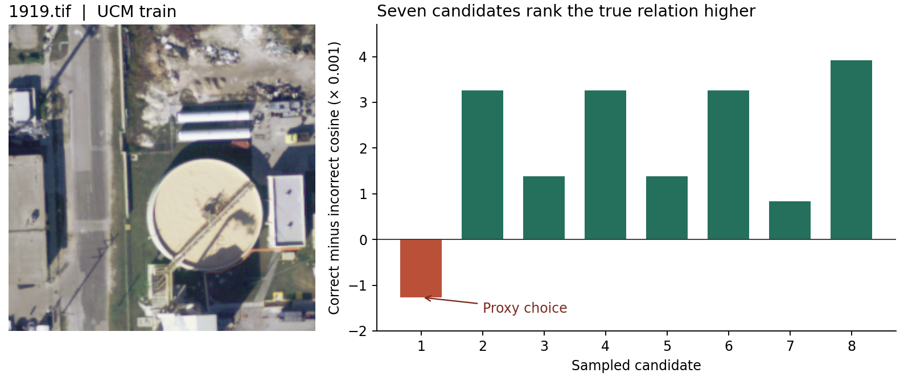

# UCM E3-1 · 空间关系候选与 RFPO 奖励

**同一张图上，Agent 已经能采出让检索器判对空间关系的先验。原 RFPO 奖励对这些先验的选择随输入而变。** 只给场景名时，32 张图中有 21 张的 8 条候选既有判对也有判错。按旧奖励选择，在这 21 张上选对 9 张，随机选的期望为 10.5 张。改用历史首条描述时，对应为 22 张有对有错，旧奖励选对 13 张，随机期望为 10.75 张。两种输入下，旧奖励相对随机的准确率差值区间都跨过零。

## 候选与检索判据

用 UCM 原训练划分构造 18 对自然图，由两位同模型家族的助手独立看图。路口角落的范围和球场旁泳池的指代分别有歧义，排除这两对。锁定 16 对、32 张图，覆盖 10 个场景类别，包括高架桥上下、储罐与道路左右、泳池与住宅上下等。每对两张图共用同一组描述，真、假方向互换。所有图号与已评分 E1 样本去重。对 2,804 个同场景图像组合进行画面配准，检出 4 处与其他训练裁块的重叠，配准到的另外四张图均在本轮和 E1 评分清单之外。筛查覆盖可见像素重叠，评估范围为有意挑选的训练图。[冻结样本](inputs/selected.json) · [盲审意见](review/decisions.tsv) · [画面重叠清单](画面重叠候选.csv)

同一幅图分别输入场景名或原始首句，使用原始 UCM AGSE 主 LoRA、原生多轮 rollout、场景分类工具和 version_2 冻结检索器。每种输入每图取 8 次独立种子的随机采样及 1 次贪心参考，共 512 条随机候选、64 条参考。场景名对配对两侧相同。历史首句可提供不同程度的地物信息，例如住宅周围是树木还是沙地。模型使用 BF16 产生隐藏向量。余弦分差由真实图像、候选向量和冻结图文检索器共同决定。它回答该候选能否帮助模型从两句关系描述中选出正确句。

旧奖励调用项目原有的格式分和代理排名分。代理先验经纯推理重建评分器投影，用全零图像与生成的视觉提示编码，在完整 1,680 张训练图像库中查找对应图片的排名。总分为格式分加排名倒数，每个训练样本按图名、Arrow 行号和 RGB 哈希核对。历史原始纯推理检查点缺失，使用冻结重建版，图库为本轮构建的训练图库。轨迹来自部署时实际调用工具的生成流程，奖励比较以同一批候选离线进行。所有模型参数冻结。[实验口径](实验口径.md) · [运行资产](scoring/binding.json) · [逐候选分数](逐候选分数.csv)

## 旧奖励能挑出判对关系的先验吗？

主评量用评分前锁定的 B 措辞。A 是另一套同义描述，用于检查直接按关系分差选候选后可否迁移到 B。以下每格为从 8 条候选中选择一条后，对 32 张图的期望正确率。并列最高时均匀选择。随机行对每图 8 条等概率求期望。最后一行查看 8 条中是否至少出现一次正分差，使用了评量答案，是可达到的事后上界。

| 候选选择方式 | 只给场景名 | 给历史首句 |
|---|---:|---:|
| 贪心生成，单次参考 | 53.13% | 50.00% |
| 随机选一条 | 57.81% | 55.47% |
| 按原 RFPO 总奖励选 | 53.13% | 62.50% |
| 按关系措辞 A 的分差选 | 53.13% | 59.38% |
| 在 B 上至少有一条能判对 | 90.63%（29/32） | 90.63%（29/32） |

场景名条件下，有 8 张图所有候选均对、3 张全部错，其余 21 张取决于选哪条。旧奖励选择相对随机少 4.69 个百分点，按 16 个完整图对聚类重采样的 95% 区间为 −16.41 至 +7.03 个百分点。首句条件下多 7.03 个百分点，区间为 −6.64 至 +21.48 个百分点。逐图看旧奖励与 B 分差的平均 Spearman 相关分别为 −0.118（−0.335 至 +0.084）和 −0.120（−0.268 至 +0.031）。代理总分的正负排序和是否恰好越过零分差是两种指标。[逐图选择](逐图选择.csv) · [区间与各类候选计数](选择统计.json)

**一张可复查的图是 1919.tif。** 储罐位于竖直道路右边。只给场景名时，8 条候选有 7 条让 B 的正确描述得分更高。旧奖励选中唯一判错的那条。8 条的格式分均为零，错选来自代理图库排名。该条把本图排第 1,205 名，其余候选排第 1,352 至 1,564 名。按 A 分差选则能选对本图。其他图上也有相反的情况，见逐图表。

主条件 256 条随机采样中有 119 条实际调用工具、84 条首轮立即结束、19 条满足原格式奖励。每图平均得到 5.47 个数值不同的隐藏状态。首句条件对应为 122 条工具调用、69 条立即结束、4 条格式得分，每图平均 4.91 个不同状态。重复采出的候选按实际出现频率计入。这里的“候选判对”指下游图文分数，与 Agent 可见文本是否明确解释该关系分别记录。

## 换一种关系说法后，直接按分差选有效吗？

在主评量中，只给场景名时按 A 选择与旧奖励同为 53.13%，各图选择的候选可以不同。为考察这种措辞敏感性，在看到 A/B 汇总后追加第三套 C。C 由未看到候选分数的视觉复核者编写，仍对应原图和原标签。将候选按其 A、B 图内秩等权平均，与单独 A、单独 B、旧奖励及随机进行比较。选择过程均不读取 C 得分。[追加口径](第三种措辞检验.md) · [第三套描述](review/heldout_C.tsv)

| 在 C 措辞上评量 | 只给场景名 | 给历史首句 |
|---|---:|---:|
| 随机选择 | 56.64% | 52.73% |
| 原 RFPO 总奖励 | 56.25% | 50.00% |
| A 分差选择 | 68.75% | 68.75% |
| B 分差选择 | 59.38% | 56.25% |
| A、B 平均秩选择 | 68.36% | 64.19% |
| C 上至少一条能判对 | 84.38% | 84.38% |

主条件下，A、B 平均秩相对随机高 11.72 个百分点，配对区间 +2.34 至 +22.27。相对旧奖励高 12.11 个百分点，区间 −3.52 至 +27.73。历史首句下，相对随机高 11.46 个百分点，区间 −0.65 至 +23.31。单独 A 在两种条件的 C 上均达到 68.75%，而在主评量 B 上的效果较弱。对 16 对描述分别计算冻结文本编码器中“正句向量减负句向量”的方向，A 与 B、A 与 C、B 与 C 的平均余弦分别为 0.006、0.325、0.156。C 与 A 在该编码器里更相近。主条件下 15/32 张至少有一条候选能同时判对三种措辞，首句条件为 17/32 张。可据此在新图上检验跨措辞的奖励，当前结果不足以选定训练配方。[第三措辞逐图比较](第三措辞逐图.csv) · [三套文本的嵌入方向](三套措辞的嵌入方向.csv)

## 原生训练描述的补充检索

用相同候选图像向量与 UCM 训练集的 8,400 条原始标注比较。按本检索器实际词元去重后有 1,635 组。每图取最佳已标注正例与所有其他组比较，计算其名次及相似度分差。场景名条件下，按旧奖励选对比随机选，最佳正例倒数名次的平均变化为 −0.0071（95% 区间 −0.0791 至 +0.0720）。逐图从图库中去除输入首句词元组后，32 张仍有其他正例，变化为 +0.0250（−0.0506 至 +0.1055）。场景名条件下旧奖励与原生文本最佳正负分差的平均图内相关为 +0.046。首句条件使用全部原生文本时，倒数名次变化为 −0.0053（−0.1139 至 +0.1178）。这是训练语料上的候选选择诊断，匹配模型的正式验证 mR 仍采用原项目完整评估协议。[原生描述汇总](训练原描述汇总.json)

## 交付与后续实验

32/32 张历史首句贪心先验重现了对应归档向量。另对预定的第一张图从头重跑两种输入的 18 条记录，原生词元、工具事件和隐藏向量均复现。576 个代理排名用 CPU 双精度独立重算并全部吻合。2,304 个 A/B 正负余弦值复算，连同分差的最大绝对偏差小于 8×10⁻¹⁶。[数值核验](核验.json) · [历史向量逐图对照](archive_check/verified.json) · [重复采样核验](repeat/verified.json) · [复现说明](复现.md) · [独立审计](.aris/traces/experiment-audit/2026-11-20_relation/EXPERIMENT_AUDIT.md)

下一步优先做独立图组的奖励筛选。预先固定用于打奖励的措辞和用于验收的措辞，让两组在表达习惯上也有区分，例如同时覆盖“物体在道路右边”和“道路在物体左边”。在新图上检验候选选择能否同时提高保留措辞的关系准确率与真实匹配分差，并继续监测普通文本检索。通过后再进入同起点、同候选采样预算的 RFPO 短训对照。本轮没有更新 Agent 权重。
