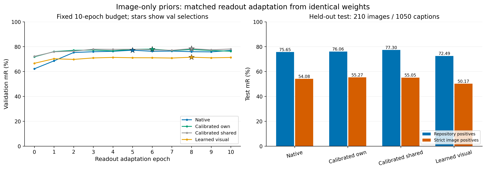
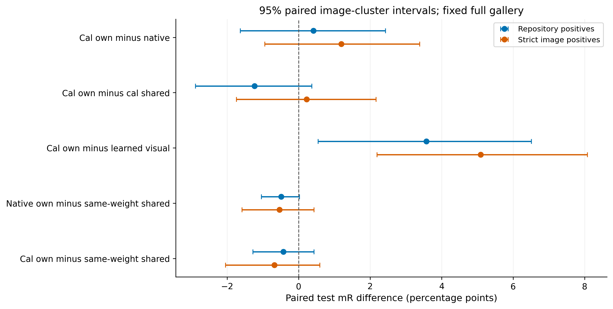

# 统一图像先验缓存与匹配训练结论（2026-11-16）

本阶段完成2100图统一缓存、四组各10轮/320步读出适配、val检查点选择、完整test210检索和同检查点共享替换对照。读出优化器更新共1280次，Agent保持均衡第32步，新增Agent更新0次。

测试主协议的mR分别为：原生自身75.65%、校准自身76.06%、校准共享77.30%、仅可学习视觉提示72.49%。校准自身模型内替换共享先验后为76.49%；自身减共享的变化为-0.43个百分点，配对95%区间[-1.29,+0.43]。本轮证据继续指向先验图像对应信息的诊断。

## 1. 数据、生成协议与训练预算

UCM沿用train1680、val210、test210划分。train的8400个原始描述槽位经原加载器按图去重后为7999个样本。每图一份3584维BF16状态供该图各描述共用；本轮新生成train1680与test210共1890份，复用val210，另重放2个锚点。统一查询为 `Describe the visible scene.`，保留历史固定港口示例、真实scene_classify回填和原生EOS控制器，按每次生成的末有效解码步骤保存状态。

2100份状态均有限，实际工具反馈2100次。2087份满足预设轨迹可用规则，13份标记异常：9次token预算终止、4次格式失败；其中train9份、test4份。全部状态与异常轨迹保留并参与既定数据流程。异常文本中出现港口示例指代及重复，后续单列提示诊断。

| 项目 | 本轮固定设置 |
|---|---|
| Agent | 均衡第32步LoRA，贪心生成，每图seed0 |
| 读出起点 | 同一归档ucm_main_domain_tool.ckpt，全张量哈希一致 |
| 可训练参数 | 同一13349511个非CLIP参数；CLIP冻结 |
| 四组预算 | 每组10轮，每轮250批/32次更新，共320次 |
| 批与精度 | microbatch32，累积8，名义有效批256；FP32，TF32关闭 |
| 优化器与调度 | 原四组AdamW，LR1e-4，weight decay0.01，betas(0.9,0.98)，eps1e-8；总320步、预热32步、线性多项式衰减 |
| 损失 | 原USCE、CMR和先验KL；Monte Carlo采样10次，原损失系数保留 |
| 数据顺序 | 每轮完整7999样本，封存randperm，四组逐批一致 |
| 硬件 | A100-SXM4-80GB，driver535.104.05，Torch2.4.1+cu124，Lightning1.4.0 |

每轮最后一次累积更新含63个样本，原累积行为保留。校准偏置使用前阶段8张训练图的原始描述条件缓存与当前贪心状态拟合，在agent_proj线性输出与LayerNorm之间固定加入。共享来源固定为训练图102.tif的均衡32步状态。仅可学习视觉提示组将视觉门控设为1，原先验KL项使用校准共享常量。共享对照中检索网络照常读取每张真实图像。

## 2. 验证曲线与模型选择

| 训练组 | 初始val mR | 选中轮数 | 选中检查点更新数 | 最优val mR |
|---|---:|---:|---:|---:|
| 原生自身先验 | 62.16 | 5 | 160 | 77.11 |
| 校准自身先验 | 71.78 | 6 | 192 | 77.97 |
| 校准共享先验 | 72.17 | 8 | 256 | 78.40 |
| 仅可学习视觉提示 | 66.59 | 8 | 256 | 71.46 |

四组完整运行10轮。以未按显示位数舍入的val mR选取检查点，使用等价命中次数分子/6300处理算术同分，平局取最早轮。四个路径和SHA先封存在 `selection_lock.json`，之后统一计算测试指标。

四组验证mR相对各自起点均提高，显示现有读出权重能够适配统一缓存。逐图先验的作用继续由独立训练组及同检查点替换对照检验。

## 3. test210完整检索结果

测试图库含210幅图和1050条描述，共377个token等价组。主协议沿用仓库重复token描述的等价正例规则，实际调用原tr_top_k/ir_top_k一致核对；补充严格图像ID对应协议。两种协议及六路前向在测试前固定，mR均为两个方向R@1/5/10的六项均值。

| 前向/训练组 | 主协议mR | 严格图像对应mR |
|---|---:|---:|
| 原生自身先验 | 75.65 | 54.08 |
| 校准自身先验 | 76.06 | 55.27 |
| 校准共享先验 | 77.30 | 55.05 |
| 仅可学习视觉提示 | 72.49 | 50.17 |
| 原生模型内替换共享先验 | 76.14 | 54.62 |
| 校准自身模型内替换共享先验 | 76.49 | 55.95 |

相对原生自身组，主协议mR的变化：校准自身先验 +0.41个百分点（相对变化+0.55%）；校准共享先验 +1.65个百分点（相对变化+2.18%）；仅可学习视觉提示 -3.16个百分点（相对变化-4.18%）。

前四行分别来自四个独立训练的验证最优模型；后两行在原生和校准自身模型的同一检查点内替换Agent向量。全部R@1/5/10见 `检索结果汇总.csv`。严格图像对应按原始图像ID确定正例，同一描述在不同图片的槽位分别处理。

| 主协议预设配对比较 | mR变化（百分点） | 95%图像成组区间 |
|---|---:|---:|
| 校准自身先验 − 原生自身先验 | +0.41 | [-1.64, +2.43] |
| 校准自身先验 − 校准共享先验 | -1.24 | [-2.89, +0.37] |
| 校准自身先验 − 仅可学习视觉提示 | +3.57 | [+0.54, +6.51] |
| 原生自身先验 − 原生模型内替换共享先验 | -0.49 | [-1.05, +0.02] |
| 校准自身先验 − 校准自身模型内替换共享先验 | -0.43 | [-1.29, +0.43] |

校准自身相对仅可学习视觉提示的主协议变化为+3.57个百分点，区间[+0.54,+6.51]。校准自身与独立训练共享先验、以及同检查点共享替换的区间均覆盖0。严格图像对应下，校准自身减同检查点共享为-0.68个百分点，区间[-2.05,+0.59]。本轮共享对照在两协议下均未呈现逐图向量的额外正向区间。

配对区间采用10000次图像成组重采样，每张图片的5条描述查询随图共同抽样，图库保持原始完整集合；seed2026111604加固定比较标签派生值。结果对应本轮单种子、10轮适配设置。

## 4. 数量诊断

沿用原85图与56个固定候选描述，四组各评分85图。train63已进入本轮读出训练，单列为训练诊断；val22为验证子集。数量1–4各类别等权，train对应样本数5/36/14/5，val为13/2/3/4。

| 训练组 | train60图B全数量宏平均 | val22图A全数量宏平均 | val22图B全数量宏平均 |
|---|---:|---:|---:|
| 原生自身先验 | 37.68 | 50.48 | 46.63 |
| 校准自身先验 | 40.06 | 46.63 | 44.71 |
| 校准共享先验 | 42.94 | 52.88 | 46.63 |
| 仅可学习视觉提示 | 43.31 | 57.21 | 55.29 |

校准自身在val22的B全数量宏平均为44.71%，共享为46.63%，仅可学习视觉提示为55.29%。两句式和逐图结果均保留于原始quantity记录；数量判别继续作为下一阶段的诊断目标。

## 5. 核验、版本与备份

服务器与本机分别核对全部2100状态/轨迹、273份历史状态精确重放、10000批实际样本顺序、400次梯度见证、308项val指标、2040项数量值、84项test召回/mR值及10组配对区间。float64缩放点积的最大误差为2.60e-5。原77份Python、15份Qwen基座、32份前序LoRA文件、CLIP/AGSE/工具头、三份Arrow及1458份父阶段证据均保持原哈希。

旧Lightning的检查点epoch字段已表示完成轮数，文件名epoch从0计数、step比实际保存更新少1。读取器按真实优化器步数/32生成独立 `training_result_v2.json`；原文件保留。编排父进程替换时，原生组训练子进程持续运行，四组始终使用同一train_arm_v4入口。统计CSV导出缺失json导入的修订保留原日志和部分CSV，新数值JSON与原已完成JSON完全一致。

缓存归档 `image_only_cache_2100_evidence_20261116.tar.gz` 已在两端核验。完整实验记录与检查点分别保存在本机和/private，字节数和SHA见交付旁路 `备份校验.json`。GitHub保存源码、输入、图表、核验及实验记录证据包；检查点独立归档保存。复现入口见 [复现说明](复现说明_20261116.md)。

初始化全张量哈希：`e94b036eca9fb2e45f3d8ad5a9fc3b3b26accf7d32a87844d6697e8d76c2dfab`。Actor LoRA数值哈希：`76156912e519f8d0165decfe0423de34300d93840c36a15255b260e1ae6fad85`。原初始化检查点的历史模型选择来源为[待确认]。

## 6. 下一阶段

固定本轮读出检查点和Agent，开展图像依赖性诊断：同分布先验置换、去除固定港口示例的提示、图像遮挡及工具反馈对照。诊断使用train/val；本轮test结果及评分矩阵保持封存。先定位逐图信息和提示示例残留，再据此形成新的奖励或状态方案。具体队列预算在核对控制器后封存，见 [下一大阶段方案](下一大阶段方案_20261116.json)。
