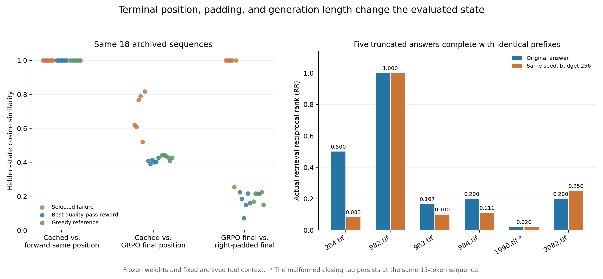

# 训练与离线状态核对（2026-11-14）

本轮确认了训练与离线缓存的状态提取差异，并量化了它们对奖励和下游检索的影响。在同一批 18 条已保存回答上，原 GRPO 函数取完整序列末位时，18 条代理排名和 17 条实际检索排名发生变化；对短序列追加训练式右侧填充后，另有 13 条代理排名和 12 条实际检索排名变化。下一版训练应优先统一生成状态传递、有效 token 掩码和真实工具流程。

同时，6 条被选失败回答在相同种子下将生成预算从 64 提高到 256：5 条截断回答均以相同前缀完成，另一条 15-token 结束标签异常原样保留。`284.tif` 在补全后实际检索排名由第 2 名变为第 12 名，表明上一轮观察到的部分收益依赖回答结束的位置。

## 1. 本轮方案与材料

承接[候选选择比较](../候选选择收益比较_20261114/候选选择收益比较说明_20261114.md)，选择原检索奖励挑中失败回答的 6 幅图：`284.tif`、`982.tif`、`983.tif`、`984.tif`、`1990.tif`、`2082.tif`。每图保留被选失败回答、奖励最高的合格候选和贪心参考，共 18 条原序列；合格候选奖励并列时取最小种子，仅用于本轮诊断。

[核对方案](核对方案.json)在运行前保存，SHA-256 为 `8ac193668df746bfe4ee7887ef2215a23eb8e26f2d6af3b8c9ba83742af71134`。本轮所有模型权重保持冻结，调用原始 `forward_logprob` 完成教师强制前向，保留相同图像、提示上下文和生成 token。这样可单独观察状态位置与填充的影响。

18 条序列各保存 4 种状态，6 条延长回答各保存 3 种状态，共 90 个 `[3584]` BF16 状态。每条状态分别使用冻结代理评分器和最终 AGSE 模型评分。原图库、391 条 val 描述及已有数量描述特征全部复用；18 条原缓存的代理排名、实际排名与全部余弦间隔重算一致，间隔最大误差为 0。

## 2. 源码中的具体差异

### 2.1 生成缓存与完整前向的末位

离线代码使用 `outputs.hidden_states[-1][-1][0,-1,:]`，取最后一个解码步骤的输入位置状态。对提示长度 P、生成步数 N，它对应完整序列的下标 P+N-2，即为最后发出 token 提供预测的状态。已有逐 token 轨迹和本轮重放均核对了这一位置。

原 GRPO [forward_logprob](source_snapshots/train_grpo.py)第 114–128 行对完整生成序列再次前向，并在第 127 行取 `fwd.hidden_states[-1][0,-1,:]`。这个位置已读入最后发出的 token；遇到正常结束时，末位通常为结束 token。两处代码都以 `h_end` 命名，实际取值位置相差一个 token。

本轮另取完整前向的倒数第二位置，用于检查同位置重算。它与生成缓存的平均余弦为 0.999913，仍有 7 条代理排名、4 条实际排名变化。奖励链直接复用生成时保存的状态，能够保留原状态字节；完整前向同位置重算用于数值诊断。

### 2.2 右填充进入了状态和损失

原 GRPO 第 99–104 行把不同长度的回答右填充到组内最大长度；第 120 行对整个完整序列设置全 1 注意力掩码，第 123–126 行把提示之后直到序列末尾的 token 全部计入 log probability。第 127 行又取序列末位。

本轮 6 图的原 8 候选组最大长度均为 64。18 条诊断序列中，13 条需要补入 10–49 个填充 token；另外 5 条已达到 64。调用原函数后，13 条补齐序列的代理排名全部变化，12 条实际检索排名变化；5 条零填充序列保持相同状态。这样，组内其他回答的长度会影响短回答的末位状态和被累计的损失 token。

### 2.3 工具上下文的形成方式

原 `sample_group` 第 52–111 行采用整段轨迹生成，函数调用列表包含 `model.generate`、解码和补齐操作。离线 rollout 则解析工具调用、执行实际场景分类并回填结果。当前固定工具诊断沿用已保存的真实工具结果。

本轮数值重放在相同固定工具上下文上执行原 GRPO 函数，用于分离状态位置差异；训练与缓存共享真实工具流程是下一版入口的另一项修正。完整源码哈希和证据行号见[source_audit.json](source_audit.json)。

## 3. 相同序列的数值对照

下表排名变化均相对于同一行的前一种状态，余弦为对应两种状态的平均值。

| 对照 | 序列数 | 代理排名变化 | 实际排名变化 | 平均状态余弦 |
|---|---:|---:|---:|---:|
| 生成缓存 → 同位置完整前向 | 18 | 7 | 4 | 0.999913 |
| 生成缓存 → GRPO未填充末位 | 18 | 18 | 17 | 0.508121 |
| GRPO未填充末位 → 右填充末位 | 18 | 13 | 12 | 0.413887 |
| 延长后生成缓存 → GRPO末位 | 6 | 6 | 6 | 0.440891 |

未填充 GRPO 末位与生成缓存的余弦范围为 0.389683–0.817961，显示终止位置带来的状态差异明显。同位置完整前向与生成缓存的余弦范围为 0.999830–0.999952，数值差异较小，离散排名依然会响应这些差异。

上表包含 6 条被选失败回答、6 条最佳合格候选和 6 条贪心参考。在“生成缓存 → GRPO未填充末位”对照中，三个分组的代理排名均为 6/6 变化；实际排名分别为 5/6、6/6、6/6。状态差异也出现在原本合格的回答上。

本轮用排名变化衡量实现敏感性。平均 RR 或余弦间隔的正负变化按原始数值保留，完整结果见[状态评分](states_scores.csv)、[逐条配对影响](paired_state_effects.csv)及[汇总](analysis.json)。

## 4. 延长失败回答后的实际检索

延长阶段只改变生成预算，保留原图像、上下文、随机种子和温度 1.0，每条生成一次。6 条回答的原始 token 前缀均逐 token 相同；真实工具结果直接从已验证记录回放。

| 图像 | 生成token数 | 延长后质量 | 代理排名变化 | 实际检索排名变化 | 实际RR变化 |
|---|---:|---|---:|---:|---:|
| 284.tif | 64→70 | 完整合格 | 71→130 | 2→12 | 0.500000→0.083333 |
| 982.tif | 64→81 | 完整合格 | 147→166 | 1→1 | 1.000000→1.000000 |
| 983.tif | 64→74 | 完整合格 | 138→195 | 6→10 | 0.166667→0.100000 |
| 984.tif | 64→84 | 完整合格 | 141→132 | 5→9 | 0.200000→0.111111 |
| 1990.tif | 15→15 | 结束标签仍异常 | 141→141 | 49→49 | 0.020408→0.020408 |
| 2082.tif | 64→76 | 完整合格 | 139→195 | 5→4 | 0.200000→0.250000 |

5 条被截断回答分别在 70、81、74、84 和 76 个 token 结束并通过原定完整性检查。它们的实际检索表现为 3 条下降、1 条持平、1 条上升；结束标签异常的 `1990.tif` 仍在 15 个 token 结束，状态对应的排名保持原值。6 条配对平均 RR 变化为 -0.087037。这些材料用于说明回答长度与状态形成的关系，样本来源为上一轮挑出的失败案例。



图左展示 18 条序列的状态余弦，右图展示 6 条回答延长前后的真实检索 RR。延长后的完整回答仍表现出生成状态与 GRPO 末位状态差异，因此状态协议修正应先于扩大训练。

## 5. 核验与复现

本轮复用 `/private` 上既有环境，A100-SXM4-80GB。启动前显存为 4 MiB；种子 0 的 CUDA 矩阵前向与反向核验通过，损失为 35.21732711791992。生成、评分和分析全部退出码 0，总耗时约 154 秒。Qwen、LoRA、原 Arrow、代理评分器与最终 AGSE 检查点按已保存哈希核对，原项目 4 个相关源文件在运行前后保持相同哈希。

服务器与本机独立核验均通过：90 个状态和评分、66 组状态几何、18 条原序列、6 条延长前缀及 72 组配对影响全部核对。保存状态按文件和张量哈希逐位核验，原评分与排名采用精确检查；CPU float64 重算后，两套排名均为 90/90 一致，特征内积最大误差低于 1.5e-7。

本机 PyTorch 2.11.0 与服务器 2.4.1 的 float32 余弦归约最大差为 1.0729e-6，首次几何绝对容差 1e-6 在 5 项上触发。几何复核改用明确记录的 `1e-5 * max(1, |原测量|)` 容差，并记录每项最大误差；状态字节、原评分和排名的精确检查保持原规则。原始测量完整保留，详见[数值核验说明](verification_numeric_note.json)、[本机核验](本机独立核验.json)和[服务器核验](服务器独立核验.json)。

本目录保留核对方案、源码快照、可复算脚本、CSV、状态比较与延长记录、PNG/PDF 图、核验记录和修正方案。`原始运行记录/` 保留完整输入、逐 token 轨迹、90 个状态、评分张量和独立核验输入。服务器目录为 `/private/AGSE_E3_1_rebuild_20261112/state_parity_20261114`，最终归档为 `state_parity_evidence_20261114.tar.gz`；归档和逐文件哈希见[备份校验](备份校验.json)。

本机核验命令（本目录，需要 PyTorch）：

```bash
python3 verify_states.py --run 原始运行记录 --out 复核结果.json
```

## 6. 下一步实施

下一步按[状态协议修正方案](状态协议修正方案_20261114.md)新建训练入口：奖励复用生成状态，梯度前向采用有效 token 掩码，训练与缓存共享真实工具回填。先完成一个优化步、组大小 2 的烟测，再检查更新前后完整回答质量、奖励与实际检索收益。原训练脚本、模型、缓存和历史结果保留原文件。
