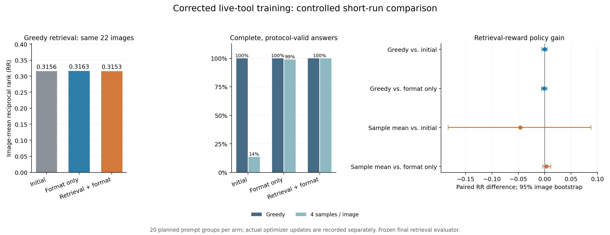

# 修正训练闭环与短程对照结论（2026-11-14）

本轮已到达约定汇报节点：**修正训练入口、真实工具流程、先验缓存与最终检索评估均已跑通，并完成两组有对照的短程训练。** 工程核验通过；在当前 22 图诊断中，增加原代理检索奖励带来的额外检索收益仍较弱，扩大训练的预定条件未达成。建议保留修正入口，下一阶段优先验证与最终检索收益对齐的奖励。

## 1. 已完成的修正与验收

1. **状态传递统一**：训练奖励、缓存和评估共同使用本次生成最后一个有效解码步骤的最后层、最后位置状态。生成状态保存、重载和评分前的张量哈希逐位一致。
2. **EOS与填充处理统一**：结束 token 计入本轮有效生成概率，生成长度之外的填充先裁掉；提示和真实工具结果作为上下文，当前模型实际生成的 token 参与本轮损失。硬件核验中追加 17 个填充 token 后，有效 token 数和 log probability 精确相同。
3. **真实工具流程共享**：识别到已注册的 `scene_classify` 调用时立即停止生成，执行真实 CLIP 与场景头，再以独立 user 消息回填结果，最后继续生成回答。训练与缓存调用同一[rollout实现](code/live_rollout.py)。
4. **采样概率一致**：温度 1.0，`top_k=0`、`top_p=1.0`、重复惩罚 1.0；首 token 的 EOS 屏蔽同时用于生成与 log probability。运行时关闭 dropout，LoRA 以 FP32 训练、保存和重载，基座保持 BF16。
5. **检查点重载一致**：保存后的 FP32 LoRA 显式按原值恢复。两组评估加载后的适配器参数哈希与训练结束时一致；本机还从两份模型备份独立重建参数哈希，每份 584 个适配器张量均通过有限值和字节核验。

6 项软件测试通过，正式单步烟测完成 1 次有限梯度更新，并核对了 LoRA 参数变化、冻结评分器的参数与梯度标志及真实工具返回。另一次开发烟测单独保存在 `development_gate_v1/`，其模型权重未用于正式两组训练；两次烟测都从相同原始 LoRA 重新加载。

## 2. 固定对照方案

正式方案在短程训练与本轮基线评估前保存于[实验方案](实验方案.json)，SHA-256 为 `c7f006da2eb62b4735f2fbe75d79d23057dd767cc5034309427ef5aadb18056f`。

| 项目 | 本轮设置 |
|---|---|
| 初始模型 | 同一份历史主LoRA；基线与两组加载后的初始参数哈希相同 |
| 强化学习数据来源 | 同一张210图UCM val Arrow，目标索引与冻结代理图库一致 |
| 本轮划分 | 22幅既有E1核查图排除在优化之外；剩余188图形成候选池，固定其中20行进行训练 |
| 两组奖励 | 合格回答格式奖励0.2；检索组另加原代理RR，格式组检索系数为0 |
| 格式判定 | 非空完整answer、真实工具协议、无伪造result或混合工具输出、无addCriterion、无token/轮数上限终止；失败轨迹全部保留 |
| 训练长度 | 每组20次图像组训练尝试，每组4条，逐条生成与反向；每组80条训练轨迹 |
| 优势与损失 | 沿用原简化组相对策略梯度：组内样本标准差归一化优势，累计有效assistant token的log probability，再按组平均 |
| 优化器 | AdamW，学习率5e-6，weight decay 0.01，梯度裁剪范数1.0 |
| 零优势处理 | 组内奖励标准差≤1e-8时跳过优化器更新 |
| 生成预算 | 最多3轮，每轮最多256个新token，min_new_tokens=1 |
| 评估 | 三个模型点各22图，每图1条贪心＋4条采样，共330条；采样种子0、1、2、3 |
| 检查点选择 | 使用第20次训练尝试结束的最终检查点 |
| 下游收益 | 冻结最终AGSE，在原391条唯一val描述中计算最佳正例RR；复用全部原文本特征 |
| 统计 | 图像配对bootstrap 10,000次，种子20261114，百分位95%区间 |

与历史入口相比，本轮还采用更严格的格式奖励、明确的采样分布、运行时零 dropout、FP32 适配器与共享真实工具消息流程。三个模型点都采用相同新推理流程，因此训练前后对比建立在同一组实现设置上。

20次训练尝试中，检索组实际更新 **18次**，格式组实际更新 **7次**；奖励相同的组按计划跳过。两组分别有74/80、70/80条训练轨迹合格。训练样本与种子预算保持相同，实际更新次数反映了两种奖励的组内差异。

## 3. 主结果：完整回答改善，贪心检索基本持平

表中的采样结果按每图4条取均值，再在22图间等权平均。所有失败轨迹仍参与原始收益汇总，质量列单独报告。

| 模型点 | 实际优化更新 | 贪心平均RR | 贪心合格率 | 采样平均RR | 采样合格率 |
|---|---:|---:|---:|---:|---:|
| 初始LoRA（同一修正流程） | — | 0.315562 | 100.00% | 0.371753 | 13.64% |
| 仅格式奖励 | 7 | 0.316288 | 100.00% | 0.322042 | 98.86% |
| 检索＋格式奖励 | 18 | 0.315283 | 100.00% | 0.325335 | 100.00% |

三组贪心回答均为22/22合格并执行真实工具。采样时，初始模型为12/88合格，格式组为87/88，检索组为88/88。初始采样较高的原始RR伴随76条格式失败轨迹，需要结合合格率解释。两组训练后协议稳定性均明显改善，格式奖励对照已解释了其中大部分变化。

| 配对比较 | 平均RR差 | 95%图像bootstrap区间 | 胜/平/负图像数 |
|---|---:|---:|---:|
| 22图，贪心：检索组 − 初始 | -0.000279 | [-0.005510, +0.004279] | 2/17/3 |
| 22图，贪心：检索组 − 格式组 | -0.001005 | [-0.005966, +0.003958] | 2/15/5 |
| 新增19图，贪心：检索组 − 初始 | -0.000323 | [-0.006380, +0.004922] | 2/14/3 |
| 新增19图，贪心：检索组 − 格式组 | -0.001163 | [-0.006685, +0.004555] | 2/12/5 |
| 22图，采样均值：检索组 − 格式组 | +0.003292 | [-0.003591, +0.011330] | 6/9/7 |

检索组贪心RR相对初始模型的相对变化为 -0.088%，相对格式组为 -0.318%，两项区间均跨过0。检索组相对初始模型有17图RR相同，相对格式组有15图相同；本轮变化集中于少数图像。新增19图与全部22图呈现相近结果。

采样均值中，检索组相对格式组平均RR高约1.02%，区间同样跨过0。检索组与格式组的格式合格率都已接近100%，这项对照仍显示较弱的额外检索收益。余弦间隔和E1句式A/B的贪心配对区间也均跨过0，完整数据见[配对统计](paired_policy_deltas.csv)。



图左为贪心平均RR，中间为贪心与采样的合格率，右侧为检索组相对初始模型和格式组的RR配对差及区间。三组模型的所有原始评分见[evaluation_scores.csv](evaluation_scores.csv)。

## 4. 扩大训练的判断

运行前约定：检索组的贪心RR相对初始模型、相对格式组的两项95%区间下界均高于0，同时合格率较初始模型下降至多5个百分点。结果满足了质量条件，两个检索收益条件均未达到，详见[机器判定](analysis.json)。

据此，本轮保留修正后的训练入口和两个模型检查点，下一阶段优先检验奖励对齐，再决定训练规模。建议固定新增验证子集，并比较直接对应最终AGSE检索RR或正负例间隔的奖励，继续保留格式奖励对照。该方向是由本轮诊断提出的后续方案，收益由下一轮对照检验。

当前证据来自一次初始化、两组短程训练和22幅此前已检查过的图像。图像bootstrap反映当前图像集合的差异；本轮划分、既有模型来源及历史诊断记录均保留在方案和原始材料中。

## 5. 独立核验与运行记录

服务器和本机分别核对了492条状态与轨迹、893轮生成、401次真实工具事件、330条评估评分、162条训练/正式烟测奖励，以及252组配对区间。真实工具结果还在42幅图上重新执行并逐事件核对。CPU float64重算后，代理排名和实际检索排名均为330/330一致，内积最大误差低于1.4e-7。[服务器核验](服务器独立核验.json)与[本机核验](本机独立核验.json)均通过。

两份模型备份已在本机逐文件校验，并从保存的safetensors张量重建了与训练内存相同的参数哈希。每份模型含584个FP32适配器张量，全部有限。模型归档、文件哈希、参数哈希和实际更新次数见[模型备份清单](模型备份清单.json)。

本轮使用既有A100-SXM4-80GB环境，PyTorch2.4.1+cu124、Transformers4.57.2、PEFT0.10.0、NumPy1.26.4；环境与原模型数据保持原版本。正式GPU流水线6阶段均退出码0，耗时约22分钟，随后完成奖励重放和统计复核。训练阶段最大PyTorch分配显存约 20.67 GiB。

关键参数哈希：

| 对象 | SHA-256 |
|---|---|
| 三个模型点共享的初始适配器参数 | `e380e96cda478a157d07de13c6a61a0357aa18e2cd07f8683a93d5673af49d2c` |
| 检索组最终适配器参数 | `0a000fbb636313f50f0ede497fd3e9e45d222698e0e63cbaacdb2092be608a3e` |
| 格式组最终适配器参数 | `b3960f80129470100b59cad40efe70ae37d63533484c63aa43e62e7fa471db3b` |
| 冻结代理评分器检查点 | `e36801d50807519273408e4caf18604ad2f43db2c7b520cee98675631eac9a59` |
| 冻结最终AGSE检查点 | `09ef20e0b354efbf8a7d4d49105cd92e1ae9412b3ea58820961265a065a874dc` |

## 6. 交付位置与复核入口

- 新训练入口：[code/train_corrected.py](code/train_corrected.py)。
- 共享生成与概率计算：[code/live_rollout.py](code/live_rollout.py)。
- 缓存与检查点重载：[code/evaluate_cache.py](code/evaluate_cache.py)、[code/checkpoint_io.py](code/checkpoint_io.py)。
- 结果汇总：[analysis.json](analysis.json)、[policy_summary.csv](policy_summary.csv)、[per_image_policy.csv](per_image_policy.csv)。
- 原始材料：`原始运行记录/`，包含代码版本、配置、全部缓存与轨迹、训练日志、评分张量、核验记录及开发烟测。
- 服务器根目录：`/private/AGSE_E3_1_rebuild_20261112/training_loop_20261114`。
- 最终结果证据包：`training_loop_evidence_20261114.tar.gz`，校验信息见[备份校验](备份校验.json)。
- 两组模型归档：本目录的 `模型检查点/` 与服务器私有挂载均保留；GitHub保存代码、结果、证据包和模型清单。

在本目录进行纯CPU结果复核（需要PyTorch和NumPy）：

```bash
python3 code/verify_milestone.py --root 原始运行记录 --out 复核结果.json
python3 code/verify_model_backups.py --root .
```

后续重跑使用新的私有实验目录和同一既有环境，按 `code/run_gates.py`、`code/run_pipeline.py`、`code/run_post.py` 顺序执行。原训练入口、原模型、数据、缓存与此前实验结果保留原文件。
