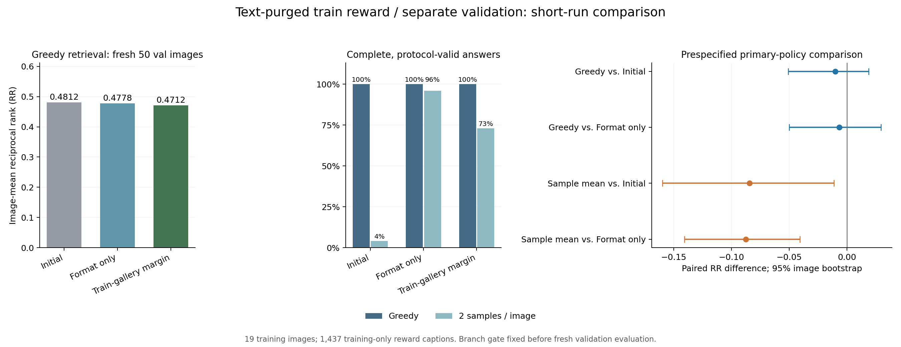

# 训练验证分离与困难负样本对照（2026-11-14）

本阶段完成训练图像、训练输入描述和奖励文本库与验证数据的分离，完成同场景候选负例对照，并在新 50 图上比较本轮实际训练的模型。**预设扩训条件未达到。** 本轮暂缓扩训。下一节点优先检查候选负例的语义有效性，利用已有人工核验的数量图文对核对训练信号，再确定后续奖励方案。

## 1. 数据分离结果

原 train Arrow 有 1,680 张、val Arrow 有 210 张，两者图像二进制哈希交集为零。原训练描述共有 1,637 条唯一原始字符串；按 Unicode NFKC、大小写归一、合并空白和去掉末尾空格/句末标点进行规范化后，剔除与全部 val 描述相同的训练文本，得到 **1,437 条训练奖励描述**，与验证描述的规范化文本交集为零。

1,277 张训练图像保留有效正例和同场景候选负例。按种子 2026111403 从 19 个有资格的场景各选一图，固定 19 组训练图像。agricultural、chaparral 两类的训练描述在本轮去重后均为空，类别覆盖如实记录在 [split_audit.json](split_audit.json)。每张训练图使用第一条保留描述作为生成输入，正例使用该图全部保留的有效描述。

新增验证 50 图以种子 2026111404 从剩余 118 张 val 图中随机抽取，排除了此前 20 张优化图、旧 22 图和上一阶段新 50 图，共 92 张。验证先验继续按每幅图像及其第一条原始描述生成。验证排名图库沿用冻结的 391 条唯一 val 描述及原始文本特征；训练过程加载训练图像与训练文本特征。

同场景标签来自原 `train_scene_cls.py` 的 `(文件名编号−1)//100` 规则，并与已保存场景头的类别表逐项核对。候选负例按训练标注配对关系与这一场景标签建立，完整排除目标图全部保留的有效描述。其细粒度语义互斥性保留为后续人工核验项。

初始 LoRA 和冻结最终 AGSE 检索器沿用既有检查点；历史来源按既有资产记录保留。本轮落实新优化图像、输入描述、奖励文本和验证数据的分离。测试 Arrow 保持原文件，本阶段使用 train 与 val。

方案 SHA-256：`0971a12c58dd397314f6c1b3dea6f47b6cfa242327aee415597248dfd123162e`，见 [实验方案](实验方案.json)。划分、图库、提示、随机种子、条件分支和扩训标准均在候选对照及本轮验证生成前固定。

## 2. 同场景困难负例的候选级对照

初始策略在 19 张训练图上每图采样 4 条，在真实工具流程下生成 76 条候选轨迹，分别计算全训练库最难负例间隔和同场景最难负例间隔。二者使用相同的正确描述、冻结检索器与格式奖励。

两种间隔的区别在于负例集合：全训练库从所有 1,437 条训练描述中排除有效正例后取最大余弦，同场景版本将这一候选集合进一步限制到同一场景。全训练库中的最难负例已有 **65/76** 条来自同场景。

预设条件要求至少 5/19 个图像组的两种总奖励在标准化组内优势上出现最大绝对差 > 0.05。实际为 **3/19 组**。同场景分支低于预设额外信号阈值，正式训练保留格式与全训练库间隔两个分支。 决策完全使用训练图像候选，未使用新 50 图的评分。完整逐组数值保存在原始记录 `pilot/branch_decision.json`。

### 探索性负例语义核查

固定抽取每图第 0 条候选，对 19 张训练图和对应负描述进行助手视觉初核。全训练库负例中，10/19 条疑似仍与图像兼容，6 条有可见冲突，3 条待确认；同场景负例分别为 11/19、4/19、4/19。该核查作为解释性诊断，保留原标注与全部训练结果。

例如，1209.tif 的正负描述均表达植被茂盛的中等密度住宅区，331.tif 的负描述为可见的海滩与海浪；1727.tif 的 R/L 和 2049.tif 的三/四块网球场则具有明确可辨差异。这提示后续需要逐项核实负描述与图像的语义冲突性。视觉初核有待独立人工复核，记录见 [负例核查](negative_review/assistant_visual_review.csv)，对应 5 页图文联查表位于同目录。

## 3. 相同预算的短程训练

| 分支 | 尝试组数 | 实际更新 | 合格轨迹 | 真实工具执行 |
|---|---:|---:|---:|---:|
| 仅格式奖励 | 19 | 6 | 66/76 | 66 |
| 训练库间隔＋格式奖励 | 19 | 19 | 67/76 | 64 |

每个分支均从同一原始 LoRA 重新加载，初始参数哈希为 `e380e96cda478a157d07de13c6a61a0357aa18e2cd07f8683a93d5673af49d2c`。每分支 19 次图像组尝试，每组 4 条，学习率 5e-6，AdamW weight decay 0.01，梯度裁剪 1.0。组内样本标准差 ≤ 1e-8 时按方案跳过更新。

全训练库间隔奖励为 `0.2 × quality_usable + best_positive_cosine − hardest_training_negative_cosine`。格式对照仅保留前一项；两个分支均保存全部间隔以便重放。

基座 BF16、适配器 FP32、运行时 dropout 为 0。真实工具调用、消息分离、EOS/填充屏蔽、assistant 有效 token log probability 和最终解码步骤状态均沿用已验证共享实现。独立单步检查完成一次有限梯度更新，该项检查记录单独保存；正式分支分别从相同初始模型开始。

## 4. 新 50 图主结果

| 模型点 | 实际更新 | 贪心平均 RR | 贪心合格率 | 采样平均 RR | 采样合格率 |
|---|---:|---:|---:|---:|---:|
| 初始 LoRA | — | 0.481177 | 100.00% | 0.494578 | 4.00% |
| 仅格式奖励 | 6 | 0.477843 | 100.00% | 0.497948 | 96.00% |
| 训练库间隔＋格式奖励 | 19 | 0.471223 | 100.00% | 0.410378 | 73.00% |

采样每图使用种子 0、1 的两条轨迹，先在图内取均值再在图像间等权平均；全部失败轨迹保留，质量合格率单列。三个模型点在同一组本轮新 50 图上比较。主分析指定模型的贪心 RR 为 0.471223，初始模型为 0.481177，格式对照为 0.477843。

| 配对比较 | 平均 RR 差 | 95% 图像 bootstrap 区间 | 胜/平/负 |
|---|---:|---:|---:|
| 贪心：训练库间隔＋格式奖励 − 初始 LoRA | -0.009954 | [-0.050731, +0.018863] | 7/37/6 |
| 采样均值：训练库间隔＋格式奖励 − 初始 LoRA | -0.084200 | [-0.159571, -0.011307] | 15/10/25 |
| 贪心：训练库间隔＋格式奖励 − 仅格式奖励 | -0.006620 | [-0.050024, +0.029599] | 5/42/3 |
| 采样均值：训练库间隔＋格式奖励 − 仅格式奖励 | -0.087570 | [-0.140716, -0.040539] | 14/18/18 |

采样条件下，间隔组相对格式组的平均 RR 差为 -0.087570，95% 区间 [-0.140716, -0.040539]；两者合格率为 73% 与 96%，差 -23 个百分点，95% 区间 [-30, -16] 个百分点。真实工具调用比例分别为 62% 与 100%。这些次要结果提示后续奖励设计还需关注采样时的输出与工具流程稳定性。

全训练库间隔组相对格式组的贪心平均 RR 差为 -0.006620，50 图中有 42 图排名指标相同。配对区间跨过 0，当前图像集合下的额外检索收益仍需复核。 回答质量和检索指标分开保存，便于核对格式稳定性的贡献。

配对区间使用 10,000 次图像 bootstrap，种子 2026111406，2.5/97.5 百分位。区间衡量当前一次训练下的图像抽样变化；训练随机性的变化留待独立种子复核。余弦间隔、工具调用率及逐图数据见 [配对数据](paired_policy_deltas.csv)、[逐图数据](per_image_policy.csv)、[完整评分](evaluation_scores.csv)。

图左为三个模型点的贪心 RR，中间为回答合格率，右侧为按训练候选条件预先确定的主要模型相对对照的 RR 差及区间。

## 5. 扩训判断

本轮主要模型由训练候选条件固定为 `global_margin`。对应的预设检查如下。

| 机器检查 | 结果 |
|---|---|
| 贪心 RR 相对初始模型的区间下界 > 0 | 未达成 |
| 贪心 RR 相对格式组的区间下界 > 0 | 未达成 |
| 贪心平均 RR 至少达到初始模型 | 未达成 |
| 贪心合格率距初始模型至多下降 5 个百分点 | 通过 |
| 已发生优化器更新 | 通过 |

总体：**未达到预设扩训条件。** 本轮暂缓扩训。下一节点优先检查候选负例的语义有效性，利用已有人工核验的数量图文对核对训练信号，再确定后续奖励方案。 本轮结果与前一轮采用不同训练图像、训练提示和新验证子集，后续分析以各轮内部的配对对照为依据。

## 6. 核验、备份与复现

服务器及本机核对了 680 条状态与轨迹、1187 轮生成、507 次真实工具事件、230 条训练/候选/单步检查奖励、450 条验证评分和 16 组配对区间。所有训练正例和同场景候选负例集合均从元数据重建，图像、规范化描述、提示与新 50 图选择规则分别复核。

真实工具在训练与验证共 69 幅图像上重跑，逐事件核对。训练奖励重放最大间隔误差为 0。本机 CPU float64 重算排名 680/680 条一致；全部保存 FP32 相似度下的奖励与排名复核通过。训练分支条件同样独立重建，见 [服务器核验](服务器独立核验.json)、[本机核验](本机独立核验.json)。

模型归档逐文件核对，并从每份 584 个有限 FP32 LoRA 张量重建训练时的参数哈希，见 [模型备份清单](模型备份清单.json)。原始代码、环境兼容文件、模型和 train/val Arrow 在运行后核对原有哈希，见 [来源核验](final_source_audit.json)。

服务器沿用 A100-SXM4-80GB、PyTorch 2.4.1+cu124、Transformers 4.57.2、PEFT 0.10.0、NumPy 1.26.4。本轮主训练及验证流程耗时 26.48 分钟，各阶段退出码均为 0。

原始记录保存在本机 `原始运行记录/` 及服务器 `/private/AGSE_E3_1_rebuild_20261112/separated_hard_negative_20261114`；模型独立保存在 `模型检查点/`。结果取证归档为 `separated_reward_evidence_20261114.tar.gz`，见 [备份校验](备份校验.json)。复现流程见 [复现说明](复现说明.md)。
