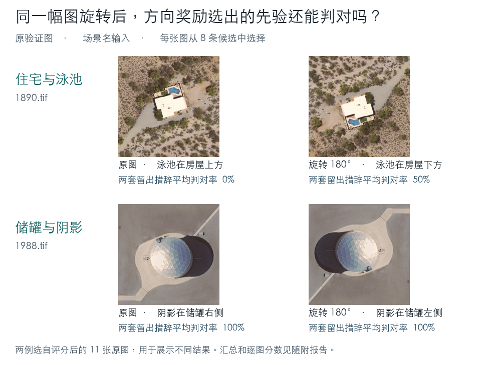

# UCM 的 RFPO 奖励能否选出更有用的 Agent 先验？

**决策：这轮保留原策略权重。两套方向语句组成的奖励能在部分图上选出更好的先验，但对换一种说法、换到两个地物之间的关系、同时保住原图文检索这三项要求，表现还不稳定。** 训练图上预先约定的五项检查通过三项。完成独立留出评估后，下一轮的候选是直接使用原图文匹配分，以及在它上面叠加同场景困难负例。

## 1　从 E1 的现象到 RFPO 的选择问题

E1 中，面对 18 对空间关系相反的 UCM 验证图，使用历史先验的 AGSE 有 4 对在两张图上都判对。本轮把同一张图的 Agent 先验换成多次实际生成的候选，考察奖励能否在这些候选中选出有用的一个。输入仍是图像和相同的场景查询。知道正确方向的是训练奖励和离线评估器。Agent 生成时看不到正反判断题或方向标签。[E1 交付](../../E1_UCM试验_20261110/UCM验证交付_20261120/E1实验交付.md)

主分析用了 22 对训练图与 8 对原验证图，合计 60 张，样本与上批候选池和已评分 E1 图像按图号去重。每对属于相同场景，两个真实画面的方向相反。这里主要考察画框中的朝向、延展方向及位置。另设一组与这 60 张互不重合的验证照片，直接考察两个可见对象之间的关系。方向题由助手看真实像素编写，由另一位同模型家族助手在未见分数时逐图核查。初筛主组 62 图和补充组 12 图分别进行了 5,395 和 1,065 次同场景图像配准，没有检出达到既定阈值的近重叠；这项检查覆盖 UCM 训练、验证照片。模型训练与评估的标准原描述来自 UCM Arrow，补充方向题无新增人工签核。[主组裁决](review/像素复核.md) · [补充组裁决](object_inputs/pixel_review.json) · [主组输入](inputs/retained.json)

同一冻结 UCM LoRA、原生多轮工具循环，每张图每种输入固定 8 条温度 1 随机轨迹及 1 条贪心参考。候选是 Agent 生成的隐藏向量。冻结的 AGSE version_2 将真实图片与各候选向量一起编码，再与图文描述计算余弦分数。同一候选比较两个方向描述，正确描述分数更高记为判对。A、B 是给候选排序的两套说法，取它们组内名次的等权平均。C、D 是提前固定的另外两套说法，只用于评价。随机选择对同组 8 条候选均匀取期望，并列最高也均匀选择。场景工具按历史运行脚本使用置信阈值 0，返回 top-3。命令行默认值及早期论文初稿记为 0.29；本轮按实跑值 0 解释。[历史运行脚本](../EOS训练验证分歧诊断_20261114/inputs/historical_pipeline_domain_tool.sh)

原 RFPO 奖励用原代码的格式分加目标图排名倒数，使用已固定的纯推理重建评分器和相应整划分图像库。历史 version_0 权重缺失。60 张主组照片用原始首句贪心重跑，隐藏向量全部与归档逐位相同。[冻结方案](inputs/protocol.json) · [逐项核验](verification.json)

## 2　方向奖励在训练图和独立留出图上的表现

下表为只给场景名时，选出的先验在 C、D 两套新措辞上的平均判对率。“严格子集”在看分数前按像素意见确定，剔除方向明显倾斜的高速路和弯曲的高架桥两对。各百分数包含并列选择的期望。

| 选择方式 | 训练 44 图 | 留出 16 图 | 高置信留出 12 图 |
|---|---:|---:|---:|
| 随机选一条 | 48.58% | 55.86% | 58.33% |
| 按原 RFPO 奖励 | 45.45% | 50.00% | 50.00% |
| 按两套方向措辞 A+B | 53.69% | 61.88% | 58.33% |

训练样本平均提高 5.11 个百分点，其中 C 提高 12.31 点，D 下降 2.08 点。原描述整库最佳正例的平均倒数排名从 0.3493 降至 0.3020，降幅 0.0473 超过预设 0.02 容许值。因此没有启动策略短训。留出 16 图的 6.02 点提升按自然图对聚类重采样的 95% 区间为 −5.08 至 +16.17 点，高置信子集的点估计差为零。给原始首句时留出表现又有变化，随机、原奖励、A+B 分别为 56.64%、40.62%、75.42%；该输入可能提供图像特有线索。[训练判断](train/decision.json) · [留出指标](val/summary.json) · [严格子集](val/strict.json)

同图 8 条候选内，原奖励与“最佳真实描述减最强负描述”的 Spearman 相关，训练图均值为 0.008（95% 区间 −0.142 至 +0.157），留出图为 0.071（−0.060 至 +0.211）。当前样本中，原奖励的排序很少能预示真实描述的检索收益。这一结果适用于当前 UCM 重建代理与已部署 LoRA 的冻结读出。[训练相关性](train/consistency.json) · [留出相关性](val/consistency.json)

## 3　用两个对象的真实相对位置检验迁移

额外取 12 张此前未用的验证照片，在查看模型结果前剔除 1 张参照道路有歧义的照片。保留的 11 张包含房屋与泳池、路口与汽车等 9 张实体关系图，以及 2 张物体与投影关系图。每张原图旋转 180° 后重走 Agent、场景工具与检索器。同一地物组合的正确方向随旋转真实交换。例如，把泳池在屋子上方的图旋转后，两者的名称保持一致，正确答案变为泳池在下方。

| 只给场景名 | 随机选候选 | 原 RFPO 奖励 | 方向奖励 A+B |
|---|---:|---:|---:|
| 11 张原图方向题 | 50.00% | 59.09% | 54.55% |
| 同一批旋转图方向题 | 48.30% | — | 51.14% |
| 原图、旋转图都答对，两个视图独立选候选 | 11.36% | — | 22.73% |

原图上的 A+B 比原奖励低 4.55 点，配对差 95% 区间为 −27.27 至 +22.73 点。两个视图都答对的 A+B 与独立随机选择差 11.36 点，区间 −4.47 至 +29.83 点。9 张实体图中 A+B 两面都对为 11.11%，2 张投影图为 75.00%，分组数量很小。相同随机种子同时选两边的另一种口径单列在明细表。旋转视图未建立原代理的真实目标图库，故该列留空。[双物体结果](object/summary.json) · [配对与随机方式敏感性](object/paired_choice.json)

另一项控制在主组 12 张可旋转验证图上同时交换像素和先验，再分别只换一项。8 条随机轨迹下，沿正确方向的平均余弦分差变化为 +0.000822。按两个交换顺序等权分解，像素部分 +0.000569，先验部分 +0.000253，先验部分区间 −0.000292 至 +0.000866。方向随图像旋转而变化的现象包含图像编码本身的贡献。[交叉替换结果](val/rotation_swap.json)

## 4　改用真实描述作奖励能否保住检索？

在主训练判断封存后，增加了一项诊断。奖励用第一条真实描述的分数减一组负描述中的最高分；评价改用同图其他真实描述，并使用互不重合的另一组负描述。相同 CLIP token 的原句归到同一组，同图第一条描述的所有等价形式都从评价正例中剔除。这个设计检验同图不同描述之间的迁移。也比较了真实描述奖励与方向奖励的等权名次组合。“其他真描述 MRR”越高表示它们在独立负描述中的排名越靠前。所有方法都只在同一批冻结候选里选择。[补充方案](inputs/native_reward_comparison.json)

| 选择依据 | 训练其他真描述 MRR | 留出其他真描述 MRR | 留出方向题 |
|---|---:|---:|---:|
| 随机 | 0.3851 | 0.5757 | 55.86% |
| 原 RFPO | 0.3885 | 0.6338 | 50.00% |
| 方向 A+B | 0.3259 | 0.5840 | 61.88% |
| 真实首句对困难负描述的分差 | 0.5166 | 0.6944 | 53.13% |
| 真实描述与方向等权组合 | 0.4307 | 0.6011 | 56.25% |

直接用真实图文分差选候选，在训练图和留出图上分别提高其他真描述 MRR 0.1315 和 0.1188。留出差的 95% 区间为 −0.0362 至 +0.2690，方向题同时低于随机 2.73 点。等权组合在 16 张留出图上比随机多 0.39 个百分点。下一阶段值得优先比较真实图文奖励与同场景困难负例奖励，用新的对象关系对检验二者是否兼顾细节和普通检索。[训练比较](train/disjoint.json) · [留出比较](val/disjoint.json)

## 5　放回完整验证图库

在原验证集 210 图、1050 条带图像归属的原描述中，保留 194 张历史先验，仅替换 16 张留出图，读取双向 R@1、R@5、R@10 的平均值。原历史首句配置 mR 为 60.06%。这 16 张改用场景查询后，对有多种候选结果的选择器用 64 次共同随机抽样估计整库均值。随机选择为 58.62%，原奖励为 59.03%，A+B 为 59.05%，场景查询单次贪心为 59.48%。替换实验同时改变了这 16 图的查询输入，比较奖励宜看三个同输入选择器；原奖励与 A+B 相差约 0.02 个百分点，变动很小。计分对相同余弦的边界并列取期望，与项目常规 top-k 任意打破精确并列的口径有差异。交付复算先对 391 个不同 token 序列各算一次相似度，再展开到 1050 条带归属的描述。首版先展开再作批量点积，精确并列在不同数值环境中出现差异，历史配置的 mR 为 60.03%。定序复算后本机和服务器的逐次输出逐字节一致。[六项明细](val/full_caption_stable.json) · [逐次抽样](val/full_caption_stable_draws.csv) · [首版记录](val/full_caption.json)

本阶段在一台 A100 80GB 上完成，主分析 1,188 条、双物体补充 198 条，共计 1,386 条纳入评分的轨迹。正式测试集未用于本阶段。生成和模型评分所用的 UCM 历史权重已有自身的训练与验证历史；本文的“留出”指相对于本阶段的新奖励选择和训练决策。项目复现路径、原始向量、生成文本、脚本和数据绑定均随包保留。[复现步骤](复现.md)
