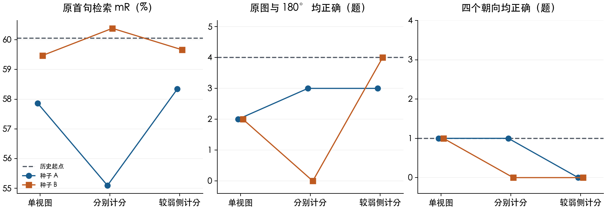

# UCM 双视图 RFPO 奖励实验交付

**继续保留历史 UCM Agent 权重。** 把一张图原样和旋转 180° 各看一次，再用两边中较差的方向分数训练 Agent，在种子 B 上找回 4 道双视图方向题，在种子 A 上得失相抵。两个新模型的完整验证图库检索 mR 均低于历史起点，均未达到预先设定的晋级条件。

## 一个可核查的问题

以验证图 `383.tif` 为例，原图中沙滩在海的上方，图转过 180° 后，沙滩就在海的下方。Agent 只接收图像和场景提示。我们将它生成的先验送入冻结的 CUP 检索器，比较“沙滩在海的上方”和“沙滩在海的下方”两种描述的余弦分数。只有原图、旋转图上正确描述都排在相反描述前面，该题才记 1 分。方向标签沿用前期的像素标注和同模型家族助手复核。验证集有 16 张方向图，每张两种措辞，共 32 项。普通检索另在 210 张验证图、1,050 条描述上计算两个检索方向的 Recall@1/5/10，再平均为 mR。“原首句”沿用历史部署方式，每张图用自己的第一条原始描述生成先验，该描述也在检索图库中；“通用查询”让所有图片共用同一句提示。图库里的图文归属沿用 UCM 原标注。[方向题](inputs/detail.json) · [逐图结果](results/detail_by_source.csv)

训练从相同的历史 UCM Agent LoRA 起步，三种配方分别跑两个采样种子。单视图配方每张原图生成 8 条候选。两个双视图配方各生成 4 条原图、4 条旋转图候选，使用相同的随机数安排、真实描述奖励、方向文本、组内名次标准化与学习率。分别计分时，每条候选依据本视图的方向分差排名。较弱侧计分时，先按固定槽位将两边的独立采样配对，取两侧正确方向分差的较小值，再用于双方各自视图内的排名。RFPO 更新 Agent 的 LoRA；正式推理用更新后的 Agent 重新生成先验，CUP 的检索参数固定。单视图组同时改变了图像朝向和每组标准化的候选数，检验奖励改动用两个匹配的双视图组。[主方案](inputs/protocol.json) · [训练与奖励](code/rewards.py)

## 普通检索和方向验证

每项均为预先指定的第 16 组末步权重。mR 越高越好，方向题要求同一种措辞的所有指定朝向连续判对。第 8 组作为中间观察点单列在检查点表中。

| 末步策略 | 原首句 mR | 通用查询 mR | 原图、180° 均对 | 顺、逆 90° 均对 | 四个朝向均对 |
| --- | ---: | ---: | ---: | ---: | ---: |
| 历史起点 | 60.06% | 45.04% | 4/32 | 3/32 | 1/32 |
| A，单视图 | 57.87% | 47.26% | 2/32 | 2/32 | 1/32 |
| A，分别计分 | 55.09% | 45.31% | 3/32 | 1/32 | 1/32 |
| A，较弱侧计分 | 58.34% | 45.37% | 3/32 | 3/32 | 0/32 |
| B，单视图 | 59.47% | 45.13% | 2/32 | 3/32 | 1/32 |
| B，分别计分 | 60.39% | 51.83% | 0/32 | 3/32 | 0/32 |
| B，较弱侧计分 | 59.66% | 44.44% | 4/32 | 2/32 | 0/32 |

与分别计分相比，较弱侧奖励在种子 A 上将原首句 mR 提高 **3.25 个百分点**（固定图库源图配对 95% 区间 +1.09 至 +5.49），双视图正确数持平。两种配方各自答对的 3 项完全不同。种子 B 的 mR 下降 **0.72 个百分点**（−2.71 至 +1.27），双视图正确数由 0 升至 4，涉及 3 幅图、3 个场景块。两个已运行的种子等权平均为 mR +1.26 个百分点（−0.22 至 +2.78），双视图正确率 +6.25 个百分点（0.00 至 +12.50）。这里固定了两个实际训练种子，区间来自对同一批源图的 20,000 次配对重采样。四项晋级规则分别在每个种子上检验。A 只达到相对分别计分组的检索要求，B 达到两项方向要求。[预设判定](results/decision.json) · [配对区间](results/paired_contrasts.json) · [逐题得失](results/direction_transitions.csv) · [全部步骤与原始召回](results/states.json)

## 训练时究竟给了多少方向信号

训练前逐对筛选 24 张候选图。房屋周围的地表 2 张、两组桥梁上下层或遮挡次序 4 张在画面旋转后仍保持原关系；另有 2 张河岸道路图存在指称歧义。保留的 16 张图覆盖 5 个场景块，每张原图的第一条真实描述在旋转后仍适用。训练图与验证图按文件名和解码 RGB 指纹均无交集。六组共处理 96 个图像候选组，现场采样 768 条轨迹，其中 94 组梯度范数为正。对有梯度轨迹的逐 token 对数概率重放误差最大为 0。[像素审核](review/rotation_screen.json) · [实际训练核对](results/training_audit.json)

四个双视图训练组各有 16 × 4 个配对槽位。分别计分种子 A、较弱侧种子 A、分别计分种子 B、较弱侧种子 B 的双侧正分候选分别为 **1、4、4、4 / 64**。即使在每一图、每个已采样的四对中尝试全部 24 种重配，四组的最大总数仍分别为 1、4、4、4。合并四组已采样候选，16 张训练图中仅 6 张在两种朝向上都出现过正确描述胜出的候选，6 张只有原图侧出现，4 张只有旋转侧出现。相对名次在两侧都得低分时也能排序。核对表明，更换奖励使 64 个双视图候选组中 63 组的优势发生变化，但训练时实际看到的“双侧都对”例子很少。两种种子的匹配训练轨迹均从第一组更新后开始分开。[同候选重排](results/same_candidate_credit.csv) · [按图正分覆盖](results/candidate_coverage_by_source.csv)

两种较弱侧权重在训练图上以贪心方式重测，直接参与奖励的 A 表述均为 **0/16**，未用作方向奖励的 B 表述均为 **2/16**。历史权重分别为 0/16、3/16。该对照揭示了训练中偶尔采到好候选与部署时稳定选中好候选之间的差距。[训练图与验证图检查点表](results/检查点汇总.csv)

## E1 迁移及先验的作用

| 原首句条件 | 数量 A | 数量 B | 属性 | 真实关系 | 真实关系正反两图均对 |
| --- | ---: | ---: | ---: | ---: | ---: |
| 历史起点 | 16/22 | 17/22 | 23/36 | 19/36 | 4/18 |
| A，分别计分 | 17/22 | 17/22 | 22/36 | 21/36 | 5/18 |
| A，较弱侧计分 | 19/22 | 18/22 | 23/36 | 20/36 | 4/18 |
| B，分别计分 | 16/22 | 17/22 | 25/36 | 20/36 | 4/18 |
| B，较弱侧计分 | 19/22 | 18/22 | 23/36 | 23/36 | 7/18 |

E1 数量题沿用已有用户确认，属性和真实关系题沿用 E1 的像素标注及同模型家族助手复核。真实关系题在两幅不同的真实图上核对相反关系。旋转方向题要求同一幅图旋转后判断随画面变化。种子 B 在两种检验上都优于自己的分别计分组；种子 A 的真实关系题减少 1 道。两种较弱侧权重的数量 A 均较历史起点多判对 3 项。历史起点在归档 E1 的 116 项判断全部复现。该统计含同一批数量图的两种表述。E1 的题图与 16 张方向验证图无重叠。[E1 各状态分项](results/E1分项汇总.csv) · [原始 E1 重放](results/e1_replay.json)

交换先验的对照保持图像和检索器权重固定，仅把同一图的原图先验和半转先验互换。种子 B 较弱侧模型的自然结果为 4/32，互换后为 2/32；原先正确的 4 项全部变错，另有 2 项变对。种子 A 交换前后都是 3/32，其中只有 1 项前后都对。先验确实能改变方向排序，改善集中在哪几道题会随模型和先验配对改变。复原自然图像与自身先验的组合后，七个模型状态的 CUP 图像向量均逐值重现；四格交叉对照也保留了像素和先验对平均有符号分差的分解。这个探索性诊断在第一个中间点评估完成后登记。[交叉实验约定](inputs/prior_swap_protocol.json) · [逐图交叉分数](results/prior_swap_by_source.csv)

顺、逆时针各转 90° 后，历史模型两边均对 3/32，较弱侧种子 A、B 分别为 3/32、2/32。把这两次判断与同一张图、同一种措辞在原图及半转图上的结果取交集，历史权重四个朝向全对 1/32，两种较弱侧权重均为 **0/32**。该角度诊断在首个训练后方向评估完成前已登记，使用的是同一批 16 张验证照片。它说明种子 B 在 180° 上找回的 4 项没有延伸到全部四个朝向。[旋转定义](inputs/quarter_protocol.json) · [逐图四朝向结果](results/quarter_by_source.csv)

## 后续决策和交付

下一步保留历史部署权重，在 UCM 训练划分上优先补充能明确核对上下、左右的图对与反向描述。先固定 CUP 读出器，按图检查同一批候选在两个朝向上能否分出正确和相反描述，并记录判断是在哪一侧失效。现有 10 张训练图在四组候选中只在一侧出现过正分，正好可用作第一批诊断样本。候选覆盖改善后，再用新的独立方向图复验，并同步重测 210 图检索。此次结论适用于这 16 张训练图、两个种子和重复使用的 UCM 验证面板。正式测试集留待最终评估。

主评估 6,292 条部署记录，加上额外角度的 224 条，共 6,516 条。用另一种并列排名算法逐项复核了 32,760 个按源图汇总的召回分项（每张图的五条文检图查询先取均值），差异为 0。服务器和本机 CPU 各自重算 25 个输出，24 个逐字节相同，余下一项仅记录矩阵乘法的浮点舍入量，两端都小于 10⁻¹⁵。[双端重算](results/local_recompute.json) · [输入、权重与历史部署核对](results/deployment_checks.json)

本机和服务器私有挂载保存了全部训练、评估及权重；Git 保存六组末步 LoRA 相对历史起点的无损分块差分。完整复验所需输入、随机设置、运行环境、逐图统计和权重恢复方式均已归档。[复现说明](复现.md) · [末步权重还原](results/weight_restoration.json) · [独立审阅](review/EXPERIMENT_AUDIT.md)
