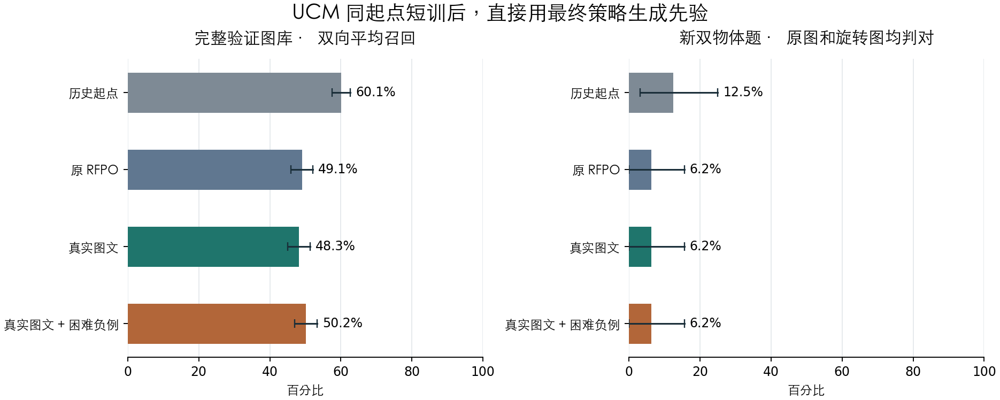

# UCM E3-2：三种 RFPO 奖励的同起点短训

**保留历史部署策略。** 三组从同一套 LoRA 出发，各自完成了 24 个训练组的策略优化，保存最终权重，并用最终策略重新生成验证先验。加入同场景困难负例后，普通检索比只用真实图文奖励高 1.91 个百分点，但仍低于历史起点。对两个地物相对位置的判断也未改善。最明显的行为变化是，两种新奖励训练出的 Agent 在绝大多数原描述查询上第一步就输出了结束符。

## 普通检索与空间细节

普通检索使用 UCM 原验证划分的 210 张图及其 1,050 条原始描述。生成先验时使用每张图的第一条描述，与历史部署口径一致。冻结检索器，按图检文、文检图的 R@1、R@5、R@10 求均值 mR。图文匹配按原描述的图像归属计分，精确并列取期望。另给所有图相同的通用查询作输入对照。

空间细节评估从此前困难题未用的验证图片中锁定 16 张。每张用两种语序表达同一对对象的位置，将照片旋转 180° 后重新生成先验，正确方向随之反转。主指标是同一种问法在原图、旋转图上都判对。每张图贡献两项判断，共 32 项。生成时只给场景名，评估语句留给冻结的检索器评分。所有主结果直接使用各策略的单次贪心输出。[冻结训练与主评估方案](inputs/protocol.json) · [新图清单与正反描述](inputs/detail.json)

| 从同一起点运行的策略 | 原始首句 mR | 全图共用通用查询 mR | 新题原图判对 | 新题旋转图判对 | 两个视图均判对 |
|---|---:|---:|---:|---:|---:|
| 历史部署起点 | **60.06%** | 45.04% | 56.25% | 43.75% | **4/32** |
| 追加原 RFPO 奖励短训 | 49.06% | 46.03% | 59.38% | 34.38% | 2/32 |
| 追加真实图文奖励短训 | 48.25% | 45.20% | 59.38% | 46.88% | 2/32 |
| 追加真实图文与同场景困难负例奖励短训 | 50.16% | 45.77% | 59.38% | 46.88% | 2/32 |

困难负例组与真实图文组的原始首句 mR 相差 **+1.91 点**，固定图库、按源图配对抽样的 95% 区间为 **+0.54 至 +3.32 点**。困难负例组与原奖励追加训练组相差 **+1.10 点**（−2.28 至 +4.45），与历史部署起点相差 **−9.89 点**（−12.83 至 −7.13）。新奖励两组在空间题上的 32 项双视图汇总都是 2/32，按源图汇总的双视图判对率也相同。预先约定同时检查普通检索与双视图细节，两个候选均未达到晋级条件。[逐图检索](results/retrieval_by_source.csv) · [逐图细节](results/detail_by_source.csv) · [配对差与区间](results/contrasts.json) · [晋级判定](results/decision.json)

在 76 张此前困难题未用的源图及它们的描述上，继续沿用完整图库，历史起点、原奖励、真实图文、困难负例的首句 mR 分别为 58.31%、50.29%、45.54%、47.42%。另以每个视图 4 条随机轨迹作补充，同种子两边都判对的比例依次为 11.72%、5.47%、8.59%、8.59%。完整图库的六个召回分项、独立随机选择两边的敏感性结果均可复算。[全量指标](results/summary.json)

## Agent 在哪一步发生了变化？

在原始首句部署下，历史策略对 210 张验证图中的 190 张调用过真实场景工具，19 张第一步就结束。真实图文组有 203 张立即结束，困难负例组有 193 张立即结束。在 16 张新细节图的原图与旋转图上，两种新策略的 32 次贪心生成全部第一步结束，历史策略在其中 28 次调用了工具。立即结束时，缓存仍包含图片与查询的隐藏表示，所取状态来自首次解码时的最后一个输入位置。

| 原描述查询，210 图 | 第一步结束 | 有真实工具调用 | 每图平均生成 token 数 | 只读第一解码步的 mR | 自然生成到结束的 mR |
|---|---:|---:|---:|---:|---:|
| 历史部署起点 | 19 | 190 | 7.60 | 46.97% | 60.06% |
| 原奖励追加短训 | 0 | 188 | 50.92 | 46.74% | 49.06% |
| 真实图文 | 203 | 7 | 1.24 | 47.43% | 48.25% |
| 真实图文 + 困难负例 | 193 | 17 | 1.63 | 49.25% | 50.16% |

表中最后两列是同一套权重、同一幅图、同一条查询，只改变读取先验的位置。历史策略沿自然轨迹继续生成后，mR 比只读第一步高 13.08 点。两种新策略的相应差值为 0.83 和 0.91 点。原奖励组仍频繁调用工具，输出也最长，但其自然轨迹的增益仅 2.32 点。输出长度、工具使用次数与下游检索收益需要分别记录。该读取位置对照是观察到训练响应长度分化后增加的诊断；晋级判定始终采用自然生成。[生成行为](results/response_profile.json) · [读取位置对照](inputs/first_state_control.json) · [各组独立复算](results/local_recompute.json)

为检查新奖励是否总把“立即结束”排在前面，还重用了历史起点在同一批 24 张训练图上生成的另一套固定候选。21 张图同时含立即结束与继续回答的轨迹。在同图内将这两类轨迹两两比较、同分计半胜，结束轨迹在原奖励、真实图文奖励、困难负例奖励下分别胜出 41.4%、55.6%、51.3%，三个区间均包含 50%。直接观察到的是训练后的结束行为集中；现有对照尚未单独分离格式奖励、策略梯度和候选分布变化各自的贡献。[固定候选上的 EOS 排序](results/eos_reward.json)

## 训练对照与证据

三组均从历史 UCM 部署 LoRA 出发。历史起点已经经过早期项目训练，本轮估计的是追加短训的效果。每组使用同一顺序的 24 张训练图、12 对此前经像素核验的同场景反向图、每图 8 条现场采样轨迹。基础 Qwen2.5-VL、工具、温度 1、最多 3 轮、每轮 64 个新 token、AdamW 学习率 5×10⁻⁶、梯度范数上限 1 及最终检查点规则均一致。训练查询只含场景提示。相同步骤和候选位置使用相同随机种子；权重更新后的自然输出可以分化。原部署脚本使用的工具置信阈值为 0。[训练清单](inputs/train.json) · [运行环境与资产哈希](environment.json)

- **原 RFPO** 使用项目格式分加目标图在 1,680 张训练图代理库中的排名倒数。历史纯推理 version_0 检查点缺失，沿用已核验的固定重建代理。
- **真实图文奖励** 用冻结 AGSE 编码真实图片、候选先验和该图第一条真实训练描述，以正描述余弦减固定负描述池中的最高余弦，在同组 8 个候选内取平均并列名次。负描述池在训练图库的去重 token 序列中按哈希偶数划分，剔除该图全部有效描述的 token 组。其余图库描述仍可能在语义上适用于相似图像。
- **真实图文与困难负例奖励** 在上述分数名次上，等权加入另一项名次：同场景正细节描述的余弦减经过像素核验的反向描述余弦。训练只使用 A 措辞。两种新奖励都未添加原有格式分，因此困难负例的直接增量应比较这两组。原奖励与任一新奖励之间还涉及格式项、评分器及分数尺度的变化。

实际完成 72 个训练组、576 条训练轨迹。三个适配器的 584 个 LoRA 张量均出现有效数值变化。LoRA 权重采用 BF16。原奖励、真实图文、困难负例组分别有 24、23、23 个非零梯度组；其余各有一组候选同分。对优势非零的轨迹，逐 token 的可微重算保留该轮输入、重复惩罚、top-k 与真实 EOS，反向传播只覆盖实际采样的动作。独立重跑首组后，三组的 token 和奖励与日志逐项吻合，有梯度的轨迹上记录的最大 log 概率重放差为 0。[三组训练核验](results/training_audit.json) · [首组直接重放](probe/scores.json)

四套策略各自重新生成 210 条原描述先验、210 条通用查询先验及 160 条新图细节先验，共 2,320 条。历史起点 210 条原描述先验与项目归档逐位相同。新细节题初筛 17 张，独立同模型家族像素复核后修订 7 张指称、剔除 1 张，得到 16 张。画面配准对初筛图执行了 1,506 次同场景比较，无达到预设阈值的重叠。双物体位置题属自定义视觉标签，没有新增人工签核。UCM 数据表中的原描述用于整库检索。该实验为单次种子日程、冻结下游读出的短训验证；未使用正式测试集，也未重新训练下游检索网络。[像素裁决](review/detail_audit.json) · [配准筛查](review/画面重叠筛查.json) · [步骤与还原](复现.md)

## 下一步

优先分离“真实图文奖励”与“生成格式约束”。从同一历史起点固定图文与困难负例的计算和尺度，仅改变是否保留原格式项，在 0、6、12、24 步同时查第一步结束率、整库 mR 和双视图方向题。这样可以定位检索开始回落的训练节点，并检验保留有内容的轨迹是否带来实际检索收益。

本机与服务器均保留三个最终 LoRA 和优化器恢复状态。Git 保存脚本、轨迹、结果及相对于历史 LoRA 的可还原权重差分，三个适配器均已从差分重建并逐字节校验。[检查点索引](checkpoint_index.json) · [还原核验](review/checkpoint_restore.json)
