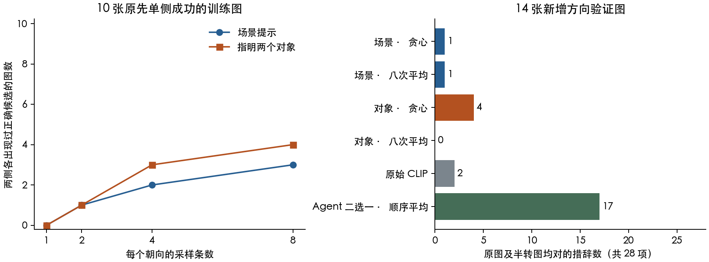
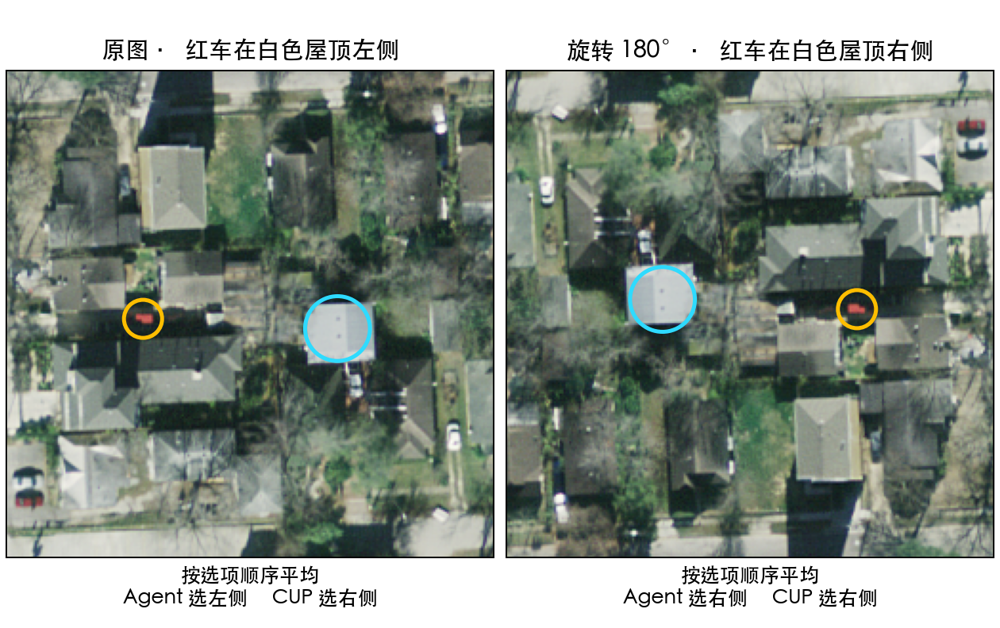

# UCM 方向判断实验：换先验后，正确方向能否排到前面

**保留历史部署权重，下一轮优先验证方向信息怎样进入检索分数。** 在 14 张新标注的方向验证图上，给历史 Agent 相同图像和两句备选描述，交换选项位置后综合打分，原图与半转图连续判对 **17/28** 项。取回答字母前的同一份隐藏状态，送入冻结的 CUP 后，同一对描述的检索排序仅连续判对 **1/28** 项。这个对照将问题缩小到方向判断如何被检索链路利用。具体原因还可能涉及先验投影、图像融合和文本表示，本轮未分别干预这三部分。

## 固定图像，多采样带来多少可选先验

上轮在 16 张训练图中发现，10 张只有一个朝向出现过正确描述胜出的候选。本轮固定历史 Agent 和 CUP，在全部 16 张图的原图和 180° 旋转图上分别运行两种提示。场景提示沿用原流程；对象提示在相同场景提示后点名两个参照物，要求描述它们在画面中的相对位置。两种提示都隐去正确方向。每个图像朝向、每种提示生成 1 条贪心轨迹和 8 条随机轨迹。训练图和新验证图共生成 1,080 条，两种提示各 540 条；实际生成词元数分别为 5,757 和 7,655。[锁定方案](inputs/design.json) · [提示构造](code/cases.py) · [真实轨迹统计](results/traces.csv)

| 在原先单侧成功的 10 张图中，两侧各出现过正确候选的图数 | 每侧采 1 条 | 2 条 | 4 条 | 8 条 |
| --- | ---: | ---: | ---: | ---: |
| 场景提示 | 0 | 1 | 2 | 3 |
| 指明两个对象 | 0 | 1 | 3 | 4 |

这里使用上轮参加奖励的 A 表述，允许在两个朝向各自挑选一次最有利的候选。指明对象后，多采样能找回 4 张图的正确排序，余下 6 张仍至少有一侧选不到正分。场景提示与对象提示各找回的图只重合 2 张。固定图像后，先验有时足以改变排序，改变的图和方向取决于提示。两侧分别从 36 个同图先验和 28 个外图先验中任选，10 张中也只有 5 张两侧都有正分。以上挑选均要事后查看真值，其用途是诊断候选覆盖。[候选覆盖表](results/coverage_table.csv) · [逐图可选空间](results/prior_interventions.csv)

## 新方向题上的实际推理

新题来自原 UCM 检索验证图库。在剔除既有方向题和已列入 E1 复核清单的图后，从 58 张合格图中按可辨识的物体关系提出 16 题。另一位同模型家族助手只看像素、两个参照物和评估轴，独立给出方向并判断指称是否唯一。因屋顶、船组指称有歧义，各剔除 1 张，最终保留 **14 张、8 个场景块**。两种表述交换主语与参照物，共 28 项。新图与训练图的 RGB 哈希、文件名无重叠，此前已参与一般检索评估。对全部 16 张提案与训练/验证库的同场景图执行了 1,417 次像素配准筛查，达到检出阈值的重叠为 0。标签属于助手像素标注；地理独立性待确认，正式测试集留待后续。[盲审裁决](review/adjudication.json) · [来源核对](inputs/source_receipt.json) · [配准结果](review/画面重叠筛查.json)

| 新方向题上的方法 | 原图和半转均对 | 单个朝向判断正确率 |
| --- | ---: | ---: |
| CUP，场景提示，贪心先验 | 1/28 | 46.43% |
| CUP，场景提示，每侧 8 条分数取均值 | 1/28 | 48.21% |
| CUP，对象提示，贪心先验 | 4/28 | 57.14% |
| CUP，对象提示，每侧 8 条分数取均值 | 0/28 | 50.00% |
| 无额外提示词元的原始 ViT-L/14 CLIP 相似度 | 2/28 | 51.79% |

对象提示的贪心结果较场景提示多对 3 项。每侧采样 8 条并直接平均候选分数后，方向判对数从场景提示的 1 项变为 0 项。预设的两个条件是找回 10 张旧难例中的多数，同时提高新图的八次平均结果；两项都未达到。即使在新图上利用答案事后挑选，在同图与外图先验合并的有限集合中，两侧独立挑选最多能覆盖 18/28，两侧固定使用同一份先验时能覆盖 12/28。该结果给出了这批实际先验的可达范围。[预设判定](results/decision.json) · [各方法分项](results/deployment_table.csv) · [换先验核对](results/donor_table.csv)

## 同一隐藏状态，为什么会得到不同方向

红车与白色屋顶的例子可以直接核对这项差异。原图中，红车在屋顶左边；旋转 180° 后在右边。以“红车在屋顶左侧”与相反描述为选项，Agent 的字母判断随画面从左切换到右。将同一输入产生的回答前状态交给 CUP，两个朝向都把“红车在右侧”排到了前面。下图的圆圈仅作展示，任何模型输入均使用原始无标记像素。[逐题分数](results/matched_choice_by_source.csv)

直接选择时，Agent 看到两个描述，每种措辞都交换一次选项顺序。按两次回答的字母 logits 抵消位置偏好，在 28 项中连续判对 17 项，单朝向正确率 78.57%。若要求**原图和半转图在两种顺序下的四次实际首选字母全部正确**，则为 **9/28**。56 个“图像朝向 × 措辞”中，交换选项后有 25 个维持相同的严格语义偏好。固定第一种或第二种选项顺序看实际首选字母，双视图均对分别为 12/28、10/28。112 次呈现的全词表首选均为 A 或 B。关闭历史 LoRA 后，原骨干的顺序校正结果为 16/28，四次全部正确为 7/28。因此，显式方向选择能力在未启用该适配器时也可测得。[选项位置核对](results/option_order.csv) · [关闭 LoRA 对照](results/backbone_table.csv)

初次发现直接选择与 CUP 排序存在落差后，补做同状态交叉读出。所有训练/验证图都按两个朝向、两种措辞、两个选项顺序完整重放。共 240 份真实的回答前隐藏状态，每份状态的语言输出头均逐值复原当次全词表 logits。保持图像、询问方式、备选描述和隐藏状态一致，让 CUP 根据图文余弦排序。验证集上，只有语言头双视图均对的有 17 项，只有 CUP 均对的有 1 项，两者共同均对 0 项，余下 10 项两者都未连续答对。训练集上，语言头为 18/32，CUP 为 0/32。验证集上的配对正确率差为 57.14 个百分点，按 14 张源图聚类重采样的 95% 区间为 +32.14 至 +78.57 个百分点。该差值来自带备选句的同状态诊断，常规检索的成绩单独报告。[追加对照约定](inputs/matched_choice_protocol.json) · [逐状态交叉结果](results/matched_choice.json)

作为另一项诊断，将原图和半转图的原始方向分差相减后再判断朝向，会按构造得到相反的预测。给定这批图片并在图内绑定两种措辞，按源图共同翻转正负方向的参考水平为 50%。直接语言头在这一条件下为 92.86%，同状态 CUP 为 53.57%。两者对应的单侧精确符号翻转参考概率分别为 0.00092、0.50。这项比较需要同时查看两幅图；单次独立判断的成绩见上表，新增题的图数和标注方式限定了外推范围。[各源图交叉分差](results/matched_choice_margins.csv)

## 普通检索及后续实验

本轮没有更新权重。把历史首句与通用提示生成的先验重新送进冻结 CUP，210 张验证图的两套图像向量共 420 份，均与历史归档逐值一致。对 1,050 条原描述重算双向 Recall@1/5/10，首句条件 mR 为 **60.06%**，通用提示为 **45.04%**。首句条件使用每张图自己的第一条原描述，该描述也在图库中。针对方向题的对象提示、字母选择及同状态干预均未作为新的整库检索策略。[完整图库召回](results/gallery.json) · [张量与归属核验](results/verification.json)

**下一轮建议用训练划分的图对验证一个方向辅助打分器。** 先固定 Agent 与 CUP，比较同一条正确描述和反向描述在原图、半转图上的顺序，要求关键信号在普通推理能获得的输入上也能读出。用本轮 14 张图记录既有误差，另留出新图做最终判断，再决定是否接入 RFPO 奖励。进入全量训练前，同时验方向题和一般图文检索，保留历史权重作为对照。[复现步骤](复现.md) · [独立审计](review/EXPERIMENT_AUDIT.md)
