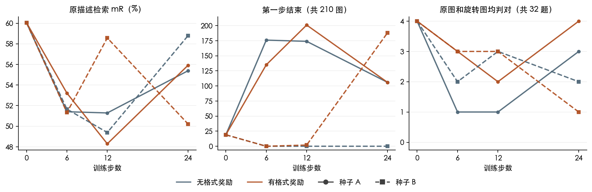

# UCM E3-2 格式奖励、提前结束与 E1 细节判断

**保留历史部署权重，结束对现有 0.2 格式分的单独加回试验。** 在两个训练种子的配对实验中，格式分对原描述检索 mR 的影响方向相反。种子 A 的首步结束数持平，种子 B 加分后从 0 张增至 188 张。两个加分模型在 E1 的真实关系题上均判对 22/36，高于历史起点的 19/36，但在原图和旋转图上连续判对的题数分别为 4/32、1/32。两套模型均未通过预先登记的部署条件。

## 格式奖励改变了什么

四组都使用真实图文和同场景困难负例奖励。每个种子做一组有格式分、一组无格式分，唯一主动改变的训练因素是完整答案标签带来的 0.2 分。模型各处理 24 个候选组，每组 8 条轨迹，合计 768 条。表中使用各组完成第 24 个候选组时的权重。历史起点为已经训练过、实际部署过的 UCM Agent。

| 第24组策略 | 原首句 mR | 通用查询 mR | 首步结束/210 | 有工具调用/210 | 双视图均对 |
| --- | ---: | ---: | ---: | ---: | ---: |
| 历史起点 | 60.06% | 45.04% | 19 | 190 | 4/32 |
| A，无格式分 | 55.39% | 45.10% | 106 | 104 | 3/32 |
| A，有格式分 | 55.92% | 45.62% | 106 | 104 | 4/32 |
| B，无格式分 | 58.80% | 50.22% | 0 | 198 | 2/32 |
| B，有格式分 | 50.21% | 44.34% | 188 | 22 | 1/32 |

在相同种子内，有格式分比无格式分的原描述 mR 分别相差 **+0.53** 个百分点（A，95% 区间 −0.67 至 +1.75）和 **−8.59** 个百分点（B，−11.85 至 −5.35）。两个已运行种子等权平均为 **−4.03** 点（−5.69 至 −2.35）。这些区间固定训练种子，在相同验证图上配对计算。 晋级规则要求在每个种子上同时保住历史起点的原描述 mR 和双视图判对数，并在匹配的无格式组上至少有一项改善、另一项持平或改善。所有判定均使用自然解码的第 24 组权重。[完整六项召回](results/states.json) · [冻结判定](results/decision.json) · [逐图配对区间](results/paired_contrasts.json)

### 退化从何时出现

每格依次为原描述 mR、首步结束图数（共 210 张）、双视图判对题数（共 32 项）。第 0 组共享同一起点，三项为 60.06%、19、4。

| 策略 | 第6组 | 第12组 | 第24组 |
| --- | ---: | ---: | ---: |
| A，无格式分 | 51.41% / 176 / 1 | 51.29% / 174 / 1 | 55.39% / 106 / 3 |
| A，有格式分 | 53.22% / 135 / 3 | 48.29% / 201 / 2 | 55.92% / 106 / 4 |
| B，无格式分 | 51.66% / 0 / 2 | 49.39% / 0 / 3 | 58.80% / 0 / 2 |
| B，有格式分 | 51.33% / 0 / 3 | 58.57% / 2 / 3 | 50.21% / 188 / 1 |

第一个观察点已经出现检索回落，四组第 6 组的 mR 都比起点低。B 无格式组到第 12 组仍是 0 张首步结束，mR 却只有 49.39%。B 有格式组第 12 组达到 58.57%，此后首步结束数由 2 增至 188，mR 回落到 50.21%。同一条训练曲线中的检索变化需要结合读取的先验和下游结果判断。 所有中间点均已保留，结果表按既定步号完整报告。[检查点表](results/检查点汇总.csv) · [逐轨迹行为](results/behavior_by_source.csv)

### 训练候选实际获得了多少格式分

将同一组已经采样的八条轨迹固定，分别按有无格式分重算，就可以直接看这个奖励是否改变了组内排序。表中“最优候选集合改变”包括并列最优集合成员变化，不涉及重新采样。最后一列分母是实际调用工具的轨迹数。

| 策略 | 非零梯度组/24 | 获格式分轨迹 | 格式分有区分的组 | 最优候选集合改变的组 | 有工具调用但无格式分 |
| --- | ---: | ---: | ---: | ---: | ---: |
| A，无格式分 | 22 | 3/192 | 2/24 | 0/24 | 82/85 |
| A，有格式分 | 21 | 4/192 | 3/24 | 0/24 | 76/80 |
| B，无格式分 | 24 | 12/192 | 10/24 | 1/24 | 47/59 |
| B，有格式分 | 24 | 16/192 | 13/24 | 4/24 | 54/70 |

有格式分的两次训练中，种子 A 的 192 条候选仅 4 条获得格式分，种子 B 有 16 条。A 有 3 个候选组出现不同的格式分，重新打分后最优集合在 24 组中全部相同。B 有 13 个这样的组，其中 4 组的最优集合改变。策略更新会使用所有非零优势的候选，最优集合相同的组也可能产生不同梯度。A 在第 5 组首次出现有区分的格式信号，两组权重从这次更新开始分开。B 在第 1 组即出现该信号。在各个末步策略的 210 张原描述验证图上，自然贪心输出完整答案标签的张数均为 0，历史起点也为 0。全部正式训练轨迹的格式分与独立解码一致，有梯度轨迹的逐 token 对数概率重放最大误差为 0。[同候选奖励对照](results/format_counterfactual_groups.csv) · [训练步与真实格式分](results/training_groups.csv)

## 实际屏蔽首步结束符后，检索和方向判断怎样变化

固定同一套末步权重、同一幅图片、同一条查询，仅在第一轮的第一个生成位置屏蔽模型的两个 EOS token，此后的正常解码、工具返回和检索评分均沿用原设置。种子 B 为主方案中登记的干预，种子 A 的同样复验在两种子任何干预结果产生前另行登记。表中的区间按同一图库的源图配对计算。

| 第24组策略 | 自然首步结束 | 自然 mR | 屏蔽后 mR | 差值及配对95%区间（百分点） | 双视图均对/32 |
| --- | ---: | ---: | ---: | ---: | ---: |
| A，无格式分 | 106/210 | 55.39% | 59.24% | +3.85 [+1.71, +6.06] | 3 → 3 |
| A，有格式分 | 106/210 | 55.92% | 58.95% | +3.02 [+0.95, +5.15] | 4 → 2 |
| B，无格式分 | 0/210 | 58.80% | 58.80% | +0.00 [+0.00, +0.00] | 2 → 2 |
| B，有格式分 | 188/210 | 50.21% | 59.49% | +9.28 [+6.12, +12.44] | 1 → 2 |

三个原本有首步结束的配置，屏蔽后整库检索都回升。B 无格式组在原描述和方向题上分别有 210 次、32 次自然生成，全部自然继续。干预前后逐项相同。两个有格式分的模型平均回升 **6.15** 个百分点（95% 区间 +3.88 至 +8.42）。相同屏蔽条件下，有无格式分的两种子平均 mR 差为 **+0.20** 点（−0.92 至 +1.31）。在方向题上，A 有格式从 4 项降到 2 项，B 有格式从 1 项升到 2 项。强制继续可挽回这批图上的部分普通检索成绩，方向判断没有同步改善。 对每个原本继续生成的样本，复查了生成 token、工具事件、BF16 先验和冻结检索向量。四个干预分支中这些样本均保持逐项一致。[干预逐组结果](results/屏蔽首步结束符.csv) · [干预核验](results/deployment_checks.json) · [复验登记](inputs/decoding_replication.json)

## 放回原 E1 困难题的结果

下表沿用 E1 的数量、外观属性和空间关系标注。数量 A、B 是同一批 22 张图的两种措辞，属性、关系各有 18 对真实反向图片。历史起点在这 116 项上的判定全部复现。数量 A、属性、关系共 94 项，覆盖 89 张不同图。这批图与本轮另外使用的 16 张旋转方向图没有重叠。数量沿用既有用户确认，新增属性与关系沿用原 E1 的像素标注及同家族助手复核。末列对数量 A、属性、关系三个分项的平均余弦分差等权取均值。

| 策略 | 数量 A | 数量 B | 属性 | 关系 | 真实反向关系图对均对 | 三类等权平均余弦分差 |
| --- | ---: | ---: | ---: | ---: | ---: | ---: |
| 历史起点 | 16/22 | 17/22 | 23/36 | 19/36 | 4/18 | +0.00726 |
| A，无格式分 | 19/22 | 19/22 | 23/36 | 21/36 | 4/18 | +0.00826 |
| A，有格式分 | 19/22 | 19/22 | 24/36 | 22/36 | 5/18 | +0.00818 |
| B，无格式分 | 16/22 | 17/22 | 23/36 | 19/36 | 4/18 | +0.00767 |
| B，有格式分 | 17/22 | 17/22 | 21/36 | 22/36 | 5/18 | +0.00785 |

两个加分模型在 18 对真实反向关系图上均有 5 对两张都答对，历史起点与两个无格式组均为 4 对。按这 18 对成组重采样，有格式相对无格式的两种子平均逐图关系正确率差为 +5.56 个百分点，95% 区间为 −4.17 至 +16.67。属性题在 A 多判对 1 张，在 B 少判对 2 张。对有格式的两组强制继续生成后，E1 关系判对数由 22/36 分别变为 18/36、19/36，显示更高的普通检索 mR 并未带来相应的细节收益。 E1 的全部余弦分差、通用查询对照及按真实反向图对重采样的区间均可按种子核对。[E1 分项与分差](results/E1分项汇总.csv) · [E1 配对区间](results/e1_paired_contrasts.csv) · [历史分数回放](results/e1_replay.json)

## 实验口径与结论适用范围

四组均从已经训练过的历史 UCM Agent LoRA 出发。训练顺序相同，共 24 张图、7 个场景类别，每张图现场采样 8 条轨迹。种子 A 和 B 改变采样随机数，同一种子内保持顺序、初始化、AdamW 学习率 5×10⁻⁶、梯度裁剪上限 1 和工具环境一致。训练查询只给场景提示。首先用候选先验编码真实训练图，计算它与该图首条真实描述的余弦分数，减去固定训练负描述池的最高分。池中排除本图全部正描述的 token 组。另一项取同场景正确关系相对反向关系的余弦分差。分别在八个候选中按名次打分，两项等权，再映射到 0 至 1。有格式分组在同一尺度上额外使用项目原函数，生成文本包含一对完整的 answer 标签得 0.2，其余得 0。该函数允许空标签，调用工具本身得 0。[训练方案](inputs/protocol.json) · [训练实现](code/train.py) · [权重与输入绑定](environment.json)

冻结同一套检索网络，使用 UCM 验证划分 210 张图、1,050 条原描述计算图检文和文检图的 R@1、R@5、R@10 及其均值 mR。历史部署口径给每张图自己的首条原描述生成先验。通用查询对照给全部图片相同的一句话。两种口径均保留原始图文归属及重复描述，精确并列按期望命中数计分。方向题用场景提示生成先验，16 张原图各配一张 180° 旋转图，每张两种问法，共 32 项双视图判断。方向标签来自既有像素复核，沿用同模型家族助手标注。两种措辞和两视图按源图成组。区间以固定图库的查询或图对为单位配对重采样 20,000 次，两训练种子先按同一源图取平均。[原图与描述清单](inputs/validation.json) · [方向题](inputs/detail.json) · [逐图得分](results/retrieval_by_source.csv)

最初用默认计算内核复跑时，种子 A 两组在第 2 组就采到了不同 token，直到第 5 组才出现组内不同的格式分。同种子无格式分短训的原描述 mR 在当次为 49.16%，前一阶段为 50.16%。正式比较改用 PyTorch 确定性计算和固定 cuBLAS 工作区，逐步保存活动 LoRA 参数的 SHA-256。种子 A 的两组独立加载，各自保存第三组的权重与优化器状态，核对候选与参数指纹后从各自的保存点续训。在首个有区分度的格式信号出现以前，逐组核对候选、语义分和更新后权重。首次出现信号的这一组也核对更新前生成的候选。预运行两组的实际权重、末步优化器和训练轨迹均保留。[默认数值复跑](numerical_control/numerical_comparison.json) · [确定性前缀复验](results/prefix_replay.json) · [有效更新与逐组核验](results/training_checks.json)

本阶段回答老师 E3-2 方案中“检索器固定后，新的先验本身是否改善”的问题。训练在 UCM 24 张有困难负例的训练图上进行，使用两个采样种子。区间只反映给定图库或题组的图像抽样波动。检索网络重新训练、跨数据集和正式测试集评价属于后续正式 E3-2 的范围。

## 后续决策与归档

下一阶段建议保留历史权重作对照，把同一训练图及其旋转图组成一对，仅选以画面坐标定义方向、且能在两图上核对的关系。比较现有困难负例奖励与直接使用两视图正确余弦分差的奖励，仍以原描述检索和方向判断同时达到历史水平作为放大训练的条件。首步 EOS 屏蔽保留为解码对照。本轮依据这两个标准继续使用历史部署策略。 本机和服务器私有挂载保存 12 个正式中间或最终 LoRA、四个末步优化器状态，以及默认内核预运行的保存点。四个正式末步 LoRA 均已从 Git 归档差分重建，并与直接保存的完整文件逐字节核对。[复现步骤](复现.md) · [检查点与恢复状态](results/checkpoint_index.json) · [末步还原](results/weight_restoration.json)

独立排序公式逐项复算了 37,800 个源图召回分项，最大差为 0。本机和服务器分别从原始输出重算结论表、逐图结果和配对区间，辅助点积舍入检查的跨平台差异保存在复算凭据。主评估和首步干预共涉及 17 个策略或解码状态、6,844 条贪心生成记录。[排序复算](results/alternative_scoring.json) · [双环境统计复算](results/local_recompute.json)
